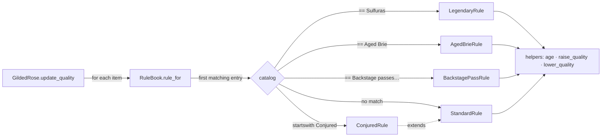

# 001 · Gilded Rose Refactor

**Python · Starter · Refactoring**

The Gilded Rose is a classic legacy-code kata: a small inventory system whose
`update_quality` method is a 40-line pyramid of nested `if`s. The task is to add
one feature, "Conjured" items, without breaking anything. This project does it
the disciplined way. First it pins the existing behaviour with characterization
tests. Then it refactors in small steps that keep the tests green. The new feature
goes in only after that, and it ends up as a one-line change.

The original legacy code is kept in [`legacy.py`](src/gilded_rose/legacy.py)
as the test oracle. You can diff the two designs side by side, and you can
re-run either one from the CLI.

## What it does

Each day, every item's `sell_in` drops by one and its `quality` changes
according to its kind:

| Item | Daily quality change | After sell-by date |
|---|---|---|
| Standard | −1 | −2 |
| Aged Brie | +1 | +2 |
| Backstage passes | +1, +2 at ≤10 days, +3 at ≤5 days | drops to 0 |
| Sulfuras (legendary) | never changes, never ages | n/a |
| **Conjured** (new) | −2 | −4 |

Quality stays between 0 and 50, except for legendary items, which are fixed at 80.

## Concepts demonstrated

- **Characterization testing.** The tests record what the code *does*, not
  what someone believes it should do. Three layers lock the behaviour down:
  1. **Golden master / approval test.** A 30-day text simulation is compared
     byte for byte with a reviewed file in `tests/approved/`.
  2. **Exhaustive boundary grid.** Every known item is run across sell-in values
     −2…12 and quality values {−1, 0, 1, 2, 3, 47–51, 80}, for 1, 2 and 12 days.
     Each result is compared with legacy.
  3. **Property-based differential testing** with Hypothesis. 400 random
     inventories, including random item names and out-of-range values, must
     match legacy after up to 40 days.
- **Refactoring in small, safe steps** (see the log below).
- **Strategy pattern.** Each kind of item gets one small rule class behind an
  `UpdateRule` protocol.
- **Open/Closed Principle.** Rules are chosen from a data table (`RuleBook`) of
  matcher → rule pairs. Adding a kind of item means adding a table entry, not
  editing a branch.
- **Working within constraints.** The kata forbids changing `Item`, so behaviour
  lives next to it rather than inside it.
- **Specification tests.** These sit alongside the characterization tests:
  readable, one-rule-per-test checks that explain *why* each behaviour exists.

## Architecture



```
src/gilded_rose/
  item.py         Item (goblin-owned, unchanged)
  legacy.py       original code, kept as the test oracle
  rules.py        UpdateRule strategies + bound-respecting helpers
  inventory.py    RuleBook (matcher → rule table) and GildedRose
  simulation.py   classic fixture + day-by-day text report
  __main__.py     CLI
tests/
  test_characterization.py   grid + Hypothesis differential tests vs legacy
  test_golden_master.py      approval test; asserts only Conjured lines changed
  test_rules.py              one test per business rule
  test_cli.py
```

## Refactoring log

Each step was a separate, behaviour-preserving change with all
characterization tests green before moving on:

1. **Pin behaviour.** Added the golden master from the legacy text fixture, then
   the boundary grid and Hypothesis differential tests against an untouched copy
   of the legacy class. A deliberate mutation (changing `< 11` to `< 10`) was
   used to check that the tests catch it.
2. **Name the magic strings.** Pulled `"Aged Brie"`, `"Backstage passes…"`,
   `"Sulfuras…"` and the 50/0 bounds into named constants.
3. **Extract quality helpers.** Replaced repeated `if q < 50: q += 1` stanzas
   with `raise_quality(item, n)` and `lower_quality(item, n)`. A key finding:
   legacy enforces bounds as a *step limit*, not a clamp. An item starting at 60
   stays at 60. The helpers keep that quirk, and the grid tests cover it.
4. **Split by item kind.** Turned the double-negative conditions
   (`name != A and name != B`) into one early-dispatch branch per kind. This
   step briefly duplicated code but made each path readable.
5. **Separate the two phases.** Each branch first ran a "before aging" step and
   then an "after aging" step. Reordering the steps to *age first, then adjust*
   simplified Standard and Brie to one line each. Backstage passes still read
   `sell_in` before aging, so their bonus is computed first.
6. **Replace conditional with polymorphism.** Moved each branch into its own
   rule class behind an `UpdateRule` protocol.
7. **Replace the dispatch `if` chain with a table.** Created `RuleBook` with an
   ordered catalog of matchers and a `StandardRule` fallback. `GildedRose`
   shrank to a two-line loop.
8. **Add the feature.** `ConjuredRule` is a `StandardRule` with
   `degradation=2`, plus one catalog entry. Re-approved the golden master and
   reviewed the diff. A test asserts that the *only* changed lines are
   Conjured ones.

## Design decisions and trade-offs

- **Keeping the legacy code.** It looks like dead code, but it is the
  executable specification for the differential tests. The cost is a file you
  must not "fix". The alternative, freezing only golden-master output, catches
  far fewer edge cases than comparing against the oracle on random inputs.
- **Exact-name matching for existing items.** The kata's prose says "Backstage
  passes" in general, but legacy matched one exact name. Matching more broadly
  would be a behaviour change, so it stays exact. Conjured, being new, matches
  by prefix. Widening the backstage matcher later is a one-line, reviewable
  change.
- **Preserving quirks.** Out-of-range starting values are left alone rather than
  normalised. Fixing that is a product decision, not a refactoring one, and the
  refactor deliberately doesn't make it.
- **Stateless rule instances, shared in a module-level catalog.** This is cheap
  and simple. If rules ever needed per-item state, the catalog would hold
  factories instead.
- **Mutating `Item` in place.** This matches the kata's interface and the
  goblin constraint. In greenfield code, a pure
  `next_day(item) -> Item` would be easier to reason about.

## Build, run and test

Requires Python 3.10+.

```bash
cd projects/001-gilded-rose-refactor
python -m venv .venv && source .venv/bin/activate
pip install -e ".[test]"

pytest                                   # 31 tests: characterization, golden master, rules, CLI
gilded-rose --days 3                     # refactored engine
gilded-rose --days 3 --legacy            # original engine, for comparison
diff <(gilded-rose --days 30 --legacy) <(gilded-rose --days 30)   # only Conjured lines differ
APPROVE=1 pytest tests/test_golden_master.py   # re-approve after an intentional change
```

## Example output

```
$ gilded-rose --days 1
-------- day 0 --------
name, sellIn, quality
+5 Dexterity Vest, 10, 20
Aged Brie, 2, 0
...
Backstage passes to a TAFKAL80ETC concert, 5, 49
Conjured Mana Cake, 3, 6

-------- day 1 --------
name, sellIn, quality
+5 Dexterity Vest, 9, 19
Aged Brie, 1, 1
...
Backstage passes to a TAFKAL80ETC concert, 4, 50
Conjured Mana Cake, 2, 4
```

## Possible extensions

- Run mutation testing (e.g. `mutmut`) to measure how strong the test suite is,
  instead of relying on a single hand-made mutation.
- Load the rule catalog from configuration, such as a TOML file mapping name
  patterns to rule types.
- Make the model immutable: `next_day(item) -> Item`, with the legacy adapter
  kept at the edge.
- Combine modifiers ("Conjured Aged Brie") using decorators rather than more
  subclasses.

## Credits

The kata and its legacy code come from Emily Bache's
[Gilded Rose Refactoring Kata](https://github.com/emilybache/GildedRose-Refactoring-Kata)
(MIT), originally by Terry Hughes.
