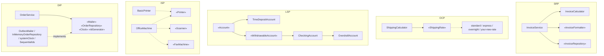

# 002 · SOLID by Example

**TypeScript · Starter · Design principles**

Five small, realistic modules, one per SOLID principle. Each one has a
`before.ts` that breaks the principle in a way you would recognise from a real
codebase, and an `after.ts` that fixes it. One test suite runs **the same
inputs through both versions** and asserts that the observable behaviour
(return values, errors, stored state, side effects) is identical. A refactoring
that changes behaviour isn't a refactoring, and these tests are the proof.

Each principle also gets a few "payoff" tests that show what the new design
lets you do that the old one didn't.

| Principle | Domain | Before (the smell) | After (the fix) |
|---|---|---|---|
| **S**ingle Responsibility | Invoices | One class validates, calculates tax, renders text and stores records | `InvoiceCalculator`, `InvoiceTextFormatter`, `InvoiceRepository`, with a thin `InvoiceService` orchestrating them |
| **O**pen/Closed | Shipping quotes | A `switch` on the method name that must be edited for every new service | `ShippingRate` strategies in a registry, so a new method is a `register()` call |
| **L**iskov Substitution | Bank accounts | `TimeDepositAccount extends Account` and throws from the `withdraw()` it inherits | `Account` / `WithdrawableAccount` split; only accounts that can withdraw claim they can |
| **I**nterface Segregation | Office devices | A fat `MultiFunctionDevice`; `BasicPrinter` has to stub `scan()` and `fax()` with throws | `Printer`, `Scanner`, `FaxMachine` role interfaces; clients ask for exactly what they use |
| **D**ependency Inversion | Order placement | `OrderService` creates its own mailer and table, reads the system clock and a hidden counter | The service declares `Mailer`, `OrderRepository`, `Clock` and `IdGenerator` and receives them; `createOrderService()` is the composition root |

## Concepts demonstrated

- **Behaviour-preserving refactoring, proven by parity tests.** Each test file
  builds both versions and compares their outcomes across a grid of normal,
  edge and invalid inputs. Errors are compared too. As a sanity check, a
  one-character change to a price or a padding width in any `after.ts` turns
  between 6 and 8 tests red.
- **Contract tests for LSP.** `withdrawContract()` in `test/lsp.test.ts` is the
  behavioural spec of `withdraw()`. Every withdrawable implementation runs it.
  `OverdraftAccount` passes because it *weakens* the precondition (it allows
  more), which LSP permits. `TimeDepositAccount` *strengthens* it to "never",
  and the test shows the result in the old design: a client crashes halfway
  through a batch, with some accounts already charged.
- **Compile-time guarantees as tests.** In the ISP and LSP "after" versions,
  misuse doesn't type-check. The tests pin this with `// @ts-expect-error`
  lines, and `npm test` runs `tsc --noEmit` first. If someone ever made
  `BasicPrinter` satisfy `Scanner`, the unused directive would fail the build.
- **Strategy pattern + registry** (OCP), **role interfaces and intersection
  types** (`Scanner & FaxMachine`, ISP), **constructor injection and a
  composition root** (DIP).
- **Testability as a design signal.** The DIP "before" module has to export
  `testHooks` (a back door into module globals), and its tests fake the global
  clock. The "after" tests pass plain object literals to a constructor.
- **Exact money arithmetic.** All amounts are integer cents, validated at the
  boundary (`shared/money.ts`); formatting is the only place dollars appear.
- **Strict TypeScript.** `strict`, `noUncheckedIndexedAccess`,
  `exactOptionalPropertyTypes`, `noImplicitOverride`, and ES modules with
  `verbatimModuleSyntax`.

## Design decisions and trade-offs

- **Same public API before and after.** `InvoiceService.createInvoice`,
  `collectFees` and `printAll` keep their signatures where the principle
  allows it, so the parity tests can drive both versions through a single
  adapter. The exceptions are deliberate: LSP and ISP *narrow* parameter types
  (`WithdrawableAccount[]`, `Scanner & FaxMachine`). That is the point of
  those fixes, and it only rejects programs that used to crash at runtime.
- **Shared rules live in `types.ts`.** Validation and business rules that a
  principle isn't about (parcel validation, order totals, the email template)
  are shared by both versions. That way the diff between `before.ts` and
  `after.ts` shows the structural change and nothing else.
- **SRP adds classes.** Four small classes are harder to take in at a glance
  than one 40-line method. That cost pays off once the parts change at
  different rates or need testing alone; for a one-off script it wouldn't.
- **OCP scatters the price list.** With strategies there's no single
  `switch` that shows every price. That's fine while rates are independent.
  Shared rules (a fuel surcharge, say) would be added as a decorator over
  `ShippingRate` so the calculator stays closed. `register()` refuses
  duplicates so that an extension can't silently override an existing method.
- **LSP uses composition of interfaces, not deeper inheritance.** The
  non-exported `BaseAccount` shares `deposit`/`balance` code, but callers
  depend only on the `Account` / `WithdrawableAccount` interfaces.
- **DIP still has a known gap, and a test documents it.** The order is saved before the
  email is sent, so a mailer failure leaves a saved order and an error. The
  "after" design makes that easy to see and test. Fixing it properly (with a
  transactional outbox) is out of scope here.

## Architecture



```
src/
  shared/money.ts          integer-cents helpers
  <principle>/types.ts     domain types + rules shared by both versions
  <principle>/before.ts    the violation
  <principle>/after.ts     the refactoring
  demo.ts                  runs before/after side by side
test/
  <principle>.test.ts      parity tests + payoff tests
```

## Build, run and test

Requires Node.js 20 or newer.

```bash
npm install
npm test          # tsc --noEmit (including @ts-expect-error checks), then vitest
npm run demo      # compile to dist/ and print before/after output side by side
npm run build     # compile only
```

Test run:

```
 ✓ test/srp.test.ts (23 tests)
 ✓ test/dip.test.ts (9 tests)
 ✓ test/ocp.test.ts (45 tests)
 ✓ test/lsp.test.ts (13 tests)
 ✓ test/isp.test.ts (9 tests)

 Test Files  5 passed (5)
      Tests  99 passed (99)
```

## Example output

`npm run demo` (abridged):

```
=== S — Single Responsibility (invoices) ===
INVOICE INV-1
Bill to: Ada Lovelace (C-042)
----------------------------------------------------------------
BK-101    Analytical Engine guide    2 x     $29.99 =      $59.98
PN-007    Fountain pen               1 x     $14.50 =      $14.50
----------------------------------------------------------------
Subtotal                                                  $74.48
Tax (8.25%)                                                $6.14
TOTAL                                                     $80.62

before === after: yes
payoff: tax rules, layout and storage can now change and be tested independently.

=== O — Open/Closed (shipping quotes) ===
[ "$8.00", "$23.50", "$39.00" ]
before === after: yes
payoff: a new carrier service is a register() call, not an edit to a switch.
...
```

Extending the shipping calculator without touching `src/`:

```ts
import { ShippingCalculator, type ShippingRate } from "./src/ocp/after.js";

const drone: ShippingRate = { method: "drone", quote: (p) => 999 + 50 * Math.ceil(p.weightKg) };
new ShippingCalculator().register(drone).cost("drone", { weightKg: 1.2, distanceKm: 10 }); // 1099
```

## Possible extensions

- Property-based parity tests with `fast-check`, generating random invoices,
  parcels and account operation sequences instead of fixed grids.
- A mutation-testing run (Stryker) on the `after/` files to measure how strong
  the parity suite is.
- A `SurchargedRate` decorator for OCP, and an HTML `InvoiceFormatter`.
- A transactional outbox for the DIP order flow, so a mailer failure can't
  leave the order and the email out of step.
- A sixth module showing the cost of *over*-applying SOLID: an abstraction
  with a single implementation and no second caller.
