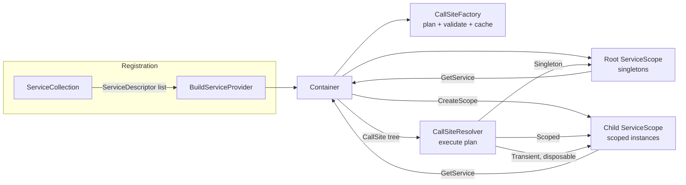

# 003 · Dependency Injection Container

**Stack:** C# 12 / .NET 8 · **Level:** Intermediate · **Area:** Design principles

MiniIoC is a small inversion-of-control container written from scratch. Its API is close to
`Microsoft.Extensions.DependencyInjection`, so it shows what that container does for you:

- **Constructor injection.** It picks the greediest public constructor that can be satisfied,
  rejects ambiguous constructors, and fills unregistered optional parameters with their defaults.
- **Lifetimes.** Singleton, scoped and transient, with child scopes (`CreateScope()`) that own
  and dispose their instances.
- **Cycle detection.** When a cycle is found, the error gives the exact path
  (`CycleA -> CycleB -> CycleC -> CycleA`). Cycles through `IEnumerable<T>` are caught too,
  and so are cycles through factories, which can only be caught while the factory runs.
- **Scope validation.** It rejects *captive dependencies*, meaning a singleton that holds a
  scoped service, even through transients or `IEnumerable<T>`. It also rejects resolving a
  scoped service from the root provider.
- **Validate on build.** Missing dependencies, cycles and lifetime errors are reported when
  the container starts, not on the first request.
- **Open generics** (`IRepository<> -> Repository<>`). The container closes them when a type
  is requested, and it skips registrations whose generic constraints don't fit.
- **Collections.** `IEnumerable<T>` returns every registration in registration order. When a
  service is requested on its own, the last registration wins.
- **Deterministic disposal.** Instances are disposed in reverse creation order, with support for
  `IAsyncDisposable`. If one `Dispose` throws, the remaining instances are still disposed.

## Concepts demonstrated

| Concept | Where |
|---|---|
| Dependency Inversion / IoC | The whole library. In the demo, `OrderService` depends on abstractions and never constructs its own dependencies |
| Composition root | `samples/MiniIoC.Demo/Program.cs` is the only place that knows about concrete types |
| Builder → immutable product | `ServiceCollection` (mutable, append-only) builds a frozen `Container` |
| Plan / execute separation | `CallSiteFactory` builds and validates a resolution plan once. `CallSiteResolver` interprets it many times |
| Fail fast | `ValidateOnBuild` and `ValidateScopes` default to on, and errors name the parameter and the resolution path |
| Immutable persistent stack | `ResolutionChain` tracks the path being planned without any cleanup on the error path |
| Ownership and RAII-style lifetime | Each scope owns what it creates and disposes it in LIFO order |
| Thread safety | A lock-free plan cache, plus one re-entrant lock per scope with a fixed lock order (child → root) |
| Error design | A small exception hierarchy (`ContainerException` → cycle / unresolvable / scope / validation) whose messages help the caller act |

## Design decisions and trade-offs

**Call sites, built once.** Resolving a type does not walk reflection on every call. The
container first builds a tree of `CallSite` nodes (constructor, factory, instance, enumerable,
built-in) and caches it. All the structural checks (constructor selection, cycles, captive
dependencies) run during this planning step. That keeps `CallSiteResolver` a short interpreter
with no validation logic. *Trade-off:* the first resolution of each type costs more. In return,
every later call skips that work, and the same code path validates the whole container at
startup.

**Cycle detection by path, not by depth counter.** `ResolutionChain` is an immutable linked
list, so each branch of the dependency graph carries its own path. A diamond (two services
sharing a dependency) is therefore not mistaken for a cycle, and the error can print the
cycle itself rather than "recursion too deep". Factories are opaque until they run, so they get
a separate runtime guard: a per-thread set of factories currently executing.

**Captive dependencies are errors by default.** If a singleton receives a scoped
`DbContext`-like object, it keeps the first request's instance forever. That bug is notoriously
hard to spot in production. `ScopedDependency` is computed recursively on each call site, so
the check also catches indirect captures such as singleton → transient → scoped.
*Trade-off:* it is stricter than MS.DI's defaults. Set `ValidateScopes = false` to opt out.

**Singletons are activated by the root scope.** Even when a singleton is first requested from
a child scope, it is built with the root's provider. So any disposable transients it pulls in
belong to the root and are not disposed when that short-lived scope ends. A singleton that
asks for `IServiceProvider` also gets the root, never a scope that will be disposed.

**Locking.** Each scope has one re-entrant `Monitor`. A cached instance is created while that
lock is held, so every singleton and scoped service is constructed exactly once (there is a
test that runs 64 parallel resolutions). Nested resolution only ever takes locks child →
root, because singletons never touch a child scope, so it cannot deadlock. *Trade-off:*
singleton construction is serialized per container. A per-call-site lock (MS.DI's approach)
allows more concurrency but needs more care to avoid deadlocks.

**Ownership rules (same as MS.DI).**
- Instances passed to `AddSingleton(instance)` belong to the caller and are never disposed.
- Disposable transients are tracked by the scope that resolved them. If you resolve them from
  the root, they live until the container is disposed, so resolve them from a scope.
- Calling `Dispose()` on a scope that holds an `IAsyncDisposable`-only service throws and tells
  you to use `DisposeAsync`. The alternative is a hidden sync-over-async block.

**Constructor selection.** The container picks the constructor with the most parameters that
can all be satisfied. If two such constructors have the same length, it throws instead of
guessing. If none can be satisfied, the error names the first missing parameter of the
largest constructor, because that is almost always the one the author meant to use.

**What is intentionally out of scope:** property or method injection (both hide dependencies),
keyed services, decorators and compiled expression trees. See the extensions section below.

## Architecture



```
src/MiniIoC/
├── ServiceCollection.cs            registration (append-only, ordered)
├── ServiceCollectionExtensions.cs  AddSingleton/AddScoped/AddTransient overloads
├── ServiceDescriptor.cs            immutable registration + validation
├── Container.cs                    root provider + scope factory
├── ServiceScope.cs                 instance cache, ownership, disposal
├── ServiceProviderExtensions.cs    GetRequiredService<T>, GetServices<T>, CreateScope
├── Exceptions.cs                   ContainerException hierarchy
└── CallSites/
    ├── CallSite.cs                 plan nodes
    ├── CallSiteFactory.cs          ctor selection, cycles, captive-dependency checks
    ├── ResolutionChain.cs          immutable path used for cycle detection
    └── CallSiteResolver.cs         executes plans against a scope
```

## Build, run and test

Requires the .NET 8 SDK.

```bash
dotnet build MiniIoC.sln
dotnet test                                    # 61 xUnit tests
dotnet run --project samples/MiniIoC.Demo
```

The build treats warnings as errors and uses the `latest-recommended` analyzer set.

## Example usage

```csharp
var services = new ServiceCollection()
    .AddSingleton<IClock, SystemClock>()
    .AddScoped<UnitOfWork>()
    .Add(typeof(IRepository<>), typeof(Repository<>), ServiceLifetime.Scoped)
    .AddTransient<IOrderValidator, PositiveTotalValidator>()
    .AddTransient<IOrderValidator, NotFromTheFutureValidator>()
    .AddTransient<OrderService>();   // takes IRepository<Order>, IEnumerable<IOrderValidator>

await using var container = services.BuildServiceProvider();   // validates the whole graph
await using var scope = container.CreateScope();               // one "request"
scope.ServiceProvider.GetRequiredService<OrderService>().Place(order);
```

## Example output

`dotnet run --project samples/MiniIoC.Demo`:

```
== 1. Lifetimes across two simulated requests ==
-- request A
  [01] Repository<Order> saved Order { Number = 1, Total = 42.50 } in UnitOfWork ac0bab
  [02] Order 2 rejected: total must be positive
  [03] UnitOfWork ac0bab disposed (end of request)
-- request B
  [04] Repository<Order> saved Order { Number = 3, Total = 42.50 } in UnitOfWork c2ee3f
  [05] Order 4 rejected: total must be positive
  [06] UnitOfWork c2ee3f disposed (end of request)

== 2. Diagnostics: problems caught when the container is built ==
  CircularDependencyException: Circular dependency detected: AuditTrail -> NotificationHub -> AuditTrail.
  CircularDependencyException: Circular dependency detected: NotificationHub -> AuditTrail -> NotificationHub.
  ScopeValidationException: Singleton 'ReportCache' cannot depend on scoped service 'UnitOfWork': the singleton would capture the first scope's instance forever.
  UnresolvableServiceException: Unable to resolve 'IRepository<Order>' for parameter 'orders' of 'OrderService'. Resolution path: OrderService.
```

In each request, both transient `OrderService` instances share one scoped `UnitOfWork`, and
that `UnitOfWork` is disposed when its request scope ends.

## Tests

There are 61 tests (xUnit), grouped by behaviour: lifetimes (including a concurrency test),
constructor injection, cycle detection, scope validation, registrations, open generics and
disposal.

## Possible extensions

- Compile call sites to `Expression<Func<ServiceScope, object>>` delegates after N resolutions
  to remove the reflection cost from hot paths (MS.DI's dynamic engine does this).
- Keyed services (`[FromKeyedServices("primary")]`).
- Decorators: `Decorate<IRepository<>, CachingRepository<>>()`.
- A source generator that emits the composition root at compile time (no reflection, AOT-safe).
- An adapter that implements `IServiceProviderFactory<ServiceCollection>` so MiniIoC can be
  used as the container of an ASP.NET Core host.
- Per-call-site locks for more parallel singleton construction.
