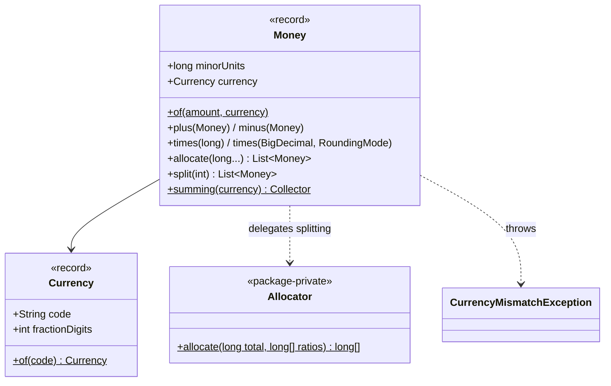

# 004 · Value Objects & Money

**Stack:** Java 21 (records, Maven, JUnit 5) · **Level:** Starter · **Area:** Domain modeling

A small, dependency-free library for handling money correctly. `Money` and `Currency` are
immutable **value objects**: they are defined only by their values, they check their own
rules when they are created, and they never change after that.

```java
Money subtotal = Money.of("69.75", Currency.USD);
Money tax      = subtotal.times(new BigDecimal("0.0825"), RoundingMode.HALF_UP); // USD 5.75
List<Money> shares = subtotal.plus(tax).split(3);  // [USD 25.17, USD 25.17, USD 25.16], sums to USD 75.50
```

## Why not `double` or plain `BigDecimal`?

| Problem | `double` | `BigDecimal` | `Money` |
|---|---|---|---|
| `0.1 + 0.2 == 0.3` | false | true | true |
| `1.0` equals `1.00` | true | **false** (`equals` compares scale) | true |
| USD + EUR | silently adds | silently adds | throws `CurrencyMismatchException` |
| USD 0.001 | allowed | allowed | rejected unless you pass a `RoundingMode` |
| Splitting $100 three ways | 33.333… × 3 | 33.33 × 3 = 99.99, **a cent lost** | 33.34 + 33.33 + 33.33 |
| Overflow | goes to infinity | none | `ArithmeticException`, never wraps around |

## Concepts demonstrated

| Concept | Where |
|---|---|
| **Value objects with records**: equality, `hashCode`, immutability | `Currency`, `Money` are Java `record`s |
| **Always-valid domain objects**: invariants checked in compact constructors and factories | `Currency` code format / digit bounds; `Money.of` precision check |
| **Making illegal states unrepresentable**: amounts stored as `long` minor units, so a USD amount with 3 decimals cannot exist | `Money.minorUnits` |
| **Fail fast, never guess**: currency mismatch, excess precision and overflow all throw | `requireSameCurrency`, `Math.*Exact` |
| **Explicit policy**: rounding is a business decision, so the caller passes a `RoundingMode` | `Money.of(..., RoundingMode)`, `times(BigDecimal, RoundingMode)` |
| **Conservation invariant**: allocation never creates or loses a cent | `Allocator` (largest-remainder method) |
| **Information hiding**: the algorithm lives in a package-private class | `Allocator` |
| **Property-style testing**: invariants checked against 1,500 generated cases with a fixed seed | `AllocationPropertiesTest` |
| **Idiomatic Java API**: `Comparable`, a stream `Collector`, a `toString`/`parse` round trip | `Money.summing`, `Money.parse` |

## Design decisions and trade-offs

- **`long` minor units instead of `BigDecimal`.** Equality, hashing and arithmetic are trivial
  and exact, and the scale is fixed per currency. The trade-off is a limit of about ±9.2 × 10¹⁶
  cents (roughly $92 quadrillion) and no sub-cent amounts. Anything that needs more precision,
  such as unit prices of fractions of a cent or FX intermediates, should stay in `BigDecimal`
  and become `Money` only at the boundary.
- **No `dividedBy`.** Dividing money is where cents go missing. `allocate(ratios…)` and
  `split(n)` return parts that always add back up to the total. Scaling by a decimal factor is
  allowed, but only with an explicit rounding mode.
- **Largest-remainder allocation.** Martin Fowler's classic `allocate` hands the extra cents to
  the first parts. Here they go to the parts whose exact share was cut the most, so a 1:1000
  split never gives the tiny part an unfair extra cent. Ties go to the earlier part, so results
  are deterministic. Negative totals (refunds) are split by magnitude and then negated, so
  rounding is the same for charges and refunds.
- **Currency is `(code, fractionDigits)`, not `java.util.Currency`.** You get value equality
  and can model non-ISO units (`new Currency("PTS", 0)`). `Currency.of("JPY")` still reads
  ISO data from the JDK. A side effect is that `USD/2` and `USD/3` count as different
  currencies.
- **Comparing different currencies throws.** `compareTo` across currencies has no meaning
  without an exchange rate. The cost is that `Money` cannot be sorted in a mixed-currency list,
  which is intentional.
- **`toString` is for machines, `format(Locale)` is for people.** `toString` gives
  `"USD 12.34"`, which is stable and round-trips through `parse`. `format` gives `"$12.34"`,
  which depends on the locale and is for display only.

## Architecture



```
src/main/java/dev/omar/money/
  Currency.java                    currency value object + ISO lookup
  Money.java                       the money value object
  Allocator.java                   largest-remainder split on integers (BigInteger, cannot overflow)
  CurrencyMismatchException.java
  Demo.java                        runnable walkthrough
src/test/java/dev/omar/money/
  CurrencyTest.java
  MoneyTest.java                   example tests grouped with @Nested
  AllocationPropertiesTest.java    generated-input invariant tests
```

## Build, run, test

Requires JDK 21.

```bash
mvn test                                         # build and run all tests
mvn -q compile && java -cp target/classes dev.omar.money.Demo
```

Without Maven, or offline, `./run-tests.sh [dir-with-junit-jars]` compiles with `javac` and
runs the suite through the JUnit Platform console launcher. On Debian/Ubuntu the jars come from
`apt install junit5`, which puts them in `/usr/share/java`, the default directory.

> When this project was built, the sandbox could not reach Maven Central, so the suite was run
> with `./run-tests.sh` against JUnit 5.10.1: **1,564 tests passed, 0 failed** (most of them are
> generated property cases). The `pom.xml` uses only standard plugins and JUnit 5.11.

### Demo output

```
Subtotal: USD 69.75
Tax:      USD 5.75
Tip:      USD 13.95
Total:    USD 89.45  ($89.45)
Split 3 ways: [USD 29.82, USD 29.82, USD 29.81] -> sums to USD 89.45
100.01 split 70/20/10: [USD 70.01, USD 20.00, USD 10.00]
JPY 1000 split 3 ways: [JPY 334, JPY 333, JPY 333]
BHD: BHD 1.234
Rejected: 0.001 has more than 2 decimal places allowed for USD; pass a RoundingMode to round it
Rejected: Currency mismatch: expected USD but got EUR
```

## Possible extensions

- `ExchangeRate` value object (`from`, `to`, `rate`) with `convert(Money, RoundingMode)`, which
  keeps conversion explicit.
- A `MoneyBag` that holds several currencies for multi-currency totals.
- A Jackson/JPA mapping as `{ "currency": "USD", "minor": 1234 }` to show value objects at
  persistence boundaries.
- Switch the property tests to jqwik for shrinking of failing inputs.
- A `BigDecimal`-backed variant for sub-minor-unit precision, with benchmarks against the
  `long` version.
