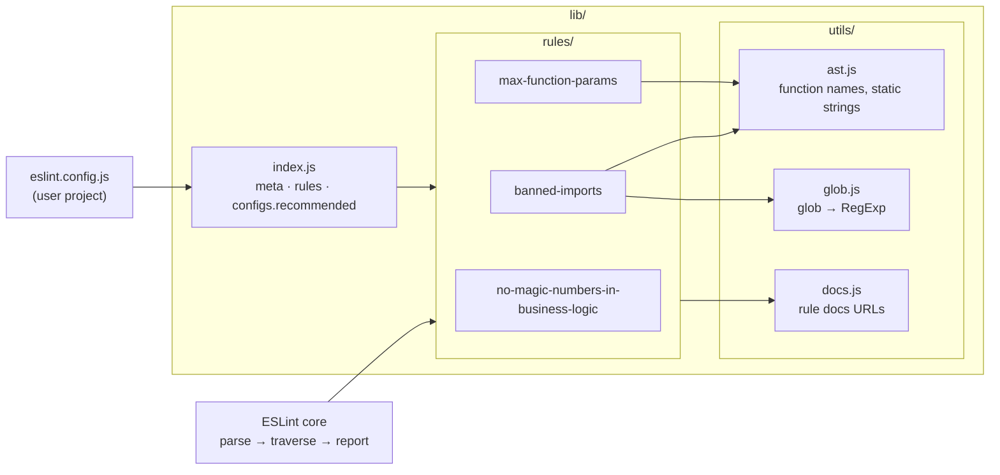

# 005 · Linter Rule Pack

**Stack:** JavaScript (ESLint 9/10 plugin, flat config, Node's built-in test runner) · **Level:** Intermediate · **Area:** Code quality

`eslint-plugin-rule-pack` is an ESLint plugin with three custom rules that turn team
conventions into automated checks:

| Rule | What it enforces | In `recommended` |
|---|---|---|
| [`no-magic-numbers-in-business-logic`](docs/rules/no-magic-numbers-in-business-logic.md) | business numbers live in named constants (`FREE_SHIPPING_THRESHOLD`), not inline (`50`) | error |
| [`max-function-params`](docs/rules/max-function-params.md) | at most N positional parameters; report points at the excess ones | warn |
| [`banned-imports`](docs/rules/banned-imports.md) | banned modules, banned named exports, banned module groups, with per-entry `allowIn` exceptions | — (needs options) |

The plugin has no runtime dependencies, and every rule is tested with ESLint's `RuleTester`.

```text
src/domain/pricing.js
  2:10  error    'merge' from 'lodash' is banned. Deep-merging untrusted input enables prototype pollution                  rule-pack/banned-imports
  3:1   error    '../ui/format.js' matches banned pattern '**/ui/**'. The domain layer must not depend on the UI            rule-pack/banned-imports
  5:53  warning  Function 'quote' has 4 parameters (maximum allowed is 3). Group related parameters into an options object  rule-pack/max-function-params
  6:46  error    Magic number 0.2 in business logic. Extract it into a named constant that says what it means               rule-pack/no-magic-numbers-in-business-logic
  8:15  error    Magic number 1000 in business logic. Extract it into a named constant that says what it means              rule-pack/no-magic-numbers-in-business-logic
  9:32  error    Magic number 0.95 in business logic. Extract it into a named constant that says what it means              rule-pack/no-magic-numbers-in-business-logic

src/ui/format.js
  2:1  error  'node:fs' is banned. File access belongs in src/infra  rule-pack/banned-imports

✖ 7 problems (6 errors, 1 warning)
```

That is the output of `npm run demo` on the small layered app in [`examples/`](examples/).

## Concepts demonstrated

| Concept | Where |
|---|---|
| **Static analysis on an AST**: rules are visitors over ESTree nodes, never regexes over text | every file in `lib/rules/` |
| **Architecture as code**: layer boundaries (domain must not import UI or `fs`) are checked on every lint run, not in review | `banned-imports` + [`examples/eslint.config.js`](examples/eslint.config.js) |
| **Scope analysis**: `require` is only CommonJS `require` if no local binding shadows it | `isGlobalRequire` in `banned-imports.js` |
| **One funnel for many inputs**: static imports, re-exports, `import()` and `require()` (including destructuring) all reduce to one `check(source, names)` | `banned-imports.js` |
| **Declarative, validated configuration**: JSON Schema rejects bad options; `meta.defaultOptions` merges partial ones | `meta.schema`, `meta.defaultOptions` in each rule |
| **Actionable diagnostics**: messages say what to do, name the function, and highlight only the excess parameters | `max-function-params.js` |
| **Table-driven tests**: `valid` / `invalid` cases with exact message data and columns | `tests/lib/rules/*.test.js` |
| **Test-runner adapter**: `RuleTester` wired to `node:test` instead of Mocha | `tests/rule-tester.js` |
| **Integration tests through the public API**: the plugin loaded via `new ESLint()` with a flat config | `tests/lib/plugin.test.js` |
| **Dogfooding**: the plugin lints its own source with its `recommended` preset | `eslint.config.js` |
| **Zero runtime dependencies**: a 30-line glob matcher instead of `minimatch` | `lib/utils/glob.js` |

## Design decisions and trade-offs

**Scope the magic-number rule to a layer instead of tuning it into silence.** Core
`no-magic-numbers` is usually turned off because it fires on layout pixels, timeouts and
tests. This rule is meant for `files: ["src/domain/**"]`, so it can be strict there: a
number is acceptable only as the value of a `const` with a constant-style name (or inside
that constant's object/array literal, `Object.freeze` included). Lowercase `const discount = 0.15`
is still reported, because it names a variable, not a business rule. The cost is that the
rule is opinionated about naming; `constantPattern` lets a team change the convention.

**Report the excess, not the function.** `max-function-params` puts the squiggle under
parameters 4..n rather than the whole function body, so the fix location is obvious. An
optional `countDestructured: "per-property"` mode catches options objects that have become
grab-bags. Setters are always skipped (they take one argument by definition).

**Exact names for `paths`, globs for `patterns`.** `{ name: "moment" }` does not ban
`moment/locale/de`. Making exact matches the default avoids surprising over-bans; groups
of modules are written explicitly as globs.

**Whole-module imports include banned names.** With `importNames: ["merge"]`, `import * as _`,
`export *`, `import()` and `const _ = require("lodash")` are all reported, because they give
access to `merge`. This can be noisy for libraries that are mostly fine, which is the
intended pressure toward named imports.

**Per-entry `allowIn` instead of extra config blocks.** "`node:fs` is banned except in
`src/infra/**`" is one entry. The alternative, a second config block that turns the rule
off for `src/infra`, would also turn off every *other* ban for those files.

**A known flat-config gotcha, shown on purpose.** When two config blocks configure the same
rule, the later block's options *replace* the earlier ones; they are not merged. The example
config therefore shares a `SHARED_BANS` array between the general block and the domain block.
Without it, the domain block silently drops the `lodash.merge` ban.

**Dynamic specifiers are skipped.** `require(name)` cannot be checked statically. Reporting
them would be a different rule (ban dynamic requires) with different trade-offs.

**`node:test` instead of Mocha/Jest.** ESLint's `RuleTester` only needs `describe` and `it`
hooks, which Node ships. One fewer dev dependency and the same per-case test output.

## Architecture



Inside `banned-imports`, every import form is normalised first:

```text
import x, { a } from "m"     ──► check(node, "m", [default, a])
export { a } from "m"        ──► check(node, "m", [a])
export * from "m"            ──► check(node, "m", null)       null = whole module
await import("m")            ──► check(node, "m", null)
const { a } = require("m")   ──► check(node, "m", [a])        only if `require` is not shadowed
const x = require("m")       ──► check(node, "m", null)
```

## Project layout

```text
lib/
  index.js                                     plugin object and recommended preset
  rules/                                       one module per rule
  utils/                                       shared AST, glob and docs helpers
docs/rules/                                    one page per rule (linked from meta.docs.url)
tests/
  rule-tester.js                               RuleTester ↔ node:test adapter
  lib/rules/*.test.js                          RuleTester suites
  lib/utils/glob.test.js                       unit tests for the matcher
  lib/plugin.test.js                           integration tests via the ESLint API
examples/                                      a small layered app and its eslint.config.js
eslint.config.js                               the plugin linting itself
```

## Build, run, test

Requires Node.js 20+.

```bash
npm install
npm test        # 103 tests: RuleTester suites, glob unit tests, ESLint API integration tests
npm run lint    # the plugin lints itself with its own recommended preset
npm run demo    # lints examples/src and prints the report above
```

The suite was also run against ESLint 9.39 (`npm i --no-save eslint@9`) and passes there too.
The peer range is `>=9.15.0` because the rules rely on `meta.defaultOptions`.

## Using it in a project

```js
// eslint.config.js
const rulePack = require("eslint-plugin-rule-pack");

module.exports = [
  rulePack.configs.recommended,
  {
    files: ["src/domain/**/*.js"],
    plugins: { "rule-pack": rulePack },
    rules: {
      "rule-pack/banned-imports": ["error", {
        paths: [{ name: "node:fs", allowIn: ["src/infra/**"] }],
        patterns: [{ group: ["**/ui/**", "react"], message: "The domain must not depend on the UI." }],
      }],
    },
  },
];
```

## Possible extensions

- **Auto-fix / suggestions**: offer an editor suggestion that extracts a magic number into
  a `const` at module scope, with a placeholder name.
- **TypeScript support**: run the suites with `@typescript-eslint/parser`, skip `import type`
  in `banned-imports`, and treat `enum` members and `readonly` fields as named constants.
- **Path-aware layering**: resolve relative specifiers against the importing file, so
  `../ui/x` and `../../ui/x` are matched by a single `src/ui/**` glob on the *target*.
- **Per-unit allow-lists**: allow `24`, `60`, `1000` only when multiplied with each other
  (time conversions) instead of globally.
- **Publish**: add `exports` types (`.d.ts`) and a release workflow for npm.
