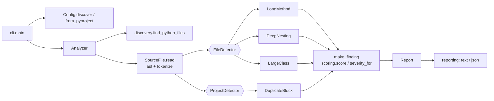

# 006 · Code Smell Detector

**Python (ast) · Intermediate · Static analysis**

A command-line static analyser that scans Python code for four classic code
smells and ranks every finding on one 0–100 severity scale:

| Rule | What it measures | Default limit |
|---|---|---|
| `long-method` | Lines of code in a function, not counting blanks, comments or the docstring | 50 |
| `deep-nesting` | Deepest stack of `if`/loop/`with`/`try`/`match` blocks in a function | 4 |
| `large-class` | Methods defined in a class, and the class's lines of code | 20 methods / 300 lines |
| `duplicate-block` | Runs of statements that repeat, even after renaming variables | 4 statements and 6 lines |

It uses only the standard library (`ast`, `tokenize`, `tomllib`). It reads its
thresholds from `pyproject.toml`, supports inline suppressions, prints text or
JSON, and returns linter-style exit codes so it can gate CI. Run on its own
source and tests at the default thresholds, it reports nothing.

## Example

```console
$ smell-detector examples/legacy_shop --config examples/demo-config.toml
examples/legacy_shop/orders.py:6-33: HIGH    50  [deep-nesting] function 'process_order' nests blocks 6 deep at line 13 (limit 3)
examples/legacy_shop/orders.py:6-33: MEDIUM  44  [long-method] function 'process_order' has 27 lines of code (limit 15)
examples/legacy_shop/reports.py:4-38: MEDIUM  27  [large-class] class 'ReportManager' is too large: 11 methods (limit 8)
examples/legacy_shop/orders.py:22-28: LOW     14  [duplicate-block] 7-line block appears 2 times (7 redundant lines); also at examples/legacy_shop/orders.py:41-47

4 findings in 2 files (high: 1, medium: 2, low: 1)
Hotspots (files by total smell score):
   108  examples/legacy_shop/orders.py
    27  examples/legacy_shop/reports.py
$ echo $?
1
```

The duplicate it found is the pricing logic that `quote()` copied from
`process_order()`. The copy renamed `total` to `amount`, and the detector
still matched it. The first loop of each function is *not* reported, because
one iterates `order["items"]` and the other `cart`. Those are different
expressions, so the clone starts at the line after them.

`--format json` produces the same data in machine-readable form, with every
finding's `metric`, `threshold`, `score`, `severity`, `symbol` and `related`
locations.

## Concepts demonstrated

- **Working with the AST.** Detectors walk `ast` trees and build qualified
  names such as `Outer.method.<locals>.helper`. They also handle edge cases
  in how Python is represented: an `elif` is an `If` nested inside `orelse`,
  and `async def`, `match` and `try*` are their own node types.
- **Mixing AST and token analysis.** The AST throws away comments and blank
  lines, so `SourceFile` tokenizes each file once. It records which physical
  lines hold code and which carry `# smell: ignore[...]` comments. A
  suppression written inside a string literal is correctly *not* treated as
  one.
- **Clone detection by structural fingerprinting.** Each statement is hashed
  with identifiers and literal values erased. Windows of consecutive
  fingerprints are indexed across all files, extended to their maximal
  length, and then pruned so that a clone nested inside a bigger clone is
  reported once.
- **One scoring model for every rule.** `score = 100·e/(1+e)`, where
  `e = (metric − threshold)/threshold`. The score is 0 at the limit and 50 at
  twice the limit, and it approaches 100 without reaching it. Because the
  score is relative, "27 lines against a limit of 15" and "6 levels against a
  limit of 3" can be ranked on the same scale. Because the curve saturates,
  one 2,000-line function can't push everything else down to "low".
- **Open/Closed via protocols.** The analyzer depends only on the
  `FileDetector` and `ProjectDetector` protocols. Adding a rule means writing a
  class and registering it in `default_detectors`. The analyzer itself
  doesn't change.
- **Immutable value objects.** `Config`, `Location`, `Finding` and `Report`
  are frozen dataclasses. Detectors can't change shared state, and the
  reporters are pure `Report → str` functions.
- **Fail loudly on configuration, softly on input.** An unknown or mistyped
  option, such as `max_function_line = 10`, is an error (exit 2), because
  silently ignoring it would be worse. A file with a syntax error is reported
  and skipped, so one broken file doesn't hide the findings in the rest.
- **CI-friendly CLI contract.** Exit codes are 0 (clean), 1 (findings at or
  above `--fail-on`) and 2 (usage or config error). `--min-severity` filters
  what is displayed.

## Architecture



```
src/smell_detector/
├── cli.py              argument parsing, exit codes
├── config.py           frozen Config, [tool.smell-detector] loading and validation
├── discovery.py        path expansion, exclude globs, skipped tool directories
├── source.py           SourceFile: AST + code lines + suppressions
├── analyzer.py         orchestration; no rule-specific knowledge
├── scoring.py          metric/threshold → score → severity
├── models.py           Severity, Location, Finding, Report
├── reporting.py        text and JSON formatters
└── detectors/
    ├── base.py         protocols, make_finding, qualified-name walkers
    ├── long_method.py
    ├── deep_nesting.py
    ├── large_class.py
    └── duplicate_blocks.py
```

### How duplicate detection works

1. Every statement list (function bodies, loop bodies, branches, `except`
   blocks and so on) is turned into a sequence of statement fingerprints.
   A fingerprint is a hash of the statement's AST shape with `Name.id`,
   `arg.arg` and constant *values* erased. Constant *types*, operators and
   attribute names are kept, so `obj.save()` and `obj.delete()` are
   different.
2. Every window of `duplicate_min_statements` fingerprints is indexed. Within
   one statement list, overlapping copies are dropped, so `x += 1` written
   six times in a row isn't counted as a clone of itself.
3. Each repeated window is extended for as long as **all** of its copies keep
   matching.
4. Clones are sorted by size. A clone whose every copy lies inside an
   already-reported clone is pruned.

The finding's metric is *redundant lines*: clone length × (copies − 1).
Three copies of a block therefore outrank two copies.

## Trade-offs and limitations

- **Erasing all names finds renamed clones, but it can also match code that
  merely has the same shape.** Requiring several consecutive statements and a
  minimum line count keeps such coincidences rare. A stricter alternative
  would be to rename identifiers consistently within each window (`a, b, a`
  → `v0, v1, v0`). That catches fewer false positives but costs more to
  compute.
- **Clones are found at statement granularity.** Duplicated *expressions*
  inside a single long statement aren't found. Token-based detectors such as
  PMD's CPD can find those, but they lose the structural awareness.
- **Imports never form clones**, because repeated import headers are not
  duplication anyone should refactor.
- **Nested functions count toward the enclosing function's length**, since
  they are physically part of it, but not toward its nesting depth. A nested
  `def` starts a new scope and is measured separately.
- **Lines of code is a proxy.** Cyclomatic or cognitive complexity would
  measure difficulty better than length. Length was kept because it is the
  usual definition of the Long Method smell, and the nesting rule already
  covers much of what makes code hard to follow.
- **Exclude globs are matched relative to the directory being scanned**
  (for example `tests/fixtures/*`). Files named explicitly on the command line
  are always analysed.

## Build, run, test

Requires Python 3.11 or later. There are no runtime dependencies.

```bash
cd projects/006-code-smell-detector
python -m venv .venv && source .venv/bin/activate
pip install -e '.[test]'

pytest                                                   # 75 tests
smell-detector .                                         # dogfood: 0 findings
smell-detector examples/legacy_shop --config examples/demo-config.toml
smell-detector src --format json --min-severity medium
smell-detector src --max-function-lines 25 --fail-on high   # CI gate
python -m smell_detector --help                          # also works without installing scripts
```

### Configuration

```toml
[tool.smell-detector]
max_function_lines = 50
max_nesting_depth = 4
max_class_methods = 20
max_class_lines = 300
duplicate_min_statements = 4
duplicate_min_lines = 6
exclude = ["tests/fixtures/*", "migrations/*"]
```

The configuration is found by walking up from the first path to the nearest
`pyproject.toml`, or it can be given explicitly with `--config FILE`. Any
threshold can be overridden from the command line, for example
`--max-nesting-depth 3`.

### Suppressions

```python
def generated_parser(tokens):  # smell: ignore[long-method, deep-nesting]
    ...

class LegacyFacade:  # smell: ignore
    ...
```

Put the comment on the `def` or `class` line, or on the first line of a
duplicated block. A bare `# smell: ignore` suppresses every rule on that line.

## Possible extensions

- A SARIF formatter, so findings show up as GitHub code-scanning annotations.
- A baseline file (`--baseline smells.json`) that reports only *new* smells,
  so the tool can be adopted on a legacy codebase.
- More smells: long parameter lists, feature envy (a method that uses another
  object's attributes more than its own), and data clumps.
- Cognitive-complexity scoring as an alternative to line counts.
- Parallel parsing with `concurrent.futures` for very large repositories.
- A pre-commit hook definition.
