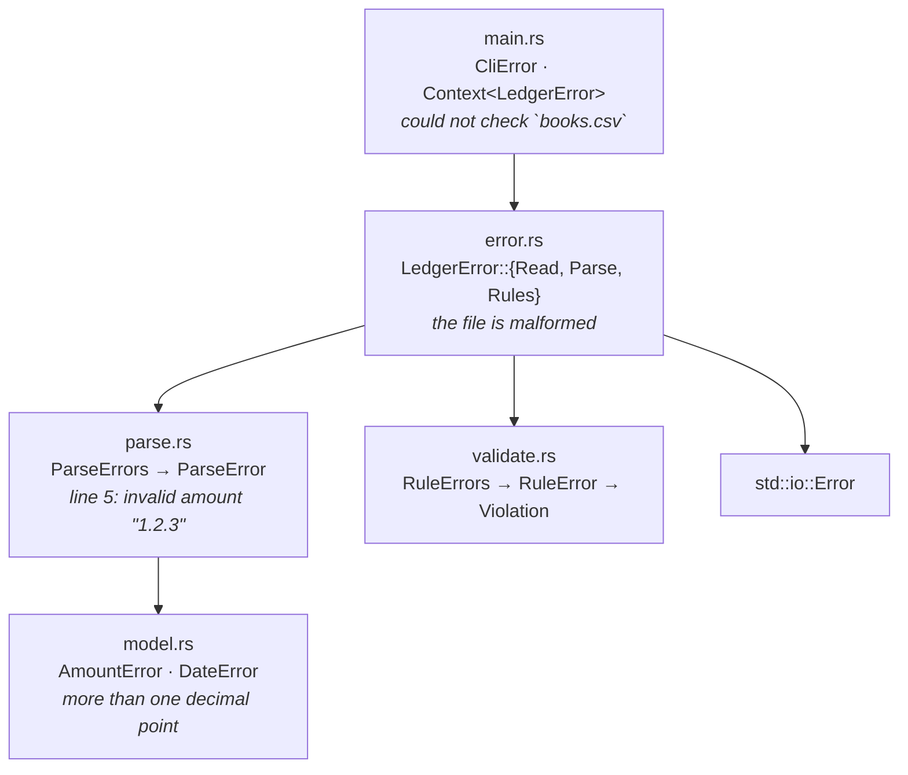

# 007 · Error Handling Patterns

**Rust · Intermediate · Reliability**

A small ledger validator, `ledger`, built to show how to design errors in Rust.
It reads a CSV of transactions, checks that every line is well-formed and that
the books make sense, and prints either a summary or a report of everything
that is wrong.

The library has **no dependencies**. Each pattern that `thiserror` and
`anyhow` usually automate is written out by hand, so you can read and test it.

## Example

```console
$ ledger balance examples/household.csv
checking        915.83
savings         300.42

$ ledger check examples/malformed.csv
error: could not check `examples/malformed.csv`
  caused by: the file is malformed
    caused by: 5 malformed lines
  - line 3: invalid date "2026-02-30": day 30 is out of range (this month has 28 days)
  - line 4: invalid amount "$300": unexpected character '$'
  - line 5: invalid amount "1.2.3": more than one decimal point
  - line 6: field `account` is empty
  - line 7: expected 5 fields, found 3
$ echo $?
65

$ ledger check examples/overdrawn.csv
error: could not check `examples/overdrawn.csv`
  caused by: the ledger breaks business rules
    caused by: 5 rule violations
  - line 3 (transaction t002): account `checking` would be overdrawn (balance -50.00)
  - line 4 (transaction t002): id `t002` was already used on line 3
  - line 4 (transaction t002): account `checking` would be overdrawn (balance -25.00)
  - line 5 (transaction t003): dated 2026-01-04, which is before the previous entry (2026-01-06)
  - line 5 (transaction t003): amount is zero

$ ledger check missing.csv
error: could not check `missing.csv`
  caused by: could not read `missing.csv`
    caused by: No such file or directory (os error 2)
$ echo $?
66
```

### Input format

```csv
id,date,account,amount,memo
t001,2026-01-01,checking,2500.00,salary
t002,2026-01-02,checking,-1200.00,rent
```

Amounts are signed (deposits positive) with at most two decimal places. Blank
lines and `#` comments are skipped. Commas are allowed in the final `memo` field.

Rules checked: unique ids, dates never go backwards, no zero amounts, no
overdrafts (unless `--allow-overdraft`), and no balance overflow.

## Architecture

Errors are layered. Each layer wraps the one below it and adds only what it
knows:



| File | Responsibility |
|---|---|
| `src/model.rs` | Domain types (`Cents`, `Date`, `Transaction`) and their leaf errors |
| `src/parse.rs` | CSV → transactions; locates errors by line and collects them all |
| `src/validate.rs` | Business rules; returns balances or every violation |
| `src/error.rs` | `LedgerError`, the single public error type, plus `Category` |
| `src/context.rs` | `Context<E>` and the `ResultExt::context` / `with_context` extension trait |
| `src/report.rs` | Walks `source()` chains to render one-line or tree reports |
| `src/main.rs` | Argument parsing, rendering, stdout/stderr split, exit codes |

## Concepts demonstrated

**Errors are values, not panics.** Clippy's `unwrap_used`, `expect_used` and
`panic` lints are set to `deny` in `Cargo.toml`, so non-test code cannot crash on
bad input. Integer overflow uses `checked_add`/`checked_mul` and becomes
`AmountError::Overflow` or `Violation::BalanceOverflow`.

**Error enums with data.** Every variant holds what's needed to explain it
(`DayOutOfRange { day, max }`, `DuplicateId { id, first_line }`). Callers can
`match` on structure instead of parsing message strings. The tests do this too.

**`Display` describes one layer; `source()` links to the next.** A layer's
message never repeats its cause, so `report::tree` and `report::chain` can
print the whole chain without duplicating text. This is the convention the
standard library and the `anyhow` crate expect.

**`From` + `?` for wrapping.** `impl From<ParseErrors> for LedgerError` lets
`check_str` be two `?` lines. There is deliberately **no**
`From<io::Error>`: a bare I/O error has no path, so the compiler forces the
caller to build `LedgerError::Read { path, source }` explicitly.

**Context wrapping, kept typed.** `result.with_context(|| format!(...))` wraps
an error in `Context<E>`. Unlike `anyhow::Error`, `Context<LedgerError>` still
exposes `.inner()`, so the CLI picks an exit code from the *typed* error while
showing the human message. `with_context` takes a closure, so the message is
only formatted on failure.

**Accumulating vs. failing fast.** Users fixing a file want every problem at
once, so parsing and validation collect errors into `ParseErrors` /
`RuleErrors`. Two cases still fail fast, on purpose: a bad header (every later
"error" would be noise), and parse failures stop validation (rules over
half-parsed data would mislead). Because `source()` can return only one cause,
aggregates expose their list through `errors()` and `LedgerError::details()`.

**Stable classification.** `LedgerError::category()` maps variants to
`NotFound | Io | Data`. The enums are `#[non_exhaustive]`, so new variants can
be added in a minor release without breaking downstream `match`es.

**Library vs. application.** The library never prints and never exits. The
binary owns presentation: `help` goes to stdout with exit 0, errors go to
stderr, and exit codes follow BSD `sysexits.h`:

| Code | Meaning |
|---|---|
| 0 | success (or `--help`) |
| 64 | bad command-line usage |
| 65 | invalid data (parse or rule errors) |
| 66 | input file not found |
| 74 | other I/O error (e.g. path is a directory) |

**Errors are `Send + Sync + 'static`.** A test checks this, so `LedgerError` can
cross threads and be boxed into `Box<dyn Error + Send + Sync>`.

### Trade-offs

- **Hand-written vs. `thiserror`/`anyhow`.** In a real project, `thiserror`
  removes the `Display`/`Error`/`From` boilerplate in the library, and
  `anyhow` replaces `Context<E>` in the binary. Writing them by hand here
  makes the mechanics visible, at the cost of about 100 extra lines.
- **Typed context vs. type erasure.** `Context<E>` keeps the inner type,
  which is useful for exit codes. The cost is that every layer of context
  changes the type (`Context<Context<E>>`). `anyhow` erases the type to avoid
  that, and you recover it with `downcast_ref`.
- **Strings vs. structure in aggregates.** `details()` returns rendered
  strings for convenience. Callers who need structure use
  `ParseErrors::errors()` / `RuleErrors::errors()` directly.
- **Amounts as `i64` cents.** Exact and fast. The cost is a fixed two-decimal
  currency and a ~92 quadrillion limit. Both are enforced as errors, not
  assumed away.

## Build, run, test

Requires Rust 1.74+ (for `[lints]` in `Cargo.toml`).

```sh
cargo build --release
cargo run -- check examples/household.csv
cargo run -- balance --allow-overdraft examples/overdrawn.csv

cargo test                     # 39 unit + integration tests
cargo clippy --all-targets     # no-panic lints are deny-level
cargo fmt --check
```

The tests are in three places:

- **Unit tests** in each module cover parsing edge cases (leap years, overflow,
  every `AmountError`), source chains, `downcast_ref` recovery, and the laziness
  of `with_context`.
- **`tests/library.rs`** uses only the public API, the way a downstream crate would:
  matching on variants, categories, and boxing into `dyn Error`.
- **`tests/cli.rs`** runs the real binary and checks stdout, stderr and exit
  codes for each failure category.

## Possible extensions

- `--format json` output that serialises the structured errors for tooling.
- Span-based diagnostics (column ranges with a caret under the bad field),
  in the style of `miette` or `codespan-reporting`.
- A `Transfer` transaction type, adding cross-account invariants.
- A retryable/permanent split on `Category` for a networked data source.
- Port the library to `thiserror` and the CLI to `anyhow`, then compare the diff.
