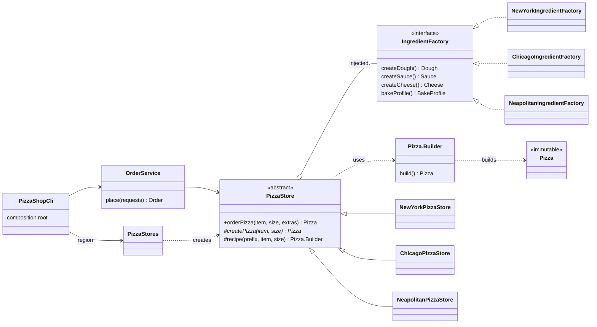

# 008 · Pizza Builder & Factory

**Stack:** Java 21 (records, sealed interfaces, Maven, JUnit 5) · **Level:** Starter · **Area:** Design patterns

A small pizza-ordering system built to show three creational patterns side by side, each solving a
real problem in the code rather than appearing for its own sake:

| Pattern | Problem it solves here | Where |
|---|---|---|
| **Builder** | A pizza has 8 fields, several optional, and rules that span fields (portion limits, one ingredient family) | `Pizza.Builder` |
| **Factory Method** | The ordering workflow is the same everywhere; only "how this region makes a pizza" varies | `PizzaStore.createPizza` and its 3 subclasses |
| **Abstract Factory** | Dough, sauce, cheese and bake profile must come from the *same* regional family | `IngredientFactory` and its 3 implementations |
| Simple factory (bonus) | Choosing a concrete store from a region key in exactly one place | `PizzaStores.forRegion` |

```java
PizzaStore store = PizzaStores.forRegion(Region.CHICAGO);         // simple factory
Pizza pizza = store.orderPizza(MenuItem.PEPPERONI, Size.LARGE,      // factory method inside
                               List.of(Topping.MUSHROOM));          // extras go through the builder
pizza.price();        // $18.00
pizza.dough();        // Dough[name=Buttery deep-dish crust, ..., style=CHICAGO]  (abstract factory)
```

## Architecture



Package dependencies point one way: `PizzaShopCli → order → store → ingredient → domain`.
`domain` (`Pizza`, `Money`, `Size`, `Topping`, `Ingredients`) depends on nothing else.

## Concepts demonstrated

### Builder (`domain/Pizza.java`)

- **Fluent, readable construction** instead of a 8-argument constructor where `size` and `slices`
  could be swapped silently.
- **Validation in `build()`, all at once.** Setters only record values; `build()` collects every
  violation and throws one `InvalidPizzaException` with the full list. A caller (or an API layer
  returning 400) gets "name is required; Ham added 3 times; max is 2" in one go.
- **Cross-field invariants:** at most 2 portions per topping, at most 8 portions total, 0–16
  slices, and dough, sauce and cheese must share a `Style`. That last check means even a buggy
  ingredient factory cannot produce a mixed-family pizza (there is a test for exactly that).
- **Immutable product:** private constructor, `List.copyOf`, no setters. A builder reused after
  `build()` cannot change pizzas it already made.
- **`toBuilder()`** for "same again, but large with pineapple" without touching the original.
  `PizzaStore` uses it to apply customer extras, so extras obey the same rules as recipes.

### Factory Method (`store/PizzaStore.java`)

- `orderPizza` is `final` and fixed: check menu, check size, call `createPizza`, apply extras.
  That is the Template Method pattern, and Factory Method is the special case where the varying
  step *creates* the object.
- Each subclass overrides only `createPizza` (plus optional `availableSizes()` / `menu()` hooks):
  New York cuts 8 slices; Chicago cuts 6 and bakes medium and large only; Naples serves pies uncut,
  small and medium only, never Hawaiian, and always adds basil.
- Subclasses start from the shared `recipe(...)` builder and adjust it, so the common steps live
  in one place.
- `OrderService` depends only on `PizzaStore`. A new region needs no change to it.

### Abstract Factory (`ingredient/`)

- `IngredientFactory` creates a family of four related products. A store receives one factory
  through its constructor, so everything on its pizzas comes from one family by construction.
- Products are records tagged with their `Style`; `Ingredient` is a **sealed interface** with
  exactly three permitted products.
- Tests are parameterised over all factories and assert the family guarantee for each.

### Other practices

- **Dependency injection without a framework:** each store has a no-arg constructor with its
  default factory and one that accepts any `IngredientFactory`. Tests pass hand-written stubs.
- **Composition root:** `PizzaShopCli` is the only class that reads config and wires objects.
  Its logic is in `run(args, env, out, err)` returning an exit code, so the CLI is unit-tested
  without spawning a process.
- **Configuration:** the tax rate comes from `PIZZA_TAX_RATE` (default `0.0825`) through
  `ShopConfig.fromEnvironment(Map)`, validated to `[0, 1)`.
- **Money in integer cents** with banker's rounding (HALF_EVEN), scaling and tax each rounded
  once, not per item.
- **Two kinds of failure, two exception types:** `UnsupportedOrderException` (a fine request
  this store does not offer) vs `InvalidPizzaException` (a request that breaks pizza rules). The
  CLI maps both to exit code 1 and argument errors to exit code 2.
- **All-or-nothing orders:** `OrderService.place` either returns a full `Order` or throws.

## Design decisions and trade-offs

| Decision | Why | Cost |
|---|---|---|
| Builder validates in `build()`, not in each setter | One complete error list; setters can be called in any order | An invalid builder can exist for a while; errors surface later |
| Builder as a static nested class | Can call `Pizza`'s private constructor; `Pizza.builder()` is discoverable | `Pizza.java` is the longest file |
| Products are records with a `Style` tag instead of one class per product per region (`NyDough`, `ChicagoDough`, ...) | 3 record types instead of 9 classes; equality for free; the family is checkable at runtime | The compiler cannot stop a factory returning the wrong family; the builder checks it at runtime instead |
| Builder also enforces "same family" | Defence in depth: the invariant holds even for hand-assembled pizzas | The rule is stated in two places (factory by construction, builder by check) |
| Abstract Factory, not a `Map<Style, Supplier<...>>` | Adding a *family* is one new class and no edits | Adding a new *product kind* (say, `Oil`) changes the interface and every factory. That is the known weakness of Abstract Factory |
| Factory Method via inheritance | Matches the classic pattern; hooks (`menu`, `availableSizes`) sit next to `createPizza` | Inheritance couples subclasses to the base. A strategy object (`PizzaStyle`) passed to one `PizzaStore` class would also work and is easier to compose |
| Simple factory is a `switch` over an enum | Exhaustive: adding a `Region` without a store fails to compile | Not open for extension at runtime (no plugins). Project 009 does that with a registry |

## Project layout

```
src/main/java/dev/omar/pizza/
  PizzaShopCli.java                 CLI + composition root
  domain/   Money, Size, Topping, Ingredients (Dough/Sauce/Cheese/BakeProfile),
            Pizza (+ Builder), InvalidPizzaException
  ingredient/ IngredientFactory + NewYork/Chicago/Neapolitan factories   (Abstract Factory)
  store/    PizzaStore + NewYork/Chicago/Neapolitan stores                (Factory Method)
            PizzaStores (simple factory), Region, MenuItem, UnsupportedOrderException
  order/    PizzaRequest (parser), OrderService, Order, OrderLine, ShopConfig
src/test/java/dev/omar/pizza/
  domain/PizzaBuilderTest.java       Builder: construction, validation, immutability, pricing
  ingredient/IngredientFactoryTest   Abstract Factory: family consistency per factory
  store/PizzaStoreTest.java          Factory Method, template workflow, stubs, simple factory
  order/OrderTest.java               totals, receipt, parsing, config
  PizzaShopCliTest.java              exit codes and output
```

## Build, run, test

Requires JDK 21.

```bash
mvn test                                    # compile with -Xlint:all -Werror, run all tests
mvn -q package -DskipTests && java -jar target/pizza-1.0.0.jar --region=ny 2:pepperoni/large/+mushroom
```

Without Maven, or offline, `./run-tests.sh [dir-with-junit-jars]` compiles with `javac` and runs
the suite through the JUnit Platform console launcher (jars from `apt install junit5`, default
`/usr/share/java`). Then run the CLI with:

```bash
java -cp target/manual/main dev.omar.pizza.PizzaShopCli --region=naples 2:margherita/s
```

> **Test status:** Maven Central was not reachable from the build environment, so the suite was run
> with `./run-tests.sh` against JUnit 5.10.1: **73 tests passed, 0 failed**, with the code
> compiled under `-Xlint:all -Werror`. The `pom.xml` uses only standard plugins and JUnit 5.11.

### Order syntax

```
pizza [--region=ny|chicago|naples] [N:]item/size[/+topping+topping...] ...
```

`item`: cheese, margherita, pepperoni, veggie, meat-lovers, hawaiian · `size`: small, medium,
large (or s/m/l) · `N:` is an optional quantity. Exit codes: 0 ok, 1 order rejected, 2 bad input.

### Example output

```
$ pizza --region=ny 2:pepperoni/large/+mushroom margherita/small
Brooklyn Slice Co. (New York)
-----------------------------
 2 x New York Style Pepperoni (Large)                              $28.50
       Large New York Style Pepperoni (35 cm): Thin hand-tossed dough, Oregano tomato sauce, Low-moisture mozzarella; Pepperoni, Mushrooms; 8 slices
       bake: 290 C for 12 min
 1 x New York Style Margherita (Small)                              $7.50
       Small New York Style Margherita (25 cm): Thin hand-tossed dough, Oregano tomato sauce, Low-moisture mozzarella; Fresh basil; 8 slices
       bake: 290 C for 12 min, vegetarian
Subtotal                                                           $36.00
Tax (8.25%)                                                         $2.97
Total (3 pizzas)                                                   $38.97

$ pizza --region=naples 2:margherita/s
Forno Vesuvio (Naples)
----------------------
 2 x Neapolitan Margherita (Small)                                 $19.00
       Small Neapolitan Margherita (25 cm): 00-flour dough, 48h proof, Raw San Marzano tomatoes, Fior di latte; Fresh basil; uncut
       bake: 485 C for 90 s, vegetarian
Subtotal                                                           $19.00
Tax (8.25%)                                                         $1.57
Total (2 pizzas)                                                   $20.57

$ pizza --region=chicago cheese/s
order rejected: Lakeshore Deep Dish (Chicago) does not bake small pizzas; available: [MEDIUM, LARGE]

$ pizza pepperoni/l/+pepperoni+pepperoni+ham+ham+ham+onion+basil+mushroom
order rejected:
  - at most 8 topping portions allowed but got 9
  - Pepperoni added 3 times; max is 2
  - Ham added 3 times; max is 2
```

## Possible extensions

- Replace store inheritance with a `PizzaStyle` strategy and compare the two designs.
- Add a product kind (`Oil`, `Garnish`) to feel the Abstract Factory's cost of change.
- A **Prototype** registry of saved "usual orders" built on `toBuilder()`.
- Load regions from configuration through a registry (`ServiceLoader`) instead of the `switch`.
- A step builder (typed stages: size → dough → ... → build) so missing fields fail at compile time.
- Expose `OrderService` over HTTP and map `InvalidPizzaException.violations()` to a 400 response.
