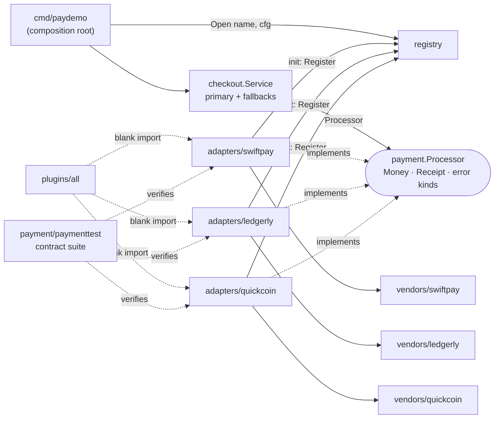

# 009 · Plugin System with Adapters

**Stack:** Go 1.22+ (standard library only) · **Level:** Intermediate · **Area:** Design patterns

A payment-provider plugin system. Three simulated vendors with deliberately incompatible SDKs are
hidden behind one small `payment.Processor` interface. Adapters register themselves in a
**registry** at import time, the application opens providers **by name from configuration**, and a
checkout service fails over between them only when it's safe to do so.

| Pattern / concept | Problem it solves here | Where |
|---|---|---|
| **Adapter** | Each vendor has different units, casing, error style and sync model; the app should see none of it | `adapters/*` |
| **Registry** (plugin registration) | Choose a provider from config without the app importing vendor packages | `registry` |
| Self-registration via `init` | Enable a plugin by importing it, like `database/sql` drivers or `image/png` | `adapters/*/adapter.go`, `plugins/all` |
| Ports & adapters (hexagonal) | Domain and app layers depend inward on `payment`, never outward on vendors | `payment`, `checkout` |
| **Contract tests** | Every adapter must *behave* like a `Processor`, not just compile as one | `payment/paymenttest` |
| Error normalisation | `errors.Is(err, payment.ErrDeclined)` works for every vendor; vendor detail is kept for `errors.As` | `payment/errors.go` |
| Idempotency | Retries and failover never double-charge, even for a vendor that lacks idempotency | `checkout`, `adapters/ledgerly` |

```go
import _ ".../plugins/all"                        // enable bundled adapters

p, err := registry.Open("ledgerly", registry.Config{"merchant_id": "M1", "secret": "…"})
r, err := p.Charge(ctx, payment.ChargeRequest{
    Amount: payment.Money{Minor: 1999, Currency: "USD"}, Source: "card_ok", IdempotencyKey: "order-42",
})
if errors.Is(err, payment.ErrDeclined) { /* same check for every vendor */ }
```

## The three vendors (simulated, in memory)

Everything under `vendors/` plays the role of third-party code we can't change. All three are
fictional and run fully in-process; no network, no real keys.

| | Swiftpay | Ledgerly | Quickcoin |
|---|---|---|---|
| Amount format | integer cents | decimal string (`"12.34"`, `"500"`, `"1.250"`) | integer minor units |
| Currency | lower case | upper case | USD/EUR only |
| Operation style | `CreatePayment`, `CreateRefund` | one `Transact(SALE/REFUND)` | async: submit invoice, then **poll** |
| Errors | `*APIError` with HTTP status | result codes (`"51"`, `"91"`) in a *successful* response; Go error only for transport | package sentinel errors |
| Idempotency | native | **none** | native (nonce) |
| `context.Context` | ignored | honoured | n/a (adapter polls with ctx) |
| Refunds | partial | partial | **full only** |

Each adapter's job is pure translation: types and units in, normalised receipts and error kinds out.

## Architecture



Dependency rule: `payment` imports nothing from the project. `registry` and `checkout` import only
`payment`. Only adapters import vendors, and only the CLI (via `plugins/all`) knows which adapters exist.

```
payment/            domain types, Processor port, error kinds
payment/paymenttest contract-test suite every adapter runs
registry/           name → Factory map, Config bag, Default registry
adapters/<vendor>/  one Adapter per vendor, self-registering
vendors/<vendor>/   simulated third-party SDKs (treated as read-only)
plugins/all/        blank-imports every adapter
checkout/           application service with safe failover
cmd/paydemo/        CLI composition root
```

## Design decisions and trade-offs

- **Compile-time plugins, not `plugin.Open`.** Go's `plugin` package loads `.so` files at runtime, but
  it's Linux/macOS-only, needs identical toolchain and dependency versions, and can't unload. Most Go
  projects (database drivers, Caddy modules, Terraform providers before gRPC) use
  init-registration instead: you choose plugins at build time with imports. A binary that only needs
  Swiftpay can import that one adapter and leave the other vendors' code out entirely.
- **`init` side effects and a global `Default` registry** are convenient, but global state is hard to
  test. So `registry.New()` returns isolated instances for tests, and the global is a thin wrapper.
  Duplicate names `panic` at startup on purpose: silently replacing a payment adapter is worse than
  crashing on boot.
- **Flat `Config map[string]string`** keeps the registry from knowing each adapter's settings shape.
  The cost is weaker typing, so each factory validates its own keys and returns errors (not panics)
  so misconfiguration fails fast at startup with a clear message.
- **A small port.** `Processor` has three methods. Capabilities that only some vendors have (partial
  refunds) are not split into extra interfaces. An unsupported request returns `ErrInvalidRequest`.
  The alternative, optional interfaces checked with type assertions (`if r, ok := p.(PartialRefunder)`),
  scales better when capability differences grow.
- **Error kinds + preserved detail.** `ProviderError.Unwrap() []error` exposes both the normalised
  sentinel and the vendor's original error, so callers branch on `payment.ErrDeclined` while support
  tooling can still `errors.As` the raw `*swiftpay.APIError`. Unknown Ledgerly result codes are treated
  as declines: failing closed is the safe default for money.
- **Idempotency where the vendor has none.** The Ledgerly adapter keeps an in-process single-flight
  cache: concurrent calls with the same key wait for the first, and only successes are cached so a
  failed attempt can be retried. Trade-off: the cache is per-process and unbounded. In production it
  would live in a shared store with a TTL.
- **Async-to-sync adaptation.** Quickcoin is submit-then-poll. The adapter polls on a ticker under a
  settle timeout and respects `ctx`. A timeout after submission is an **unknown outcome**: the money
  may still move. That's marked with `OutcomeUnknown`, which `payment.SafeToFailover` checks.
- **Failover rules** (`checkout.Service`): declines, invalid requests and auth errors stop right away
  (another provider won't change the answer). A transient failure with a *known* outcome moves to the
  next provider with the *same* idempotency key. An unknown outcome stops, because charging elsewhere
  could double-charge the customer.
- **Simplification:** the demo uses one source token across providers. Real payment tokens are
  provider-specific; a token vault mapping one customer instrument to per-provider tokens would sit
  in front of the adapters.

## Build, run, test

Requires Go 1.22+. No third-party dependencies.

```bash
make test        # go test ./...
make race        # go test -race -count=1 ./...
make vet fmt     # static checks
make demo        # failover demo across all three providers
make build       # bin/paydemo
```

Tests: 75 passing cases across the packages, race-detector clean. The contract suite runs 10
behavioural checks (receipts, idempotency including concurrent duplicates, error mapping, refunds,
not-found, cancellation) against each of the three adapters. Coverage is 87–100% on adapters,
registry, checkout and CLI.

## Example usage

```text
$ paydemo -list
ledgerly
quickcoin
swiftpay

$ paydemo -providers swiftpay,ledgerly,quickcoin -source tok_outage -refund
attempt 1  swiftpay   swiftpay: payment provider unavailable (code service_unavailable): Try again later.
attempt 2  ledgerly   ok
charged    19.99 USD via ledgerly (id LG00000001)
refunded   19.99 USD via ledgerly (id LG00000002)

$ paydemo -providers quickcoin -currency EUR -amount 4200 -source wallet_alice -refund
attempt 1  quickcoin  ok
charged    42.00 EUR via quickcoin (id qc-1)
refunded   42.00 EUR via quickcoin (id qc-rev-2)

$ paydemo -providers ledgerly,swiftpay -source card_stolen     # decline: no failover, exit code 2
attempt 1  ledgerly   ledgerly: payment declined (code 05): DO NOT HONOUR
paydemo: order demo-…: ledgerly: payment declined (code 05): DO NOT HONOUR
```

Flags: `-providers`, `-amount` (minor units), `-currency`, `-source`, `-order`, `-refund`, `-timeout`, `-v`
(structured `slog` output per attempt). Provider settings come from `<PROVIDER>_<KEY>` environment
variables (e.g. `SWIFTPAY_API_KEY=sp_test_revoked` to see an auth failure) and fall back to the fake
sandbox defaults in `cmd/paydemo/main.go`.

**Sandbox magic values:** Swiftpay `tok_decline`, `tok_outage`; Ledgerly `card_insufficient`,
`card_stolen`, `card_offline`, `card_network`; Quickcoin `wallet_empty`, `wallet_busy`, `wallet_slow`.

## Adding a provider

1. Write `adapters/acme/adapter.go` with a `New(registry.Config) (payment.Processor, error)` factory and
   `func init() { registry.Register("acme", New) }`.
2. Add a test that calls `paymenttest.RunConformance` with Acme's sandbox magic values.
3. Blank-import it from `plugins/all`. Nothing in `checkout` or `payment` changes.

## Possible extensions

- Optional capability interfaces (`PartialRefunder`, `Authorizer` for auth/capture) discovered by type assertion.
- Decorators around `Processor` for retries with backoff, circuit breaking and metrics (see project 010).
- A reconciliation job that resolves `OutcomeUnknown` charges by polling the original provider.
- Out-of-process plugins over gRPC (HashiCorp `go-plugin` style) for crash isolation and independent releases.
- Weighted or cost-based routing instead of a fixed primary/fallback chain.
