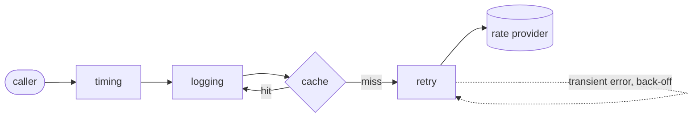

# 010 · Decorator Middleware Pipeline

A small, dependency-free TypeScript library that wraps any async service in composable **logging, retry, caching and timing** decorators, plus a test suite whose main job is to pin down **ordering semantics**: the same four decorators behave observably differently depending on where they sit in the chain.

The worked example is a mocked exchange-rate provider that fails transiently on a scripted schedule. No network is used anywhere.

## What it demonstrates

| Concept | Where |
| --- | --- |
| **Decorator pattern** (GoF) in its functional form: every layer has the same signature as the thing it wraps, so layers stack in any order | `src/core/types.ts` |
| **Chain of responsibility / onion model**: first middleware = outermost layer | `src/core/compose.ts` |
| **Immutable fluent builder** with introspection (`describe()`) | `Pipeline` |
| **Ports and adapters** for side effects: `Clock`, `Logger`, metrics sink are injected | `src/core/clock.ts`, `src/middleware/logging.ts` |
| **Resilience patterns**: capped exponential back-off, full jitter, retryable vs permanent errors, error chaining via `cause` | `src/middleware/retry.ts` |
| **Read-through cache** with TTL, LRU eviction and *single-flight* request coalescing | `src/middleware/cache.ts` |
| **Fail-fast configuration** (`ConfigError` when the pipeline is built, not when a request arrives) | all factories |
| **Deterministic tests of time-dependent code** with a fake clock, so nothing actually sleeps | `test/support/fakes.ts` |

## Architecture



`compose([a, b, c])(h)` is exactly `a.wrap(b.wrap(c.wrap(h)))`. Requests travel left→right, responses and errors travel right→left.

```
src/
  core/        types, compose + Pipeline, Clock, errors
  middleware/  logging, retry (+ exponentialBackoff), cache, timing
  example/     FakeRateProvider + the recommended rate-service pipeline
  demo.ts      runs the example in two orders side by side
test/          one file per middleware, plus ordering.test.ts and the example
```

## Ordering semantics (what the tests prove)

Everything **inside** `retry` runs once per attempt; everything **outside** runs once per logical call. Everything **outside** `cache` sees hits; everything **inside** only sees misses.

| Arrangement | Observable behaviour | Test |
| --- | --- | --- |
| `logging → retry` | one start/ok pair per call | `ordering.test.ts` |
| `retry → logging` | start/failed lines for every attempt | 〃 |
| `timing → retry` | one sample = all attempts **+ back-off** (230 ms in the test) | 〃 |
| `retry → timing` | one sample per attempt, back-off excluded | 〃 |
| `cache → retry` | a hit skips retries and sleeps entirely | 〃 |
| `retry → cache` | each attempt does a cache lookup | 〃 |
| `logging → cache → logging` | outer logger sees 3 calls, inner sees 1 miss | 〃 |

The recommended order for a read-mostly remote lookup, used in `src/example/exchange-rates.ts`:

```
timing → logging → cache → retry → handler
```

* **timing outermost**: measure the latency the caller actually experiences.
* **logging next**: one log line pair per logical call; noise-free.
* **cache before retry**: hits cost nothing; failures are never cached.
* **retry innermost**: only the remote call is repeated, and only for `UpstreamUnavailableError`.

## Design decisions and trade-offs

* **Functions, not classes, for layers.** A `Middleware` is `{ name, wrap(next) }`. This is lighter than a class hierarchy of `ServiceDecorator`s and works for any `(req) => Promise<res>`. The cost is that it decorates a single operation; decorating every method of a multi-method interface needs an adapter per method (or a `Proxy`, which trades type safety for convenience).
* **Named middlewares.** The name is only for `describe()` and diagnostics, but it makes the order reviewable in code and in tests (`"timing → logging → cache → retry → handler"`).
* **Cache state is per wrapped handler.** Calling `wrap` twice gives two independent caches. That avoids hidden global state, at the price of not sharing a cache between pipelines (inject a shared store if you need that).
* **Single-flight coalescing.** Concurrent misses share one upstream call. A failure is delivered to every waiter and the slot is cleared, so the next call retries instead of being poisoned.
* **Errors are never swallowed or rewrapped by observers.** Logging and timing rethrow the original error. Only `retry` wraps, and only on exhaustion, into `RetryExhaustedError` with every attempt's error and the last one as `cause`. Non-retryable errors pass through unwrapped so callers can still `instanceof` them.
* **Logging is opt-in for payloads.** `describeRequest` defaults to nothing, so tokens or PII are not logged by accident (there is a test for this).
* **The clock is injected.** Tests run in milliseconds and are fully deterministic; the cost is one extra option on three factories (defaulting to `systemClock`).

## Build, run, test

Requires Node 20+.

```bash
npm install
npm test        # type-check (strict) + vitest, 37 tests
npm run demo    # build and run the side-by-side demo
npm run build   # emit dist/
```

## Example output (`npm run demo`, abridged)

```
=== Recommended order
    timing → logging → cache → retry → handler
[info] rates.lookup start {"pair":"USD/EUR"}
[info] rates.lookup ok {"pair":"USD/EUR"}
[metric] rates.lookup ok 302.0ms          <- two transient failures + 100ms + 200ms back-off
[metric] rates.lookup ok 0.2ms            <- cache hit
[error] rates.lookup failed {"pair":"XXX/YYY","error":"UnknownCurrencyError: ..."}
  -> XXX/YYY threw UnknownCurrencyError   <- permanent error, not retried
  provider was called 4 time(s)

=== Inverted order (retry outermost: ...)
    retry → cache → logging → timing → handler
[info] rates.lookup start
[metric] rates.lookup error 0.1ms
[error] rates.lookup failed {"error":"UpstreamUnavailableError: ..."}
...                                        <- logs and metrics repeat per attempt
  -> XXX/YYY threw RetryExhaustedError     <- permanent error retried pointlessly
  provider was called 6 time(s)
```

## Usage

```ts
import { Pipeline, cache, exponentialBackoff, logging, retry, timing, consoleLogger } from "./src/index.js";

const getUser = Pipeline.create<string, User>()
  .use(timing({ metric: "users.get", sink: histogram.record }))
  .use(logging({ logger: consoleLogger, label: "users.get", describeRequest: (id) => ({ id }) }))
  .use(cache({ key: (id) => id, ttlMs: 30_000 }))
  .use(retry({ maxAttempts: 3, backoff: exponentialBackoff({ baseMs: 50, maxMs: 500, jitter: true }) }))
  .build((id) => api.fetchUser(id));
```

## Possible extensions

* `timeout` and `circuitBreaker` middlewares using `AbortSignal`, with ordering tests against `retry` (a per-attempt vs. per-call timeout).
* A pluggable `CacheStore` interface so a Redis adapter can replace the in-memory `Map`.
* Stale-while-revalidate and negative caching for permanent errors.
* A request-scoped context (trace id, attempt number) threaded through every layer.
* A `Proxy`-based helper to decorate every method of an object-style service.
