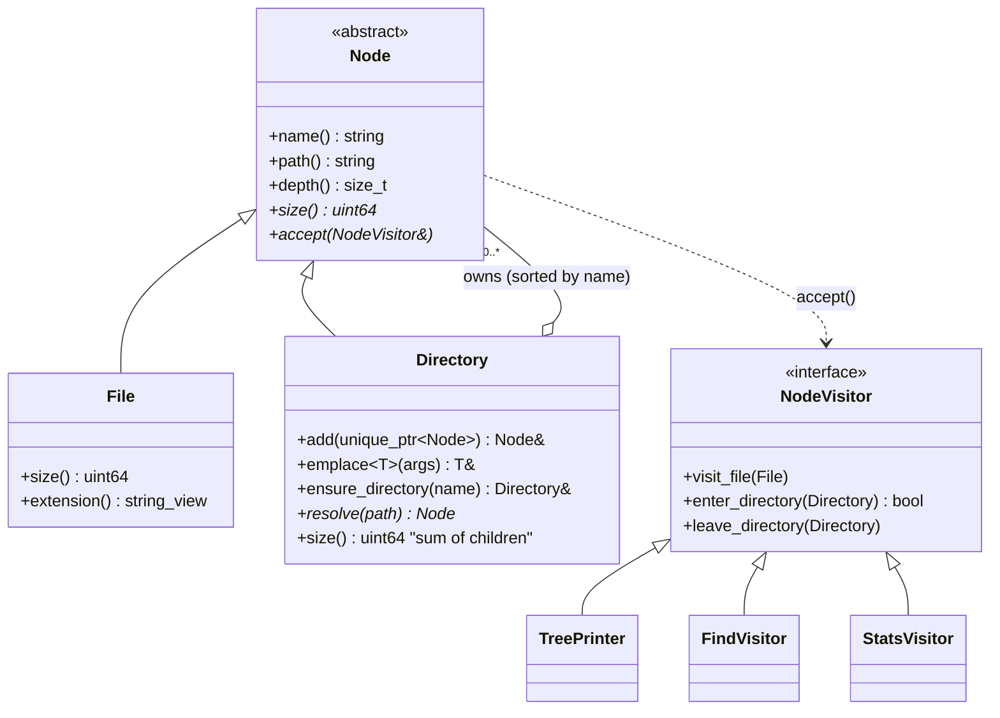

# 011 · Composite File Tree

A small C++20 library and CLI (`vfs-tree`) that models a **virtual filesystem** as a Composite of files and directories, then adds operations to it with the Visitor pattern: a `tree`-style printer, a glob/size search, and a one-pass statistics report. Trees are loaded from a plain-text manifest, so nothing touches the real disk.

## What it demonstrates

| Concept | Where |
| --- | --- |
| **Composite pattern**: `File` (leaf) and `Directory` (composite) share the `Node` interface; `size()` works the same on either and recurses through directories | `include/vfs/node.hpp`, `src/node.cpp` |
| **Visitor pattern with double dispatch**: `Node::accept` → `visit_file` / `enter_directory` / `leave_directory` | `include/vfs/visitor.hpp` |
| **Hierarchical visitor**: the composite drives a deterministic pre-order walk; visitors can prune subtrees by returning `false` from `enter_directory` | `Directory::accept`, `TreePrinter` depth limit |
| **Open/closed principle**: printing, searching and stats were added without changing `Node`, `File` or `Directory` | `src/visitors.cpp` |
| **Clear ownership in modern C++**: parents own children through `std::unique_ptr`; children hold a non-owning back-pointer; nodes are non-copyable *and* non-movable so that pointer can never dangle | `Node`, `Directory::add` |
| **Invariants enforced at the boundary**: valid names, no duplicates, no file/directory clashes, and only a `Directory` can adopt a node (`friend` + private root constructor) | `is_valid_name`, `Directory::make_root` |
| **Composable predicates** (`std::function` combinators) instead of a flag-heavy search API | `match::name_glob`, `min_size`, `files_only`, `all_of` |
| **Error handling with context**: tree errors are `std::invalid_argument`; the parser re-throws them as `ManifestError` carrying a line number; the CLI maps errors to exit codes 1 / 2 | `src/manifest.cpp`, `src/cli.cpp` |
| **Testable CLI**: `run(args, in, out, err)` takes streams, so end-to-end behaviour is unit-tested without spawning a process | `include/vfs/cli.hpp`, `tests/test_cli.cpp` |
| **C++20 features**: concepts (`std::derived_from` on `emplace<T>`), ranges with projections, `std::span`, `std::format`, designated initializers, `starts_with`/`ends_with` | throughout |

## Architecture



```
include/vfs/   public headers: node, visitor, visitors, manifest, text, cli
src/           implementation + main.cpp (a three-line shim over cli::run)
tests/         GoogleTest suites, one per header (52 tests)
examples/      project.manifest — a sample tree used by the demo and a test
```

## Design decisions and trade-offs

- **Two ways to compute an aggregate.** `size()` is a virtual on the Composite itself, because "how big is this?" is intrinsic to every node and the classic Composite example. New, optional operations (stats, search, printing) are visitors. The rule of thumb: put an operation on the hierarchy if every node needs it and it is stable; make it a visitor if it is one of many and changes often. The cost of Visitor is the mirror image: adding a new *node type* (say, `Symlink`) means touching every visitor.
- **Who drives the traversal?** Here `Directory::accept` walks its children and calls `enter`/`leave` hooks. Every visitor gets the same deterministic order and pruning for free. The alternative, letting each visitor recurse by itself, gives more control (post-order, breadth-first) at the cost of duplicated traversal code.
- **Size is recomputed, not cached.** `Directory::size()` is O(subtree) per call. Caching it would make reads O(1) but every `add` would have to invalidate all ancestors, which is easy to get subtly wrong. The tree is usually small and built once, so correctness wins. `StatsVisitor` shows the alternative: compute everything in one pass.
- **Sorted children.** Insertion uses `lower_bound`, so `add` is O(n) per directory but lookups are O(log n) and output is always in the same order, which makes golden-output tests possible.
- **Non-movable nodes.** Parent back-pointers make moving a `Directory` unsafe, so all copy and move operations are deleted and nodes always live on the heap behind `unique_ptr`.
- **No real filesystem.** Reading `std::filesystem` would be a small adapter that produces the same tree. Keeping the core pure makes every test hermetic and fast.

## Build, run, test

Requires CMake ≥ 3.20 and a C++20 compiler (GCC 13+, Clang 17+, or MSVC 19.36+; `<format>` is needed). Tests use GoogleTest: an installed copy (`libgtest-dev`, Homebrew `googletest`, vcpkg) is used if found, otherwise v1.15.2 is downloaded via `FetchContent`.

```bash
make test          # configure, build, run ctest
make run           # print the example tree
# or by hand:
cmake -S . -B build && cmake --build build -j
ctest --test-dir build --output-on-failure
./build/vfs-tree --help
```

Warnings are strict (`-Wall -Wextra -Wpedantic -Wconversion -Wshadow -Werror`); pass `-DVFS_WARNINGS_AS_ERRORS=OFF` to relax them. The suite is also clean under `-fsanitize=address,undefined`.

## Example usage

Manifest format: `path size` for files, `path/` for empty directories, `#` for comments. Parent directories are created automatically.

```text
$ ./build/vfs-tree examples/project.manifest
/ (216.4 KiB)
├── .gitignore (42 B)
├── CMakeLists.txt (1.2 KiB)
├── README.md (2.3 KiB)
├── build/ (0 B)
├── docs/ (186.0 KiB)
│   ├── architecture.md (6.0 KiB)
│   └── images/ (180.0 KiB)
│       └── tree.png (180.0 KiB)
├── src/ (18.8 KiB)
│   ├── app/ (5.7 KiB)
│   │   ├── cli.cpp (4.8 KiB)
│   │   └── cli.hpp (980 B)
│   ├── core/ (12.7 KiB)
│   │   ├── node.cpp (3.5 KiB)
│   │   ├── node.hpp (4.0 KiB)
│   │   └── visitors.cpp (5.1 KiB)
│   └── main.cpp (390 B)
└── tests/ (8.2 KiB)
    ├── test_cli.cpp (2.9 KiB)
    └── test_node.cpp (5.3 KiB)

$ ./build/vfs-tree --find '*.cpp' --min-size 4000 examples/project.manifest
/src/app/cli.cpp  4.8 KiB
/src/core/visitors.cpp  5.1 KiB
/tests/test_node.cpp  5.3 KiB

$ ./build/vfs-tree --stats examples/project.manifest
files:        13
directories:  8
total size:   216.4 KiB (221592 bytes)
max depth:    3
largest file: /docs/images/tree.png (180.0 KiB)
by extension:
  png           1 file   180.0 KiB
  cpp           6 files   22.0 KiB
  md            2 files    8.2 KiB
  hpp           2 files    5.0 KiB
  txt           1 file     1.2 KiB
  (none)        1 file        42 B

$ printf 'a 1\nb oops\n' | ./build/vfs-tree -
error: line 2: invalid size: 'oops'
```

Other flags: `--at /src` to work on a subtree, `--depth N` to limit expansion, `--files` to restrict `--find` to files, `--no-sizes`.

Using the library directly:

```cpp
auto root = vfs::Directory::make_root();
auto& src = root->emplace<vfs::Directory>("src");
src.emplace<vfs::File>("main.cpp", 1200);

vfs::TreePrinter printer(std::cout, {.show_sizes = true});
root->accept(printer);

auto big = vfs::find(*root, vfs::match::all_of({vfs::match::files_only(),
                                                vfs::match::min_size(1024)}));
```

## Possible extensions

- A `std::filesystem` adapter that builds the tree from a real directory (read-only).
- `Symlink` as a third node type, to feel the cost Visitor puts on adding new types (and to handle cycles).
- Cached sizes with ancestor invalidation, benchmarked against the recompute-on-demand version.
- A `std::variant<File, Directory>` + `std::visit` version, to compare closed-set sum types with the open class hierarchy.
- JSON output from a `JsonVisitor`, and `du`-style "top N largest directories".
