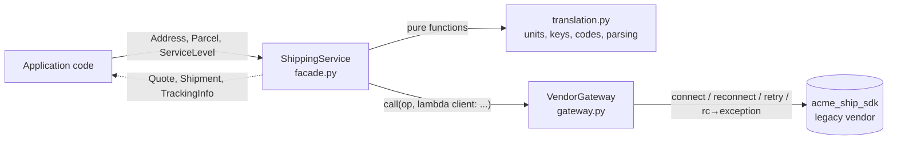

# 012 · Facade over a Messy API

**Python · Starter · Design patterns**

A typed `ShippingService` facade that hides a deliberately awkward legacy
shipping SDK behind four plain methods: `quote`, `ship`, `track` and `cancel`.
The application works in kilograms, centimetres, `Decimal` money, enums and
exceptions. The vendor works in pounds, inches, strings of cents, cryptic
dictionary keys and numeric return codes.

The "vendor" (`acme_ship_sdk`) is a simulated, in-memory, deterministic SDK.
It is the code we pretend we cannot change. It is intentionally unpleasant:

| Vendor quirk | What the facade gives callers instead |
|---|---|
| `Connect(acct, key, env)` must be called first, and the session silently expires | Lazy connect, transparent reconnect |
| Every call returns `{"rc": 503, ...}` intermittently | Bounded retry with exponential backoff |
| Return codes `400/401/404/409` instead of exceptions | `InvalidShipmentError`, `AuthenticationError`, `ShipmentNotFoundError`, `CancellationRejectedError` |
| `"pkg": "WT=5.6;L=11.9;W=7.9;H=5.9"` in pounds and inches | `Parcel(weight_kg, length_cm, width_cm, height_cm)` |
| `{"nm", "a1", "cty", "st", "zp", "ctry"}` | `Address(name, street1, city, state, postal_code)` with validation |
| `"amt": "1299"` cents, `"eta": "5"` | `Money(Decimal("12.99"), "USD")`, `estimated_days: int` |
| `"GND" / "2DA" / "NDA"` | `ServiceLevel.GROUND / TWO_DAY / OVERNIGHT` |
| `Track()` returns `"RC=0~20260105 090000\|LC\|LABEL CREATED;..."` | `TrackingInfo` with typed `TrackingEvent`s and a `TrackingStatus` |

## Example

```console
$ PYTHONPATH=src python -m shipping_facade.demo
Quotes for a 2.5 kg box, Dallas -> Brooklyn:
  ground     18.29 USD  ~5 day(s)
  two_day    36.99 USD  ~2 day(s)
  overnight  65.29 USD  ~1 day(s)

Cheapest within 2 days: two_day at 36.99 USD
Shipped: 1ZACME00000001 (23-byte label)
  [WARNING] track: vendor busy (attempt 1), retrying in 0.01s
  [INFO] track: session expired, reconnecting

Tracking 1ZACME00000001: in_transit
  2026-01-05 09:00  label_created    LABEL CREATED
  2026-01-05 15:00  picked_up        SCANNED AT ORIGIN FACILITY
  2026-01-05 21:00  in_transit       SCANNED AT REGIONAL HUB

Cancel refused: cancel: Pkg already in network
```

The demo configures the vendor to fail every 4th request and to expire the
session every 3 calls. The two log lines are the gateway absorbing both
problems. The calling code in `demo.py` has no retry or session logic at all.

Using it from application code:

```python
from decimal import Decimal
from shipping_facade import Address, Parcel, ServiceLevel, ShippingConfig, ShippingService, ShippingError

service = ShippingService.create(ShippingConfig.from_env())   # reads ACME_* variables
box = Parcel(Decimal("2.5"), 30, 20, 15)
try:
    quote = service.cheapest(warehouse, customer, box, max_days=2)
    shipment = service.ship(warehouse, customer, box, quote.service)
except ShippingError as exc:      # one base class for everything the facade raises
    ...
```

## Architecture



| Module | Responsibility |
|---|---|
| `models.py` | Immutable, self-validating domain types. No vendor vocabulary. |
| `errors.py` | One `ShippingError` hierarchy. Each error keeps the raw `vendor_code` for logs. |
| `translation.py` | Pure, I/O-free mappings in both directions. All vendor field names live here. |
| `gateway.py` | The only module that calls the SDK. Handles sessions, retries and return codes. |
| `facade.py` | `ShippingService`. Each method translates out, calls, and translates back. |
| `config.py` | `ShippingConfig`, validated, loadable from environment variables. |
| `demo.py` | End-to-end walkthrough against a misbehaving simulated vendor. |

## Concepts and design decisions

**Facade pattern.** The vendor exposes many concepts (sessions, return codes,
package strings, envelope formats). Callers need four verbs. The facade gives a
narrow interface tuned to the application's use cases rather than a
one-to-one wrapper of every SDK call. `cheapest()` is an example: it is not a
vendor operation at all, just a use case the app keeps needing.

**Anti-corruption layer.** The vendor's vocabulary (`zp`, `rc`, `GND`, inches)
stops at `translation.py` and `gateway.py`. If the company switches carriers,
those two files are replaced and `ShippingService`'s signature stays the same.

**Facade split into three layers.** Translation, resilience and orchestration
change for different reasons, so they live in different modules. That also
means each part is tested at the right level. Translation rules get fast,
exhaustive unit tests with no SDK. Resilience gets tested with the SDK's fault
knobs. The facade tests read like use cases.

**The gateway lends the client, it does not share it.** `call()` takes
`lambda client: client.GetRates(...)`. The facade never holds a client
reference, so it cannot bypass the retry and session logic by accident.

**Parse, don't validate.** `Address` and `Parcel` validate in `__post_init__`
and are frozen, so if you hold one it is valid. Local `ValidationError`s are
raised before any network call. Vendor-side rejections become
`InvalidShipmentError`.

**Round up on unit conversion.** 1 kg converts to 2.3 lb, not 2.2.
Under-declaring weight leads to carrier surcharges, so conversions use
`ROUND_CEILING` to one decimal place. `Decimal` is used throughout, so money and
weights never pick up float error.

**Retry policy.** Only `503` is retried, with `backoff * 2^(n-1)` delays and no
sleep after the last attempt. An expired session (`440`) is handled by
reconnecting and re-sending within the same attempt, so it does not use up the
retry budget. Everything else fails fast. `sleep` is injected, so the tests
assert the exact backoff schedule without waiting.

**Defensive inbound parsing.** A vendor response missing a field, or a tracking
line in an unknown format, raises `UnexpectedResponseError` (still a
`ShippingError`) rather than leaking a `KeyError` from deep inside the facade.
Unknown service codes in a rate list are skipped, so the vendor adding a new
service does not break quoting.

### Trade-offs

- **Retrying `ship` is only safe because the simulated vendor fails before
  creating the label.** A real carrier could time out *after* buying a label,
  and a blind retry would buy two. A production version would send an
  idempotency key or look up the label by reference before retrying.
- The facade hides vendor detail, including some useful detail (for example,
  the raw label format). `vendor_code` on errors is the only intentional leak.
- Tracking descriptions are passed through verbatim (`SCANNED AT BROOKLYN NY`).
  Re-casing free text would mangle place names, so presentation is left to the UI.
- One `ShippingService` per vendor. Supporting several carriers would mean
  extracting a `CarrierGateway` protocol, which is not worth it for one vendor.

## Build, run, test

Requires Python 3.11+. There are no runtime dependencies.

```bash
python -m venv .venv && . .venv/bin/activate
pip install -e '.[test]'
pytest                                  # 42 tests
python -m shipping_facade.demo
ruff check . && ruff format --check .   # optional lint
```

Without installing: `PYTHONPATH=src python -m pytest`.

Configuration (all read by `ShippingConfig.from_env()`):

| Variable | Default | Meaning |
|---|---|---|
| `ACME_ACCOUNT` | required | Vendor account (`ACME-TEST-001` for the simulator) |
| `ACME_API_KEY` | required | Vendor key (`sandbox-key` for the simulator) |
| `ACME_ENV` | `SANDBOX` | `SANDBOX` or `PROD` |
| `ACME_MAX_ATTEMPTS` | `3` | Total attempts for a busy vendor |
| `ACME_BACKOFF_SECONDS` | `0.2` | Initial backoff, doubled per retry |

## Tests

- `test_models_and_config.py`: domain validation and environment config parsing.
- `test_translation.py`: unit conversion and rounding, key mapping, rate sorting,
  envelope and tracking parsing, malformed inputs.
- `test_facade.py`: use cases end to end against the simulator, error mapping
  for each return code, retry and backoff schedule, give-up behaviour, transparent
  reconnects, and lazy connection.

## Possible extensions

- Idempotency keys on `ship` so retrying a label purchase is safe.
- A second simulated carrier behind a `CarrierGateway` protocol, plus a
  rate-shopping facade across both.
- A circuit breaker in the gateway, so a vendor outage fails fast.
- Structured logging/metrics per operation (attempts, latency, vendor codes).
- An async variant using `asyncio` and an HTTP-backed fake vendor.
