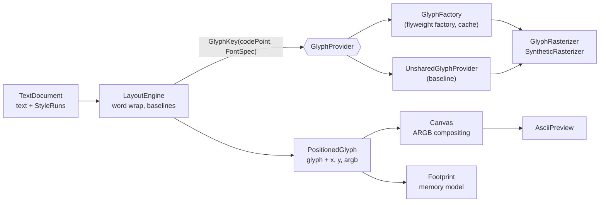

# 013 · Flyweight Text Renderer

**Kotlin · Intermediate · Design patterns**

A small text-editor rendering pipeline (styled document → word-wrapped layout →
raster canvas) built around the **Flyweight** pattern. Every occurrence of the
same character in the same font face points at **one** shared, immutable
rasterized `Glyph`; only the cheap per-occurrence data (position and colour) is
stored per character. A benchmark lays out the same 200 000-character document
with and without sharing and reports the difference.

```console
$ gradle run --args="bench"
Flyweight benchmark: 200000 chars, 16px, 800px lines

strategy   glyph objs rasterized      intrinsic      extrinsic  measured heap   layout
unshared       198909     199243      39.49 MiB       6.83 MiB      51.22 MiB    241ms
flyweight          69         69       0.01 MiB       6.83 MiB       7.34 MiB    134ms

Sharing glyphs uses 6.8x less memory (analytic model; measured heap is GC-noisy).
```

199 000 bitmaps collapse into 69: one per distinct character × face actually
used. Layout is also faster because rasterization happens 69 times instead of
~200 000.

```console
$ gradle run --args="render --width 260 Flyweight shares glyphs"
...:: . ....:::. .::...::.: :::... :.: .::: .:..:      :::. .::: .:.: .::  :::. :::.
:     +    =   . -.  .=.:   +    :  :  =.   :  :       =. . =.   :    +  : =::  =. .
=     =    =     = .. =:. : -    =. .  -    =          =  . -    =    =.   +:.  =  .
::::: ::... :.:: -.:: :..:: :::..:::.: -::..:::::      :::: -::. :.:: =::. -... ::::

23 glyphs on 1 line(s), 239x16px
glyph cache: 19 entries, 23 requests, hit rate 17.4%
```

(The glyph shapes come from a synthetic rasterizer, so they are blocks rather
than letters; see *Design decisions*.)

## Architecture



| Package | Responsibility |
|---|---|
| `font` | `FontSpec` / `FontStyle` value objects (family, pixel size, weight/slant) |
| `glyph` | `Glyph` (the flyweight), `GlyphKey`, `GlyphRasterizer`, `GlyphFactory`, `UnsharedGlyphProvider` |
| `document` | `TextDocument` with run-length-encoded `StyleRun`s; insert, delete, restyle |
| `layout` | `LayoutEngine` → `Layout` of `PositionedGlyph`s |
| `render` | `Canvas` (alpha-blended compositing) and `AsciiPreview` |
| `bench` | `Footprint` analytic memory model and `MemoryBenchmark` |
| root | `Main.kt` CLI (`render`, `bench`) |

## Concepts demonstrated

**Intrinsic vs extrinsic state.** The core of Flyweight is deciding what can be
shared. A glyph's pixels depend only on *(code point, family, size, style)*, so
that tuple is the `GlyphKey` and the bitmap lives in the shared `Glyph`. Position
and colour vary per occurrence, so they live in `PositionedGlyph` and are passed
to `Canvas.draw` at render time. Colour is a deliberate choice: had it been baked
into the bitmap, every colour change would multiply the cache.

**Immutability makes sharing safe.** `Glyph` has no setters, copies the coverage
array it is given, and never exposes it (only `coverageAt(x, y)`). A shared object
that could be mutated would corrupt every place it is drawn.

**Identity over equality.** `Glyph` is a plain class rather than a `data class`:
the property tests check is `===`, "the same object", which is the whole point
of the pattern. `GlyphKey` and `FontSpec`, by contrast, *are* data classes,
because they must compare by value to work as map keys.

**Thread-safe factory.** `GlyphFactory` uses `ConcurrentHashMap.computeIfAbsent`,
which runs the rasterizer at most once per key even under contention; a test
fires 16 threads at one key through a deliberately slow rasterizer and checks it
ran once.

**The same idea applied to extrinsic state.** `TextDocument` stores styles as
run-length-encoded `StyleRun`s and merges equal neighbours after every edit, so
a long document in one font is one run instead of one style object per
character.

**Strategy for comparison.** The benchmark swaps `GlyphFactory` for
`UnsharedGlyphProvider` behind the `GlyphProvider` interface. Nothing else in the
pipeline changes, which makes the comparison fair and shows the pattern is a
local decision.

## Design decisions and trade-offs

- **Synthetic rasterizer.** A real font engine (FreeType, AWT) would add native
  dependencies or font files to the repo. `SyntheticRasterizer` is
  deterministic, has realistic memory cost (`advance × size` bytes per glyph,
  scaling with font size), and leaves whitespace empty. The `GlyphRasterizer`
  interface is where a real engine would plug in.
- **Analytic memory model, not just `Runtime`.** The JVM can't report object
  sizes without an agent such as JOL, and heap deltas after `System.gc()` are
  noisy. `Footprint` computes sizes from a documented model (64-bit HotSpot,
  compressed oops, 12-byte headers, 8-byte alignment) by counting distinct glyph
  objects by identity. Tests assert on the model; the CLI also prints the noisy
  measured heap, which agrees in direction and roughly in magnitude.
- **Unbounded cache.** An editor touches a few hundred code points in a handful
  of faces, so the cache stays tiny (69 entries above). An unbounded map is
  simpler and faster than an LRU. `clear()` exists for whole-cache invalidation
  such as a DPI change. A CJK document or a font-size slider would change this
  calculation.
- **What sharing doesn't fix.** After sharing, the 6.8 MiB of extrinsic
  `PositionedGlyph` records dominate. That cost is per character in any
  object-per-character design; see *Extensions*.
- **Layout scope.** Greedy word wrapping, with hard breaks for over-long words
  and dropped spaces at wrap points. Each line is as tall as its tallest glyph,
  and glyphs share a bottom baseline. Text is handled as UTF-16 code units
  (Basic Multilingual Plane); no shaping, kerning or bidi.

## Build, run, test

Requires JDK 21.

```bash
gradle test                                   # JUnit 4 suite (46 tests)
gradle run --args="bench --chars 200000 --size 16 --width 800"
gradle run --args="render --width 320 Hello flyweight world"
```

No Gradle wrapper jar is committed; use any Gradle 8.x, or generate one with
`gradle wrapper`.

**Offline / no Maven Central:** `./run-tests.sh` compiles the main and test
sources with the Kotlin compiler and JUnit 4 jars that ship inside a Gradle 8.x
distribution (`$GRADLE_HOME/lib`), then runs the suite with `JUnitCore`. This is
how the suite was verified when the project was created:

```console
$ ./run-tests.sh
Compiling main sources...
Compiling tests...
JUnit version 4.13.2
..............................................
OK (46 tests)
```

The tests cover cache identity and statistics, single rasterization under
concurrency, defensive copying, document run splitting and merging, wrapping and
baselines, colour as extrinsic state, compositing and clipping, the memory model,
and the CLI parser.

## Possible extensions

- **Struct-of-arrays layout.** Store x, y, colour and a glyph index in parallel
  `IntArray`s instead of a `PositionedGlyph` object per character. This cuts
  most of the remaining extrinsic cost.
- **Bounded cache.** Add an LRU or size-weighted eviction policy behind the same
  `GlyphProvider` interface for large scripts or zoom levels.
- **Real rasterizer.** Implement `GlyphRasterizer` with `java.awt.Font` and
  `GlyphVector`, and use real advance widths for proportional fonts.
- **Glyph atlas.** Pack cached bitmaps into one texture, the way GPU text
  renderers do, so a draw becomes a quad referencing atlas coordinates.
- **Incremental layout.** Re-lay out only the paragraphs an edit touched.
- **Exact sizes with JOL.** Verify the `Footprint` model with OpenJDK's Java
  Object Layout.
