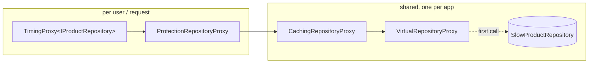

# 014 · Proxy & Lazy Loading

**Stack:** C# 12 / .NET 8 · **Level:** Intermediate · **Area:** Design patterns

A product catalog sits behind a deliberately slow repository: connecting costs ~800 ms and
every call ~150 ms. Four proxies, each implementing the same `IProductRepository` interface,
make it fast, safe and observable without changing a line of the real repository:

| Proxy | Kind | What it adds |
|---|---|---|
| `VirtualRepositoryProxy` | Virtual proxy / lazy loading | Connects only on the first call that needs the store. Concurrent first calls share one connection attempt, a failed attempt is retried, and disposal only touches a subject that was actually created. |
| `ProtectionRepositoryProxy` | Protection proxy | Permission checks per operation. Hides `CostPrice` from users without `ViewCost`, and stops those users from overwriting it. Denied calls cost no I/O. |
| `CachingRepositoryProxy` | Caching (smart) proxy | Read-through cache with TTL, LRU bound, negative caching, single-flight loading and invalidation on writes. |
| `TimingProxy<T>` | Dynamic proxy | Generated at runtime with `System.Reflection.DispatchProxy` for *any* interface. Times every call, including async ones, until the task completes. |

`CatalogComposition` wires them together in the one order that is correct (see below).

## Concepts demonstrated

| Concept | Where |
|---|---|
| Proxy pattern: same interface as the subject, transparent to callers | `Proxies/*`, `Domain/IProductRepository.cs` |
| Lazy initialisation that doesn't cache failures | `Lazy/AsyncLazy.cs` |
| Separation of concerns: the real repository knows nothing about users, caching or metrics | `Infrastructure/SlowProductRepository.cs` |
| Cache stampede protection (single flight) | `Caching/ReadThroughCache.cs` |
| Race-free invalidation of in-flight loads | `ReadThroughCache.LoadAsync` (`IsCurrent` check) |
| Runtime code generation / interception | `Dynamic/TimingProxy.cs` |
| Composition root and why decorator order matters | `CatalogComposition.cs` |
| Immutability for safely shared cached objects | `Domain/Product.cs`, read-only cached lists |
| Testable time and latency (`TimeProvider`, `ILatency`) | `Infrastructure/ILatency.cs`, `tests/TestDoubles/ManualTimeProvider.cs` |

## Architecture



`ForUser(user)` builds the cheap per-request part. The cache and the virtual proxy are shared.

## Design decisions and trade-offs

**Protection sits outside the cache.** The cache is shared and stores *unredacted* products.
Redaction happens per user on the way out. If the order were reversed, whichever user
loaded a product first would decide what everyone else sees: an admin's read would leak
cost prices to shoppers, or a shopper's read would hide them from admins.
`CompositionTests.The_shared_cache_holds_full_products_and_each_user_gets_their_own_view`
pins this down. *Trade-off:* redaction runs on every hit (it's a cheap copy of one record).

**Caching sits outside the virtual proxy**, so cache hits never force a connection, and
**timing is outermost**, so it measures what the caller experiences, denied calls included.

**`AsyncLazy<T>` instead of `Lazy<Task<T>>`.** `Lazy<Task<T>>` caches a faulted task forever,
so one network blip during start-up would break the repository for the life of the process.
`AsyncLazy` retries on the next call. A caller's `CancellationToken` only stops *that caller*
waiting; it never cancels the shared attempt others are waiting on.

**Single flight.** On a miss, the first caller puts a pending entry (a `TaskCompletionSource`)
in the map before it starts loading. Callers arriving meanwhile await that same task. In the
demo, 10 concurrent reads of an uncached category reach the store once (`Coalesced = 9`).
*Trade-off:* the shared load runs with `CancellationToken.None`, so it finishes and is cached
even if every caller gave up.

**Invalidation beats in-flight loads.** A load only stores its result if its entry is still
the current one. When a write invalidates a key while a read of it is in flight, the waiting
callers get the result, but it isn't cached. Without this check, a slow read that started
before a write could put the old value back in the cache for a full TTL.

**Coarse invalidation.** A write drops the product's own entry and *all* category lists,
because the product may have changed category. That is always correct and easy to reason
about. Targeted invalidation (old and new category only) would keep more of the cache warm,
but it needs the previous version of the product. Writes that bypass the proxy only show up
after one TTL. That is the usual weakness of an in-process cache.

**Negative caching is on by default** (`CacheOptions.CacheMisses`). It protects the store
from repeated lookups of ids that don't exist, at the cost of a newly created product being
invisible for up to one TTL if it was written through another path.

**Cost prices for writers who can't see them.** A merchandiser without `ViewCost` reads a
redacted product (cost `null`) and saves it back. The protection proxy reads `null` as
"unknown", not "clear", and keeps the stored cost, so a redacted write can't wipe data.
This costs one extra read per save, for those users only.

**Hand-written vs dynamic proxies.** The three static proxies are type-safe, easy to debug
and fast. `TimingProxy<T>` works for any interface, but it uses reflection per call, can't
be trimmed or AOT-compiled (`[RequiresDynamicCode]`), and only understands `Task`/`Task<T>`
for async timing (a `ValueTask` is timed until it is returned). That is fine for
cross-cutting concerns like metrics. Domain rules (caching, security) are clearer as
ordinary classes.

**One lock per cache.** The map and the LRU list share one lock, and loads always run
outside it. That is simple and correct, and good enough for a catalog. A hot multi-core
service would want a striped or lock-free cache.

## Project layout

```
src/CatalogProxies/
  Domain/            Product, ProductId, IProductRepository (the subject interface)
  Infrastructure/    SlowProductRepository (real subject), ILatency
  Lazy/              AsyncLazy<T>
  Proxies/           Virtual, Protection, Caching proxies
  Caching/           ReadThroughCache, CacheOptions, CacheStatistics
  Security/          CatalogPermissions, IUserContext, AccessDeniedException
  Dynamic/           TimingProxy<T> (DispatchProxy), invocation sinks
  CatalogComposition.cs
samples/CatalogProxies.Demo/   console walkthrough with real delays
tests/CatalogProxies.Tests/    49 tests (+ Shim/ for offline runs)
```

## Build, run and test

Requires the .NET 8 SDK.

```bash
dotnet build CatalogProxies.sln
dotnet test                               # xUnit, needs NuGet access
make test-offline                         # same tests, no NuGet needed
make demo                                 # or: dotnet run --project samples/CatalogProxies.Demo
```

The build treats warnings as errors and uses the `latest-recommended` analyzer set.

**Offline tests.** `tests/CatalogProxies.Tests/Shim/` holds a ~350-line, source-compatible
subset of xUnit (`[Fact]`, `[Theory]`/`[InlineData]`, the `Assert` methods this suite uses)
and a small runner with xUnit's lifecycle: a new class instance per test, disposed
afterwards. With `-p:OfflineTests=true` the test project builds as a console app against the
shim instead of the xUnit packages, so the same test files run where NuGet is blocked. This
project was built and verified that way: **49 passed, 0 failed**. Without the flag, the
shim is excluded and `dotnet test` uses real xUnit.

## Example output (`make demo`)

```
== Virtual proxy: nothing is connected until the first real call
  connected: False
  [timing] GetByIdAsync             967 ms  Succeeded
  sam sees Mechanical keyboard at $129.00, cost hidden
  connected: True

== Caching proxy: the same read again is served from memory
  [timing] GetByIdAsync               3 ms  Succeeded
  sam sees Mechanical keyboard at $129.00, cost hidden

== Protection proxy: one shared cache, a different view per user
  [timing] GetByIdAsync               0 ms  Succeeded
  ada sees Mechanical keyboard at $129.00, cost $61.00

== Single flight: 10 concurrent reads of an uncached category reach the store once
  [timing] ListByCategoryAsync      160 ms  Succeeded
  ... (x10, all ~160 ms: they all waited on the same load)

== Writes invalidate, and denied calls never reach the store
  [timing] SaveAsync                156 ms  Succeeded
  [timing] GetByIdAsync             150 ms  Succeeded
  sam sees Mechanical keyboard at $119.00, cost hidden
  [timing] SaveAsync                  2 ms  Faulted
  denied: User 'sam' needs WriteCatalog to change the catalog.

== Cache statistics
  CacheStatistics { Hits = 2, Misses = 3, Coalesced = 9, Evictions = 0, Invalidations = 2, ... }
  hit ratio: 79 %
```

## Example usage

```csharp
await using var catalog = new CatalogComposition(
    connect: async ct => await SlowProductRepository.ConnectAsync(seed, connectLatency, callLatency, ct),
    cacheOptions: new CacheOptions { TimeToLive = TimeSpan.FromMinutes(5), MaxEntries = 10_000 },
    sink: metricsSink);

// Per request, e.g. in middleware:
IProductRepository repo = catalog.ForUser(new StaticUserContext(user.Name, user.Permissions));
var product = await repo.GetByIdAsync(new ProductId("kb-100"), ct);
```

## Tests

49 tests, grouped by proxy: `AsyncLazyTests` (deferral, single run under contention,
retry after failure, cancellation isolation), `VirtualProxyTests`, `ProtectionProxyTests`
(a theory over every operation for denied users, redaction, cost preservation),
`CachingProxyTests` (TTL with a manual clock, negative caching, coalescing, failure
handling, invalidation, the in-flight-write race, LRU eviction, read-only lists),
`TimingProxyTests` (sync, async, faulted, cancelled) and `CompositionTests` (layer order,
end to end with the slow repository). Concurrency tests hold calls open with
`TaskCompletionSource` gates, not sleeps, so they are deterministic.

## Possible extensions

- **Ghost / value-holder lazy loading** for entity parts (e.g. load a product's reviews only
  when they're accessed), with a test that catches N+1 queries.
- **Remote proxy:** the same interface over HTTP with retries and a circuit breaker.
- **Stale-while-revalidate:** serve an expired entry once while refreshing it in the background.
- **Distributed invalidation** via pub/sub so several instances can share one store safely.
- A **source-generated** timing proxy (Roslyn incremental generator) that is AOT-friendly.
- Plug `TimingProxy` into `System.Diagnostics.Metrics` / OpenTelemetry instead of a custom sink.
