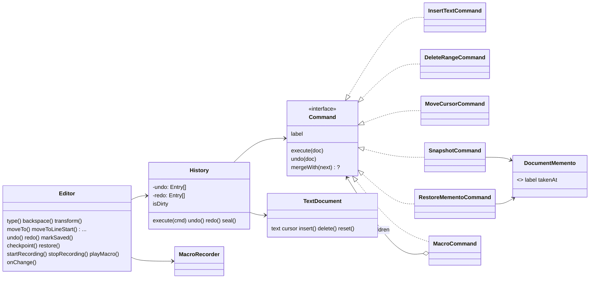

# 015 · Undoable Text Editor

A headless text-editor core in TypeScript built around the **Command pattern**: every edit is an object that knows how to apply and reverse itself. On top of that it has undo/redo stacks, word-level typing coalescing, recordable **macro commands**, and **memento** snapshots for edits that have no cheap inverse.

It has no UI. The `Editor` facade is the API a UI (terminal, DOM, VS Code-style webview) would call, and it emits change events through `onChange`.

## Concepts demonstrated

| Concept | Where | Notes |
|---|---|---|
| Command pattern | `src/commands/*` | `Command { execute, undo, label, mergeWith? }`. Inverse-operation commands store only what they need to reverse: inserted text, or the deleted text captured at execute time. |
| Invoker / caretaker | `src/history/History.ts` | Linear undo and redo stacks with a size limit. A new edit clears redo. A command that throws is never recorded. |
| Command coalescing | `InsertTextCommand.mergeWith`, `DeleteRangeCommand.mergeWith` | Adjacent keystrokes merge into one entry inside a time window (the clock is injected) and split at word boundaries. Repeated backspaces merge too. Moving the cursor, undo and save all *seal* the group. |
| Composite command (macro) | `src/commands/MacroCommand.ts` | Many commands form one history entry. `execute` is **transactional**: if child *N* fails, children *N-1..0* are rolled back before the error is rethrown. |
| Macro recording | `src/editor/MacroRecorder.ts` | Records *command factories*, not concrete commands, so positions are worked out again at playback. A macro recorded on line 1 works on line 7. |
| Memento | `src/document/Memento.ts` | Opaque, frozen snapshot objects. The real state lives in a module-private `WeakMap`, so callers can hold a memento but can't read or forge one. |
| Memento-backed command | `SnapshotCommand`, `RestoreMementoCommand` | Used for whole-document transforms (sort lines, replace all, upper case) and for undoable "restore checkpoint". |
| Facade + Observer | `src/editor/Editor.ts` | Turns user intents into commands and sends them through the history and the recorder. Listeners get an immutable `EditorState`. |
| Dirty tracking | `History.markSaved` / `isDirty` | Each entry has an id, and "saved" means "the top entry id at save time". So undoing back to the save point makes the document clean again. |

### Design decisions and trade-offs

- **Inverse operations vs. snapshots.** Inserts and deletes store O(edit size) undo data. Transforms store a whole-document memento, which is O(document size) per entry. That is simple and always correct, but it costs memory. The history `limit` caps the total cost.
- **Linear history, not an undo tree.** It is simpler and matches what most editors do. Edits made after an undo throw away the redo branch.
- **Macros are applied, then rolled back, then re-executed through `History`.** Each step has to see the document as the previous step left it. Doing a real dry run, rolling it back, and then executing a `MacroCommand` keeps a single "execute = record" path in `History` and reuses the macro's transactional guarantee. The cost is that playback does the work twice.
- **Cursor moves aren't undoable edits** (like most editors), but inside a macro they become `MoveCursorCommand`s so that undoing a macro also restores the cursor.
- **The document is a plain `string`.** That keeps the focus on the patterns. A production editor would use a piece table or rope (see *Extensions*). Only `TextDocument` would need to change.
- **Validation happens before mutation.** `TextDocument` checks ranges first, so a failing command never leaves a half-applied edit.

## Architecture



```
src/
  document/  TextDocument.ts (receiver)  Memento.ts (opaque snapshots)
  commands/  Command.ts + Insert/Delete/MoveCursor/Snapshot/RestoreMemento/Macro
  history/   History.ts (invoker: stacks, coalescing, limit, dirty tracking)
  editor/    Editor.ts (facade + observer)  MacroRecorder.ts
  demo.ts    scripted walkthrough
test/        document, commands (reversibility contract), history, editor
```

## Build, run, test

Requires Node 20+.

```bash
npm install
npm test          # tsc --noEmit (strict) + vitest: 41 tests
npm run demo      # build and run the scripted walkthrough
npm run build     # emit dist/
```

## Example

```ts
import { Editor, transforms } from "./src/index.js";

const editor = new Editor("one\ntwo\nthree");
editor.moveTo(0);

editor.startRecording("bullet");
editor.moveToLineStart();
editor.type("- ");
editor.moveToNextLine();
const bullet = editor.stopRecording();

editor.playMacro(bullet, 2);   // "- one\n- two\n- three"
editor.undo();                 // both playbacks undone in one step
const v1 = editor.checkpoint("v1");
editor.transform("Upper", transforms.upperCase);
editor.restore(v1);            // undoable rollback
```

`npm run demo` output (`|` is the cursor, `*` means unsaved changes):

```
type 'hello brave world'           "hello brave world|"  *
  undo stack: Type "hello " · Type "brave " · Type "world"
undo (removes one word)            "hello brave |"  *
redo                               "hello brave world|"  *
backspace ×2                       "hello brave wor|"  *
undo backspaces                    "hello brave world|"  *
save                               "hello brave world|"
split words onto lines             "hello⏎brave⏎world|"  *
record macro on line 1             "- hello⏎|brave⏎world"  *
play macro ×2 (one undo step)      "- hello⏎- brave⏎- world|"  *
  undo stack: Type "hello " · Type "brave " · Type "world" · Replace spaces · Type "- " · Macro "bulletize" ×2
sort + upper case                  "- BRAVE⏎- HELLO⏎- WORLD|"  *
restore checkpoint                 "- hello⏎- brave⏎- world|"  *
undo the restore                   "- BRAVE⏎- HELLO⏎- WORLD|"  *
undo back to save point (clean)    "hello brave world|"
  redo stack (next first): Replace spaces · Type "- " · Macro "bulletize" ×2 · Sort lines · Upper case · Restore "bullets"
```

## Testing approach

- A shared **reversibility contract** test (`assertReversible`) checks every command type: execute → undo gives back the exact text *and* cursor, and redo gives back the post-execute state.
- History tests inject a fake clock to check the merge window without sleeping.
- Failure paths are covered: invalid ranges, forged mementos, macro steps that fail partway (the document is left untouched), and recorder misuse.

## Possible extensions

- A piece-table or rope `TextDocument` for large files (no change to the command layer).
- An undo *tree* (like Vim's `:undotree`) instead of a linear stack.
- Selections and multi-cursor editing, with commands that carry a list of ranges.
- Serializable commands, so history can survive a reload or sync between collaborators (a stepping stone to OT/CRDTs).
- Periodic memento checkpoints plus command replay, to bound undo memory on long sessions.
