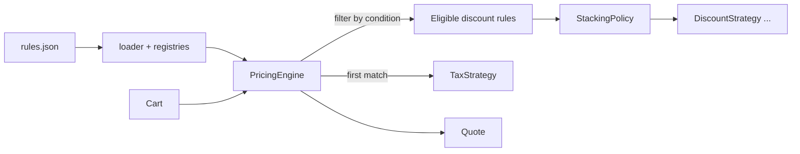

# Strategy Pricing Engine

Prices a shopping cart using pluggable discount and tax strategies. Declarative rules
(plain JSON or Python) decide which strategies apply to a given cart, and every quote
itemises what each rule did.

## Concepts and design decisions

| Concept | Where | Trade-off |
| --- | --- | --- |
| **Strategy pattern** | `DiscountStrategy` / `TaxStrategy` protocols | Many small classes, but each pricing formula is isolated and tested alone. Structural typing means strategies need no base class. |
| **Open/closed principle** | `StrategyRegistry` | Registering a new `type` requires no engine change (see `test_new_strategy_needs_no_engine_change`). The cost is string keys, checked at load time rather than by a type checker. |
| **Decorator** | `CategoryScoped` | Any strategy can be limited to categories without containing scoping code. |
| **Composable predicates** | `all_of`, `any_of`, `negate` in `rules.py` | Plain functions are lightweight; the JSON layer gives non-developers the same power. |
| **Stacking as a strategy** | `Sequential`, `BestForCustomer` | Combination is a business decision, so it is swappable too. `BestForCustomer` compares each discount alone, so it does not search for the best combination. |
| **Pure core** | `PricingEngine.quote` | The order date is an input, not a clock read, so quotes are deterministic and replayable. |
| **Exact money** | `Decimal`, `allocate_pro_rata` | Floats are refused at the boundary. Fixed discounts use largest-remainder allocation so line amounts sum to the exact total. |
| **Fail closed** | `NoTaxRuleError`, unknown-key checks | An unmatched region raises instead of charging no tax, and a typo like `categoris` is an error rather than a discount silently widened to the whole cart. Exemptions must be explicit (`{"type": "none"}`). |
| **Contract enforcement** | `run_discount`, `_compute_tax` | Third-party strategies returning negative or wrong-length results raise `StrategyError`. Over-large discounts are capped at the line's price, so a net price is never negative. |

Other decisions worth knowing:

- Discounts run before tax, and tax is computed per line because rates vary by category.
  Some jurisdictions require tax rounding on the invoice total, which would be a new
  `TaxStrategy`.
- Percentages round per line (half up), so a percentage off a whole cart may differ by a
  cent from one computed on the order total. In exchange, every line is self-consistent,
  which refunds of a single line need.
- There is one implied currency. See project 004 for a multi-currency `Money` type.

## Architecture



```
src/pricing_engine/
  models.py     Cart, LineItem, Quote and money arithmetic
  discounts.py  PercentageOff, FixedAmountOff, BuyXGetYFree, VolumeTiers, CategoryScoped
  taxes.py      NoTax, FlatRateTax, CategoryRateTax
  rules.py      Rule and condition combinators
  stacking.py   Sequential, BestForCustomer
  engine.py     orchestration only
  loader.py     JSON to objects, with strict validation
  cli.py        command line and receipt rendering
```

## Build, run and test

Requires Python 3.11+. There are no runtime dependencies.

```bash
python -m venv .venv && source .venv/bin/activate
pip install -e '.[test]'

pytest                # unit tests and Hypothesis property tests
pricing-engine --rules examples/rules.json --cart examples/cart.json
pricing-engine --rules examples/rules.json --cart examples/cart.json --json
```

Example output:

```
SKU            QTY     GROSS     DISC     TAX     TOTAL
PEN-BLUE        60     90.00    27.54    5.15     67.61
BOOK-DDIA        3    135.00    61.52    0.00     73.48
MUG-LOGO         1     12.99     2.39    0.87     11.47

Subtotal                          237.99
  Bulk pens                       -13.50
  Book bundle 3-for-2             -45.00
  Gold members 10% off            -17.95
  Black Friday coupon             -15.00
Tax (Texas sales tax)               6.02
Total                             152.56
```

Using it from Python:

```python
from decimal import Decimal
from pricing_engine import PricingEngine, Rule
from pricing_engine.discounts import PercentageOff
from pricing_engine.rules import always, tier_in
from pricing_engine.taxes import FlatRateTax

engine = PricingEngine(
    discount_rules=[Rule("Gold 10%", tier_in("gold"), PercentageOff(Decimal(10)))],
    tax_rules=[Rule("VAT", always, FlatRateTax(Decimal(20)))],
)
```

## Rule format

- **Strategies:** discounts are `percentage`, `fixed`, `buy_x_get_y` and `volume`, each
  accepting optional `categories`. Taxes are `none`, `flat` and `category_rate`.
- **Conditions:** `tier`, `region`, `coupon`, `min_subtotal`, `between`, combined with
  `all`, `any` and `not`. A rule without `when` always matches.
- **Priority:** lower runs first, default 100. All eligible discounts are considered, but
  only the first matching tax rule applies.

## Possible extensions

- Exhaustive search for the best discount combination, or exclusivity groups
- Cross-line promotions, such as a free item with another product
- Effective-dated rule sets with versioned, auditable quotes
- Multi-currency carts and tax-inclusive pricing
