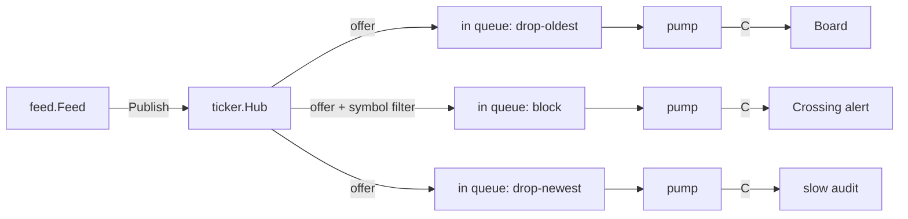

# 017 · Observer Stock Ticker

**Stack:** Go 1.22+ (standard library only) · **Level:** Starter · **Area:** Design patterns

An in-process pub/sub hub for stock quotes. A simulated feed publishes prices; observers subscribe,
filter by symbol, and unsubscribe at any time. Each observer chooses what happens when it falls
behind: make the publisher wait, lose the oldest quote, or lose the newest.

| Concept | Problem it solves here | Where |
|---|---|---|
| **Observer pattern** | The feed knows nothing about who consumes prices | `ticker.Observer`, `observer/` |
| **Channels as the transport** | Subscribers run at their own pace on their own goroutines | `ticker/subscription.go` |
| **Backpressure policies** | Falling behind is an explicit, per-subscriber decision | `ticker.OverflowPolicy` |
| **Single-sender channel ownership** | Unsubscribing can never cause a "send on closed channel" panic | `Subscription.pump` |
| **Copy-on-write subscriber list** | A blocked publisher holds no lock, so a stuck subscriber can always cancel | `ticker/hub.go` |
| Context cancellation | A publisher stuck behind a `Block` subscriber can give up | `Hub.Publish` |
| Dependency inversion | `feed` needs only a one-method `Publisher`, so tests use a stub | `feed/feed.go` |
| Integer money | Threshold comparisons are exact | `ticker.Cents` |

## Architecture



```go
hub := ticker.NewHub()
defer hub.Close()

sub, err := hub.Subscribe(ticker.Options{Buffer: 8, Policy: ticker.DropOldest, Symbols: []string{"ACME"}})
if err != nil { /* invalid options or closed hub */ }
defer sub.Cancel()

go sub.Notify(ticker.ObserverFunc(func(q ticker.Quote) { fmt.Println(q.Symbol, q.Price) }))
err = hub.Publish(ctx, ticker.Quote{Symbol: "ACME", Price: 18705, Seq: 1, At: time.Now()})
```

## Design decisions and trade-offs

| Policy | Publisher when full | Consumer sees | Suits | Cost |
|---|---|---|---|---|
| `Block` (zero value) | waits, up to `ctx` | every quote | audit trails, alerts | one slow consumer stalls the feed and everyone behind it |
| `DropOldest` | evicts and continues | gaps, but the latest quote | price displays | history is lost |
| `DropNewest` | discards and continues | gaps, older quotes first | contiguous prefix after a burst | data goes stale under sustained load |

- **Every loss is counted.** `Stats().Dropped` makes lossy behaviour observable; the tests assert
  that received + dropped equals published.
- **A pump goroutine per subscriber** costs one goroutine and one extra hop. In exchange, publishers
  only send on a channel that is never closed, and `Cancel` can close the consumer's channel safely.
  The pump holds one quote while waiting, so effective capacity is `Buffer + 1`.
- **Fan-out is sequential**, in subscription order. It keeps `Publish` simple, but a `Block` subscriber delays those after it. If `ctx` expires mid-fan-out, earlier subscribers
  already have the quote; there is no all-or-nothing delivery.
- **Copy-on-write** makes subscribe and cancel O(n) so that `Publish` holds only a brief read
  lock, never during delivery. Subscriptions change far less often than prices.
- **`Cancel` discards queued quotes** instead of draining them: a consumer that has left should not
  have to keep reading. `Hub.Close` is the same, so shutdown is prompt but not lossless.
- **Ordering is per publisher.** Concurrent publishers may interleave.
- **The queue is per subscriber, not per symbol.** Under `DropOldest`, a burst across symbols can
  evict one symbol's only quote, so size the buffer to hold a full round. The demo does this.

## Build, run, test

```sh
make test   # go test ./...
make race   # go test -race -count=1 ./...
make run    # go run ./cmd/tickerdemo
go run ./cmd/tickerdemo -duration 5s -interval 2ms -slow 80ms -seed 9
```

The tests cover each overflow policy, cancellation while a publisher is blocked, shutdown, and a
concurrent subscribe/publish/cancel run that checks for goroutine leaks under `-race`.

## Example output

Counts vary slightly between runs because the observers race the feed.

```text
SYMBOL      LAST
ACME        193.64
GLOBO       42.60
INITECH     95.56

OBSERVER    POLICY       BUFFER  DELIVERED  DROPPED
board       drop-oldest  3       1197       0
alert       block        64      400        0
slow-audit  drop-newest  8       50         1141

alerts: 24
  ACME rose to 187.45 (seq 853)
  ACME fell below 187.29 (seq 886)
  ACME rose to 187.42 (seq 907)
```

## Possible extensions

- Per-symbol conflation, so "latest value wins" holds for each symbol independently.
- A policy that disconnects a subscriber once it has dropped too many quotes.
- Replay of the last N quotes for late joiners.
- Metrics export for queue depth and per-subscriber lag.
