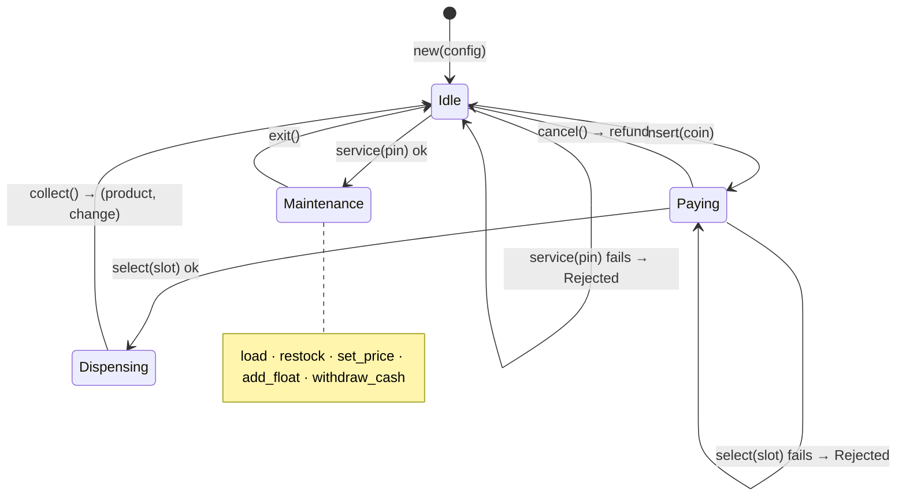

# 018 · State Machine Vending

**Stack:** Rust 2021 (standard library only, no dependencies) · **Level:** Intermediate · **Area:** Design patterns

A vending machine built with the **type-state pattern**. The machine's state is part of its type
(`VendingMachine<Idle>`, `VendingMachine<Paying>`, …). Each state has only the methods that make sense
in it, and every transition consumes the old machine and returns a new one. So "select before paying",
"restock while a customer has money in", or "collect the same vend twice" are **compile errors**, not
runtime checks.

Around that core sits a realistic money model: integer cents, coins held in escrow until a vend, and
exact change-making with a limited number of each coin. A small CLI shows how untyped user input is
bridged into the typed core.

| Concept | Problem it solves here | Where |
|---|---|---|
| **Type-state pattern** | Illegal transitions cannot be written down | `src/machine.rs` |
| **Move semantics as protocol** | A consumed state can't be reused (no double dispense) | `collect(self)`, `select(self, …)` |
| **Sealed trait** | Outside code can't invent a new state or forge transitions | `machine::State` |
| **Private fields + single constructor** | Every machine starts `Idle`; no state can be built directly | `VendingMachine::new` |
| **Failure returns ownership** | A rejected vend hands the machine (and the customer's money) back | `error::Rejected<M, E>` |
| **Validate, then commit** | A failed vend changes nothing | `check_vend` / `commit_vend` |
| **Bounded change-making (DP)** | Correct change with finite coins, where greedy fails | `CoinBag::make_change` |
| **Newtype money** | Prices can't be mixed up with counts; arithmetic is exact | `money::Cents` |
| **Typed core, untyped edge** | Runtime input meets compile-time rules in one place | `src/session.rs` |
| `compile_fail` doctests | The compile-time guarantees are themselves tested | docs in `src/machine.rs` |

## State diagram



## The core idea in code

```rust
pub struct VendingMachine<S: State> { core: Core, state: S }   // fields are private

impl VendingMachine<Idle> {
    pub fn insert(self, coin: Coin) -> VendingMachine<Paying> { … }
    pub fn service(self, pin: u32) -> Result<VendingMachine<Maintenance>, Rejected<Self, ServiceError>> { … }
}

impl VendingMachine<Paying> {
    pub fn select(self, slot: SlotId) -> Result<VendingMachine<Dispensing>, Rejected<Self, VendError>> { … }
    pub fn cancel(self) -> (VendingMachine<Idle>, CoinBag) { … }
}
```

Each state's data lives in the state itself. Only `Paying` has an `escrow`, and only `Dispensing` has
a `product` and `change`, so there is no `Option<Product>` that might be `None` at the wrong moment.

### What fails to compile

These are `compile_fail` doctests in `src/machine.rs`, so `cargo test` runs them:

| Attempt | Error |
|---|---|
| `VendingMachine::new(cfg).select(a1)` | `E0599`: no method `select` on `VendingMachine<Idle>` |
| `paying.restock(a1, 1)` | `E0599`: no method `restock` on `VendingMachine<Paying>` |
| `d.collect(); d.collect();` | `E0382`: use of moved value |
| `VendingMachine::<Maintenance> { core, state }` | `E0451`: private fields |
| `impl State for Hacked {}` | `E0277`: `Sealed` is not implemented |

Stable `rustdoc` only checks that a `compile_fail` block fails, not which error it fails with. A typo
could make a block fail for the wrong reason and still pass. `make verify`
(`scripts/verify_compile_fail.py`) compiles each block and checks it fails with exactly the error
code it lists.

## Design decisions and trade-offs

**Fallible transitions return the machine.** `select` consumes `self`. If it returned
`Result<Dispensing, VendError>`, a failed vend would drop the machine and the escrowed coins with it.
`Rejected { machine, error }` keeps ownership linear: every path out of a transition yields exactly one
machine. `Rejected` implements `std::error::Error`, so it still works with `?`.

**Validate, then commit.** `check_vend` is a pure `&self` function that checks the slot, stock, credit
and whether change can be made. Only then does `commit_vend` touch anything. So the "change was
impossible but the item already dropped" bug can't happen. The `expect`s in `commit_vend` state
invariants that the check already proved.

**Change from the customer's own coins.** Feasibility is checked against float plus escrow. With an
empty float, six quarters for a $1.25 item still works: one of the customer's quarters comes back.

**Exact change-making.** Greedy (largest coin first) is optimal for unlimited US coins but not for a
real cash box: with one quarter and three dimes, greedy can't make 30¢, but 3 × 10¢ can. `make_change`
solves the bounded problem with a 0/1-knapsack DP over individual coins, O(coins × amount). That's
trivially cheap at vending-machine scale.

**Typed core, untyped edge.** A REPL can't know the state at compile time, so `session::AnyMachine` is
an enum with one variant per state. Each match arm holds a concretely typed machine, so the compiler
still enforces the rules inside each arm. "Not allowed now" can only come from a single fallback arm.
This is the usual shape of type-state in practice: strong guarantees in the domain, one explicit
dynamic dispatch at the boundary.

**Trade-offs of type-state**

- ✅ Whole classes of bugs are unrepresentable, and the API documents itself: autocomplete only shows
  legal moves.
- ✅ Zero runtime cost: the state markers are zero-sized (or hold exactly the state's data).
- ❌ You can't store machines in different states in one `Vec` without an enum wrapper like `AnyMachine`.
- ❌ Transitions that depend on runtime data (`select` might fail) still need `Result`. Type-state
  removes *protocol* errors, not *business* errors.
- ❌ More types and boilerplate than a `match self.state` enum. For a machine with dozens of states, a
  table-driven runtime FSM may be easier to maintain.

## Project layout

```
src/
  money.rs      Cents newtype, Coin enum, dollar parsing
  coins.rs      CoinBag with bounded change-making
  inventory.rs  SlotId, Product, Inventory with capacity and price rules
  error.rs      InventoryError, VendError, ServiceError, Rejected<M, E>
  machine.rs    the type-state core and compile_fail doctests
  command.rs    text → Command parsing
  session.rs    AnyMachine: runtime enum over typed states
  main.rs       REPL / scripted CLI
tests/
  customer_journeys.rs   end-to-end flows and money conservation
  cli.rs                 runs the binary against examples/demo.txt
scripts/verify_compile_fail.py
```

## Build, run, test

Requires Rust 1.75+ (`rustup` stable). No crates are downloaded.

```bash
cargo test                 # 32 unit + 5 integration + 6 doctests (5 compile_fail)
make lint                  # rustfmt + clippy -D warnings
make verify                # compile_fail blocks fail with the documented error codes
cargo run -- --demo        # interactive, pre-stocked
make demo                  # scripted run of examples/demo.txt
VENDING_PIN=9999 cargo run -- --demo
```

## Example output

`make demo` (abridged):

```
> select A1
✗ cannot select a product while idle
> insert dollar
credit $1.00
> select A1
✗ price is $1.25 but credit is only $1.00
> insert quarter
credit $1.25
> select A1
dispensed Cola; change: no coins — type 'take'
> service 1234
✗ cannot open the service panel while dispensing
> take
you took Cola and no coins
...
> withdraw
withdrew 1×dollar, 10×quarter, 11×dime, 10×nickel ($5.10)
> exit
service panel closed
> insert $
> insert $
> select C1
✗ cannot return $1.60 in change; please use exact change (credit $2.00)
> cancel
returned 2×dollar ($2.00)
```

Emptying the cash box leaves the machine unable to give change, and it refuses the sale without
taking the money.

## Possible extensions

- A `Faulted` state (jammed coin mech) reachable from any state, using a generic `impl<S: State>`.
- Card payments as a second `Paying` flavor: `Paying<Cash>` vs `Paying<Card>` via a type parameter.
- Persist sales and the cash-box audit to a file between runs.
- A property-based test (e.g. `proptest`) showing money is conserved across random command sequences.
- Make the PIN a hashed secret with lockout after N failed attempts.
