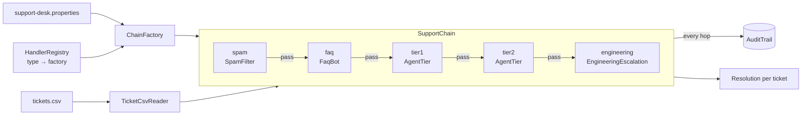

# 019 · Chain of Responsibility Support Desk

**Stack:** Java 21 (sealed interfaces, records, pattern-matching `switch`, Maven, JUnit 5) · **Level:** Starter · **Area:** Design patterns

A support-ticket router built on the **Chain of Responsibility** pattern. Each ticket visits an
ordered chain of handlers (spam filter → FAQ bot → Tier 1 → Tier 2 → engineering) until one of them
takes it. The chain is assembled from a properties file, so the order, the handlers and their rules
are configuration rather than code, and every hop is written to an **audit trail** that says not
only who took a ticket but *why everyone before them passed*.

| Concept | Problem it solves here | Where |
|---|---|---|
| **Chain of Responsibility** | Senders don't need to know which tier can handle a ticket | `chain/SupportChain`, `chain/SupportHandler` |
| **Sealed decision type** | A handler must either take the ticket or give a reason to pass; the `switch` is exhaustive | `chain/Decision` |
| **Central forwarding (pipeline flavour)** | Handlers can't forget to call `next`, and auditing/fault isolation live in one place | `SupportChain.process` |
| **Fault isolation** | A handler that throws is logged as `FAILED` and skipped; the ticket is never lost | `SupportChain.process` |
| **Registry + factories (Open/Closed)** | New handler types plug in without touching the chain or config parser | `config/HandlerRegistry` |
| **Fail-fast configuration** | Unknown types, bad values and *misspelt keys* stop startup with the key named | `config/ChainFactory`, `config/HandlerSettings` |
| **One class, many instances** | Tier 1 and Tier 2 are the same `AgentTier` with different data | `handlers/AgentTier` |
| **Lock-free capacity** | A full queue overflows to the next tier, correctly under concurrency | `AgentTier.tryReserveSlot` |
| **Injected `Clock` and `AuditTrail`** | Deterministic tests; storage is swappable | `SupportChain` constructor |
| **Composition root** | Only the CLI knows how the pieces are wired | `SupportDeskCli` |

## Architecture



The interfaces are tiny:

```java
public interface SupportHandler {
    String name();
    Decision handle(Ticket ticket);          // never calls another handler
}

public sealed interface Decision {
    record Handled(Outcome outcome, String message) implements Decision {}
    record Pass(String reason) implements Decision {}
}
```

and the chain's loop is the whole pattern:

```java
for (SupportHandler handler : handlers) {
    Decision decision;
    try { decision = handler.handle(ticket); }
    catch (RuntimeException e) { record(FAILED, e); continue; }   // isolate broken handlers
    switch (decision) {
        case Decision.Handled h -> { record(HANDLED, h); return resolution(h); }
        case Decision.Pass p    -> record(PASSED, p.reason());
    }
}
record(UNHANDLED); return unhandled(ticket);
```

## Design decisions and trade-offs

**Pipeline vs. linked handlers.** The textbook version gives each handler a `next` reference and
has it call `next.handle()` when it can't help. Here the chain object does the forwarding instead.

- *Gained:* handlers can't break the chain by forgetting to forward; auditing, error handling and
  ordering are written once; handlers are pure rules you can unit-test without wiring a successor;
  reordering is a config edit.
- *Lost:* a handler can't do "around" work such as timing the rest of the chain or changing the
  ticket before passing it on. If that were needed, the [Decorator middleware pipeline](../010-decorator-middleware-pipeline/)
  shape (handler receives `next`) is the better fit. A support desk *routes*; it doesn't wrap, so
  the simpler shape wins.

**`Pass` must carry a reason.** It costs one string per handler, and it turns the audit trail from
"T-109 went to engineering" into a full explanation: category not covered by Tier 1, CRITICAL
above Tier 2's limit, and so on. That is what you need when a customer asks why they were escalated.

**Tickets are immutable.** Handlers report through their `Decision` and never annotate the ticket,
so no handler can quietly change what a later handler sees.

**Stateful handler, explicitly.** `AgentTier` keeps a queue counter, so a chain instance has state.
The counter uses `AtomicInteger.getAndUpdate`, and a test pushes 200 tickets from 16 threads into
a capacity-10 tier and checks that exactly 10 are accepted. In a real system the counter would live
in the queue service; the handler would ask it rather than count.

**A catch-all at the end.** `EngineeringEscalation` accepts everything, which guarantees no ticket
falls off the end. The chain still handles the "nobody took it" case (`UNHANDLED` plus an audit
entry) because configuration is allowed to leave the catch-all out.

**Misspelt settings are errors.** `HandlerSettings` remembers every key a factory read. Anything
left over under `<name>.` is reported, so `tier1.capacty = 3` fails at startup instead of silently
meaning "unlimited". The trade-off is that a factory must read every setting it supports, even
optional ones, which the defaults-with-fallback accessors make easy.

**Properties, not YAML.** `java.util.Properties` needs no dependency. It doesn't keep key order, so
FAQ answers are matched in sorted key order, which is documented and deterministic.

## Configuration

```properties
chain = spam, faq, tier1, tier2, engineering      # visiting order

spam.type = spam-filter
spam.blocked-phrases = free money, crypto giveaway

faq.type = faq-bot
faq.max-severity = LOW                             # bots don't answer outages
faq.answer.invoice = Invoices are under Billing > History.

tier1.type = agent-tier
tier1.display-name = Tier 1
tier1.categories = ACCOUNT, BILLING
tier1.max-severity = MEDIUM
tier1.capacity = 3                                 # 0 or absent = unlimited

engineering.type = engineering-escalation
engineering.page-at = CRITICAL
```

| Type | Settings |
|---|---|
| `spam-filter` | `blocked-phrases` (comma list) |
| `faq-bot` | `max-severity` (default `LOW`), `answer.<keyword>` (one per FAQ) |
| `agent-tier` | `categories` (required), `display-name`, `max-severity` (default `MEDIUM`), `capacity` (default unlimited) |
| `engineering-escalation` | `page-at` (default `CRITICAL`) |

The full default is in [`src/main/resources/support-desk.properties`](src/main/resources/support-desk.properties).

## Build, run, test

Requires JDK 21.

```bash
mvn test                                           # compile with -Xlint:all -Werror, run 55 tests
mvn -q package -DskipTests
java -jar target/support-desk-1.0.0.jar --audit    # bundled config + sample tickets
java -jar target/support-desk-1.0.0.jar --config=my-desk.properties tickets.csv
```

Without Maven, or offline, `./run-tests.sh [dir-with-junit-jars]` compiles with `javac` and runs
the suite through the JUnit Platform console launcher (jars from `apt install junit5`, default
`/usr/share/java`). That is how the suite was run for this commit, since Maven Central was not
reachable from the build environment: **55 tests, all passing.**

Ticket files are CSV with the header `id,customer,category,severity,subject,body`; quoted fields
may contain commas and `""` escapes. Exit codes: `0` success, `1` usage error, `2` bad config or
ticket file.

## Example output

From [`examples/demo.txt`](examples/demo.txt) (timestamps shortened):

```
Chain: spam -> faq -> tier1 -> tier2 -> engineering

TICKET   OUTCOME        HANDLED BY     MESSAGE
T-101    AUTO_RESOLVED  faq            Reset it from the sign-in page via "Forgot password?"; the link is valid for 30 minutes.
T-102    REJECTED       spam           blocked phrase 'free money'
T-103    AUTO_RESOLVED  faq            Invoices are under Billing > History, where each one can be downloaded as a PDF.
T-104    ASSIGNED       tier1          assigned to Tier 1 queue
T-105    ASSIGNED       tier1          assigned to Tier 1 queue
T-106    ASSIGNED       tier1          assigned to Tier 1 queue
T-107    ASSIGNED       tier2          assigned to Tier 2 queue
T-108    ASSIGNED       tier2          assigned to Tier 2 queue
T-109    ESCALATED      engineering    paged on-call engineer (CRITICAL)
T-110    ESCALATED      engineering    filed engineering bug report

Summary: 10 tickets, REJECTED=1, AUTO_RESOLVED=2, ASSIGNED=5, ESCALATED=2

Audit trail:
  ...
  18:43:39Z  T-107    tier1          PASSED    queue full (3/3)
  18:43:39Z  T-107    tier2          HANDLED   ASSIGNED: assigned to Tier 2 queue
  ...
  18:43:39Z  T-109    faq            PASSED    severity CRITICAL above bot limit LOW
  18:43:39Z  T-109    tier1          PASSED    category TECHNICAL not covered
  18:43:39Z  T-109    tier2          PASSED    severity CRITICAL above tier limit HIGH
  18:43:39Z  T-109    engineering    HANDLED   ESCALATED: paged on-call engineer (CRITICAL)
```

A typo in the config is caught before any ticket is processed:

```
$ java -jar target/support-desk-1.0.0.jar --config=bad.properties
config error: unknown setting(s) for handler 'tier1': tier1.capacty
```

## Project layout

```
src/main/java/dev/omar/supportdesk/
├── SupportDeskCli.java          composition root, argument parsing, output
├── domain/                      Ticket, Category, Severity, Outcome, Resolution
├── chain/                       SupportHandler, Decision (sealed), SupportChain
├── handlers/                    SpamFilter, FaqBot, AgentTier, EngineeringEscalation
├── audit/                       AuditTrail, InMemoryAuditTrail, AuditEntry, AuditStep
├── config/                      ChainFactory, HandlerRegistry, HandlerSettings, HandlerFactory
└── io/                          TicketCsvReader, TicketParseException
src/main/resources/              default config and sample tickets
src/test/java/...                one test class per package, plus an end-to-end CLI test
```

## Possible extensions

- **Persistent audit trail:** a JDBC `AuditTrail` writing to an append-only table, plus a
  `--trace=T-109` CLI option that prints one ticket's journey.
- **Business-hours routing:** a handler that passes outside office hours, using the injected `Clock`.
- **Re-entry on agent reply:** feed "customer replied" events back into the chain starting at the
  handler that owns the ticket.
- **Metrics:** count `PASSED` reasons per handler to find tiers that are always full or rules that
  never match.
- **Hot reload:** rebuild the chain when the properties file changes, swapping it atomically.
