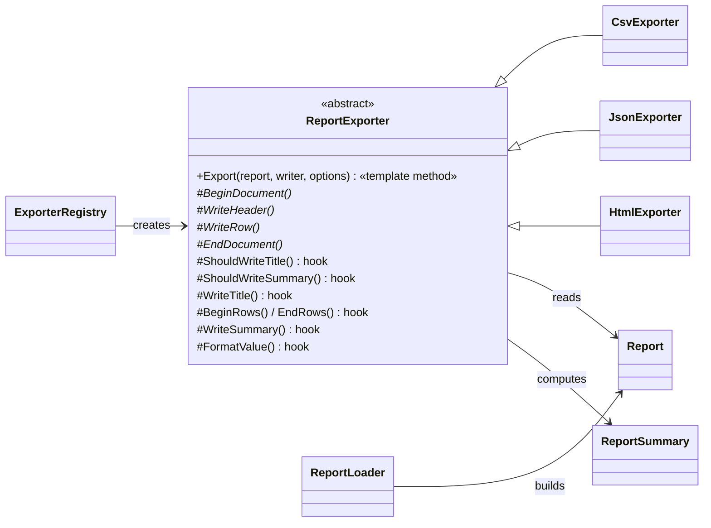

# 020 · Template Method Report Generator

**Stack:** C# 12 / .NET 8 (class library + console app, xUnit) · **Level:** Starter · **Area:** Design patterns

A command-line tool that turns a CSV file into a **CSV, JSON or HTML report**. All three exporters
share one algorithm — open the document, maybe write a title, write the header, write each row,
maybe write totals, close the document — implemented once as a **Template Method** in an abstract
base class. Each format supplies only the steps that differ, and opts in or out of optional steps
through **hook methods**.

```text
$ report-gen examples/sales.csv --title "Q3 Sales" --format html -o sales.html
Wrote 5 rows as html to sales.html
```

| Concept | Problem it solves here | Where |
|---|---|---|
| **Template Method** | The step order and the summary arithmetic are written once and can't drift between formats | `ReportExporter.Export` |
| **Primitive operations** (`abstract`) | The compiler forces each format to supply the steps that have no sensible default | `BeginDocument`, `WriteHeader`, `WriteRow`, `EndDocument` |
| **Hook methods** (`virtual`, default provided) | Formats customise optional behaviour without copying the algorithm | `ShouldWriteTitle/Summary`, `WriteTitle`, `BeginRows/EndRows`, `WriteSummary`, `FormatValue` |
| **Hollywood Principle** | "Don't call us, we'll call you": subclasses never drive the flow, so they can't forget a step | Every exporter |
| **Non-virtual public entry point** | C# methods are sealed by default; `Export` can't be overridden and reordered | `ReportExporter` |
| **Validate once, at the edge** | `Report` rejects ragged rows and wrongly-typed cells on construction, so exporters trust their input | `Model/Report.cs` |
| **Type inference** | Plain CSV in, typed numbers and dates out, using the narrowest type that fits every cell | `Input/ReportLoader.cs` |
| **Registry (Open/Closed)** | A new format is one subclass plus one `Register` call | `ExporterRegistry` |
| **Output encoding** | HTML-encodes everything; JSON and CSV escape per their specs. Report data is treated as untrusted | `HtmlExporter`, `JsonExporter`, `CsvExporter.Escape` |
| **Composition root** | Only `Program.cs` knows about files, the console and exit codes | `ReportGenerator.Cli` |

## Architecture



The template is the whole pattern, and it fits on one screen:

```csharp
public void Export(Report report, TextWriter writer, ExportOptions? options = null)
{
    BeginDocument(report, writer);
    if (ShouldWriteTitle(options)) WriteTitle(report.Title, writer);
    WriteHeader(report.Columns, writer);
    BeginRows(writer);
    for (var i = 0; i < report.Rows.Count; i++) WriteRow(report.Columns, report.Rows[i], i, writer);
    EndRows(report.Rows.Count, writer);
    if (ShouldWriteSummary(options)) WriteSummary(report.Columns, ReportSummary.Compute(report), writer);
    EndDocument(report, writer);
}
```

### How each format uses the hooks

| Hook | CSV | JSON | HTML |
|---|---|---|---|
| `ShouldWriteTitle` / `ShouldWriteSummary` | **overridden → always false** (extra lines would break parsers) | default (follows options) | default (follows options) |
| `WriteTitle` | – | `"title": …` | `<h1>` |
| `BeginRows` / `EndRows` | – | opens/closes `"rows": [ ]` | `<tbody>` |
| `WriteSummary` | – | `"summary": { rowCount, totals }` | `<tfoot>` row |
| `FormatValue` | default: invariant, lossless (`5400.00`, `2026-07-03`) | default for text/dates; numbers stay JSON numbers | **overridden**: `5,400.00`, `3 Jul 2026` |

## Design decisions and trade-offs

- **Inheritance on purpose.** Template Method is the inheritance-based sibling of Strategy (project 016).
  It suits this problem because the *skeleton* is the valuable shared part and the variations are small
  and numerous. The cost is coupling: subclasses depend on the base class's protected contract, so
  changing a hook's signature touches every format. Strategy would allow mixing parts at run time
  (e.g. HTML layout with CSV formatting), which nobody here needs.
- **Hooks with defaults vs. abstract steps.** Only the four steps every format truly needs are
  abstract. Making `WriteTitle` abstract would force CSV to write an empty method that means "I have
  no title" — the boolean `ShouldWriteTitle` hook says that more honestly and keeps the decision visible.
- **Summary computed by the template.** `ReportSummary.Compute` runs in `Export`, not in subclasses, so
  totals are identical in every format. The subclass only decides how to *display* them.
- **`rowIndex` and `rowCount` are passed in.** A streaming JSON writer needs to know where commas go;
  passing that information in keeps `JsonExporter` stateless and safe to reuse (there's a test for it).
- **Streaming to a `TextWriter`.** Exporters never build the whole document in memory and work equally
  with a file, stdout or a `StringWriter` in tests. The trade-off is that a format which needs to see
  all rows before writing (e.g. column widths for a fixed-width text table) would have to buffer itself.
- **Hand-written JSON rather than `JsonSerializer` on a DTO.** That would be simpler for JSON alone,
  but it would bypass the template and defeat the point. String escaping still goes through
  `System.Text.Json`, so correctness isn't hand-rolled. Relaxed escaping keeps `"Pro"` readable; it is
  fine for a `.json` file, but not for JSON inlined into an HTML `<script>`.
- **Type inference over a schema file.** Zero configuration for the common case. The downside is
  ambiguity: a ZIP-code column of `02134` becomes an integer and loses its leading zero. A schema
  option would fix that (see extensions).
- **Integer vs. decimal.** Integers are `long` and decimals are `decimal` (never `double`), so money
  totals are exact.

## Project layout

```
src/ReportGenerator/            class library (no dependencies)
  Model/        Report, Column, ColumnType, ReportSummary
  Exporters/    ReportExporter (template), Csv/Json/HtmlExporter, ExporterRegistry, ExportOptions
  Input/        CsvParser (RFC 4180), ReportLoader (type inference)
src/ReportGenerator.Cli/        `report-gen` console app (composition root)
tests/ReportGenerator.Tests/    xUnit tests (48 cases)
tests/OfflineTestHost/          runs the same test files without NuGet (see below)
examples/                       sales.csv and the three generated reports in output/
```

## Build, run, test

Requires the .NET 8 SDK.

```bash
dotnet build
dotnet run --project src/ReportGenerator.Cli -- examples/sales.csv -t "Q3 Sales" -f json
dotnet test                      # standard xUnit run
./run-tests.sh                   # same suite; falls back to offline mode if NuGet is unreachable
```

```text
Usage: report-gen <input.csv> [options]
  -f, --format <csv|json|html>   Output format (default: html)
  -t, --title <text>             Report title (default: input file name)
  -o, --output <path>            Write to a file instead of stdout
      --no-title                 Omit the title
      --no-summary               Omit the totals
```

Use `-` as the input to read CSV from stdin. Exit codes: `0` success, `1` bad data or I/O error,
`2` bad usage (unknown option or format).

**About the offline test host.** This project was built in a sandbox where `api.nuget.org` was
blocked, so the xUnit packages couldn't be restored. Rather than skip tests, `tests/OfflineTestHost`
compiles the *same* `*.cs` test files against `MiniXunit.cs`, a ~100-line shim implementing just the
`[Fact]`/`[Theory]`/`[InlineData]`/`Assert` subset the suite uses, and runs them by reflection with a
fresh test-class instance per case. `run-tests.sh` picks it automatically when restore fails; on a
normal machine `dotnet test` runs the real xUnit project. All 48 cases pass under the shim.

## Example output

Input (`examples/sales.csv`, note the quoted comma, doubled quotes, `<`/`>` and a missing date):

```csv
Region,Product,Units,Revenue,Shipped
North,"Widget, Large",1200,5400.00,2026-07-03
South,"The ""Pro"" Kit",45,6705.00,2026-08-02
South,Widget <Mini>,2875,3593.75,
...
```

JSON (`-f json`), with inferred types, real numbers, `null` for missing, and totals:

```json
{
  "title": "Q3 Sales",
  "columns": [
    { "name": "Region", "type": "text" },
    { "name": "Units", "type": "integer" },
    ...
  ],
  "rows": [
    { "Region": "North", "Product": "Widget, Large", "Units": 1200, "Revenue": 5400.00, "Shipped": "2026-07-03" },
    { "Region": "South", "Product": "Widget <Mini>", "Units": 2875, "Revenue": 3593.75, "Shipped": null },
    ...
  ],
  "summary": { "rowCount": 5, "totals": { "Units": 5410, "Revenue": 41485.85 } }
}
```

HTML (`-f html`) renders a styled table with right-aligned numbers, `Widget &lt;Mini&gt;` safely
encoded, and a footer row `Total (5 rows) · 5,410 · 41,485.85`. See all three files in
[`examples/output/`](examples/output/).

## Adding a format

`ExporterRegistryTests` contains a complete Markdown exporter in about 25 lines. It overrides the four
primitive steps plus `WriteTitle`, then registers it:

```csharp
var registry = ExporterRegistry.CreateDefault().Register("md", () => new MarkdownExporter());
```

No library code changes. That is the Open/Closed payoff of putting the algorithm in the base class.

## Possible extensions

- Ship the Markdown exporter, plus XLSX (via a package) and fixed-width text (needs buffering, see trade-offs).
- An optional schema (`--schema columns.json`) to override inference, and per-column aggregates (sum/avg/min/max).
- Group-by subtotals: a new `WriteGroupHeader`/`WriteGroupFooter` hook pair in the template.
- Culture-aware presentation formatting (`--culture fr-FR`) passed through `ExportOptions` to `FormatValue`.
- Async streaming (`ExportAsync` over `IAsyncEnumerable` rows) for very large inputs.
