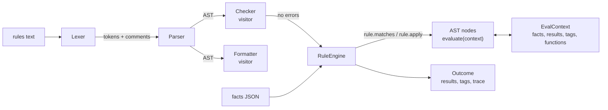

# Interpreter for Rules DSL

A small, typed business-rules language and its full toolchain in pure Python:
a hand-written lexer, a recursive-descent parser with error recovery, an AST that
evaluates itself (the GoF **Interpreter pattern**), a static checker, a canonical
formatter, and a rule engine that returns a full explanation trace.

```text
rule "gold loyalty discount" priority 50
when
    customer.tier == "gold" and order.subtotal >= 100
then
    set discount += round(order.subtotal * 10%, 2)
    tag "loyalty"
end
```

Rules are data that non-developers can read and review, while the host
application keeps control of what facts exist and which functions are callable.
There are no runtime dependencies.

## Concepts and design decisions

| Concept | Where | Trade-off |
| --- | --- | --- |
| **Interpreter pattern** | `nodes.py`: each node class implements `evaluate(context)` | Adding a node type is one class. Adding an *operation* would mean touching every class, so evaluation is the only operation that lives on the nodes. |
| **Visitor for other operations** | `visitor.py`, `formatter.py`, `analysis.py` | Checking and formatting are visitors, so the node classes stay focused. Dispatch by method name (`visit_Binary`) is simple but not checked by a type checker. |
| **Context object** | `runtime.EvalContext` | Nodes are stateless and immutable; facts, results, tags and functions travel in the context. One parsed ruleset is safely reused across evaluations. |
| **Recursive descent, one method per production** | `parser.py` | The code is a direct transcription of the EBNF in the module docstring, which is easy to review. A parser generator would be shorter for a big grammar but adds a build step and worse error messages. |
| **Error recovery** | `Parser._synchronize` | After a syntax error the parser skips to the next `rule` keyword, so one run reports every broken rule. Errors inside a rule after the first one are not reported until it is fixed. |
| **Precise diagnostics** | `Span`, `Source.excerpt` | Every token and node keeps its source span, so lexer, parser, checker and runtime errors all point at the exact text with a caret underline. |
| **Strict typing, no truthiness** | `Expr.evaluate_bool`, `values.values_equal` | `when 1` is an error, and `true == 1` is false (in Python it is true). Strictness catches mistakes early, but rule authors have to write `len(xs) > 0` instead of `xs`. |
| **Exact money** | `Decimal` everywhere, `10%` literals | JSON floats are converted through `str`, so `0.1 + 0.2 == 0.3`. Numbers are output as decimal strings so no precision is lost. |
| **Special forms vs functions** | `has(path)` is a node, not a function | Functions get evaluated arguments; `has` must *not* evaluate its argument, so it is part of the grammar. |
| **Transactional rules** | `EvalContext.begin/commit/rollback` | A rule's actions are all-or-nothing. With `--on-error skip` a rule that fails half-way leaves no partial results. |
| **Deterministic execution** | `RuleSet.in_execution_order` | Single pass, highest priority first, ties in source order. There is no forward chaining (re-firing until a fixpoint), which keeps runs predictable and explainable at the cost of some expressiveness. |
| **Static analysis** | `analysis.Checker` | Unknown functions, wrong arity, duplicate names, constant expressions that must fail (`"a" - 1`), always-true/false conditions, rules made unreachable by `stop`, and `result.x` read before assignment. The checker is conservative: a clean report means no *detectable* problem. |
| **Property-based testing** | `tests/test_formatter.py` | Hypothesis generates random ASTs and checks `parse(format(tree)) == tree`. This proves the formatter's minimal parenthesisation matches the parser's precedence. |
| **Defensive limits** | `MAX_NESTING` | Deeply nested input produces a syntax error instead of a Python `RecursionError`. |
| **Extension point** | `FunctionRegistry.register` | Host applications add domain functions with declared arity. Exceptions inside them become rule errors with a source location. |

## Architecture



```text
src/rules_dsl/
  source.py     Span + Source (caret excerpts)
  errors.py     DslError hierarchy
  tokens.py     TokenKind, keywords, operators
  lexer.py      scanner (percent literals, escapes, comments)
  nodes.py      AST + evaluation (Interpreter pattern)
  parser.py     recursive descent + error recovery
  values.py     value model, JSON conversion, strict equality
  functions.py  FunctionRegistry + built-ins
  runtime.py    EvalContext with staged (transactional) writes
  visitor.py    NodeVisitor, walk, children
  analysis.py   static checker
  formatter.py  canonical pretty-printer
  engine.py     RuleEngine, EngineConfig, Outcome, trace
  cli.py        rules-dsl {check,run,fmt,functions}
```

## The language

```text
rule "<name>" [priority N]
when
    <boolean expression>
then
    set <name> = <expr>       # also += and -= (an unset name starts at 0)
    tag "<label>"
    stop                      # skip all lower-priority rules
end
```

| Kind | Syntax |
| --- | --- |
| Literals | `42`, `19.99`, `15%` (= 0.15), `"text"` (escapes `\" \\ \n \t`), `true`, `false`, `[1, 2]` |
| Facts | `customer.address.country` (a missing fact is an error; test with `has(...)`) |
| Results | `result.discount`: values set by higher-priority rules |
| Arithmetic | `+ - * /`, unary `-`; `+` also joins two strings |
| Comparison | `== != < <= > >=`, `in`, `not in` (on lists and strings); not chainable |
| Logic | `and`, `or` (short-circuit), `not` |
| Functions | `len min max abs round sum lower upper starts_with` + your own |

Precedence, loosest first: `or`, `and`, `not`, comparisons, `+ -`, `* /`, unary `-`.

## Build, run and test

Requires Python 3.11+.

```bash
python -m venv .venv && . .venv/bin/activate
pip install -e ".[test]"
pytest                 # 99 tests, including Hypothesis round-trip properties
ruff check . && ruff format --check .
```

CLI (also available as `python -m rules_dsl`):

```bash
rules-dsl run examples/checkout.rules --facts examples/order.json --trace
rules-dsl check examples/broken.rules
rules-dsl fmt examples/checkout.rules        # --check exits 1 if not canonical
rules-dsl functions
```

Exit codes: `0` success, `1` problems in the rules or facts, `2` usage or I/O errors.
JSON goes to stdout and traces and diagnostics go to stderr, so output can be piped.

## Example output

```text
$ rules-dsl run examples/checkout.rules --facts examples/order.json --trace
  fired        defaults                      discount = 0
  not matched  block embargoed destinations
  fired        gold loyalty discount         discount = 14.99
  not matched  first order welcome
  fired        bulk electronics              discount = 29.99
  fired        free shipping                 shipping = 0
  not matched  standard shipping
  fired        total                         total = 119.91
{
  "results": { "discount": "29.99", "shipping": "0", "total": "119.91" },
  "tags": ["loyalty", "free-shipping"],
  "fired": ["defaults", "gold loyalty discount", "bulk electronics", "free shipping", "total"]
}
```

```text
$ rules-dsl check examples/broken.rules
examples/broken.rules:5:32: warning: 'result.score' is never assigned by any rule (in rule "vip")
   5 |     customer.tier == "vip" and result.score > 3
                                      ^^^^^^^^^^^^
examples/broken.rules:8:17: error: always fails: operator '-' needs two numbers, got string and number (in rule "vip")
   8 |     set label = "VIP" - 1
                       ^^^^^^^^^
examples/broken.rules:11:1: error: duplicate rule name "vip" (in rule "vip")
  11 | rule "vip"
       ^^^^^^^^^^
examples/broken.rules:13:5: warning: condition is always false; rule never fires (in rule "vip")
  13 |     1 > 2
           ^^^^^
examples/broken.rules:15:17: error: unknown function 'rounded' (known: abs, len, lower, max, min, round, starts_with, sum, upper) (in rule "vip")
  15 |     set bonus = rounded(order.total)
                       ^^^^^^^^^^^^^^^^^^^^
3 error(s), 2 warning(s)
```

Embedding in Python, with a custom function:

```python
from decimal import Decimal
from rules_dsl import RuleEngine, builtin_functions

functions = builtin_functions()

@functions.register("vat", 2, 2, "price including VAT")
def vat(price, country):
    return price * {"DE": Decimal("1.19"), "FR": Decimal("1.20")}[country]

engine = RuleEngine.from_source(
    'rule "gross" when true then set gross = vat(net, country) end', functions=functions
)
engine.evaluate({"net": 100, "country": "DE"}).results   # {'gross': Decimal('119.00')}
```

## Known limitations

- The formatter keeps comments above a rule and at the end of the file, but drops
  comments *inside* a rule body.
- Lexer errors stop at the first bad character; only parser errors are collected.
- There are no user-defined variables or functions inside the language. That is a
  deliberate choice to keep rules declarative.

## Possible extensions

- Compile the AST to Python closures or bytecode and benchmark it against tree walking.
- Forward chaining (Rete-style) for rules that react to each other's results.
- Static type inference over a declared fact schema, catching `customer.tier > 3`
  without data.
- A `date` type with literals and duration arithmetic for eligibility windows.
- A language server (diagnostics and formatting on save) that reuses `check` and `fmt`.
