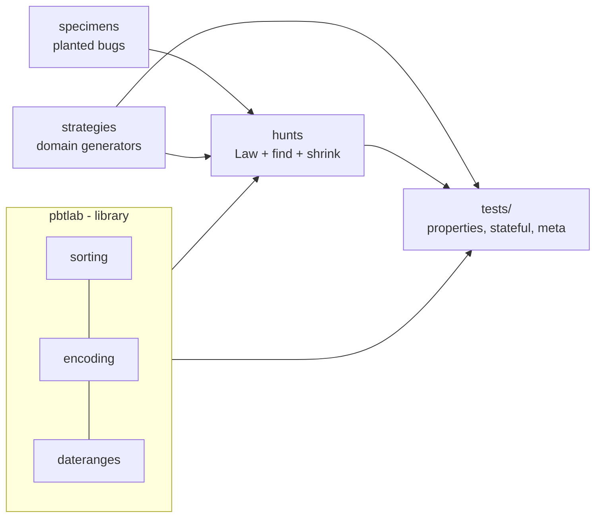

# Property-Based Testing Lab

A small Python library (stable merge sort, run-length encoding, LEB128
varints and half-open date ranges) tested almost entirely with
[Hypothesis](https://hypothesis.readthedocs.io) properties rather than
hand-picked examples.

The lab has two halves:

1. **The library and its property suite** (`src/pbtlab/`, `tests/`): 76 tests,
   including a model-based stateful test of `RangeSet`.
2. **Bug hunts** (`pbtlab.hunts`): eight realistic buggy first drafts kept as
   *specimens*. Each specimen passes the hand-written test you would probably
   write first. The hunts point one property at each specimen and let
   Hypothesis find and **shrink** an input that breaks it.

```text
$ pbtlab-hunt
[caught] merge_sort_unstable
         law:  sorting by key keeps equal keys in input order
         min:  [(0, 0), (0, 1)]
[caught] merge_sort_drops_tail
         law:  output is a permutation of the input
         min:  [0, 0]
[caught] rle_naive
         law:  decode(encode(s)) == s
         min:  '0'
[caught] rle_decode_single_digit
         law:  decode(encode(s)) == s
         min:  '0000000000'
[caught] zigzag_fixed64
         law:  zigzag(n) >= 0 and unzigzag(zigzag(n)) == n
         min:  9223372036854775808
[caught] overlaps_inclusive
         law:  a.overlaps(b) iff some day is in both
         min:  (DateRange(2095-01-01, 2095-01-02), DateRange(2095-01-02, 2095-01-03))
[caught] merge_without_sorting
         law:  merge() is sorted, disjoint, non-touching and covers the same days
         min:  [DateRange(2095-01-02, 2095-01-03), DateRange(2095-01-01, 2095-01-02)]
[caught] split_by_month_naive
         law:  month pieces concatenate back to the original range
         min:  DateRange(2095-05-01, 2095-12-02)

8/8 specimens caught
```

Each `min:` line is the whole bug report. `9223372036854775808` is `2**63`,
the first integer the C idiom `(n << 1) ^ (n >> 63)` gets wrong once ints are
unbounded. `'0'` is the shortest string whose digit collides with an
unescaped run count. Generation and shrinking are random, so the exact
counterexamples can differ between runs. The simplest ones (`[0, 0]`, `'0'`,
`2**63`) are pinned in `test_hunts.py`.

## Real bugs the properties found while I built this

The specimens were planted on purpose. These three were not:

| Found by | Bug | Fix |
| --- | --- | --- |
| `test_rle_decode_never_crashes_unexpectedly` (fuzz) | `rle_decode("999999999999a")` tried to allocate ~1 TB and died with `MemoryError`: a **decompression bomb** in a 13-byte input. | `max_decoded` limit (default 1,000,000 chars), raised as `DecodeError`. |
| `test_law_holds_for_real_implementation[overlaps_inclusive]` under the `ci` profile | `DateRange.overlaps` said `[Jan 1, Jan 3)` overlaps the **empty** range `[Jan 2, Jan 2)`. The textbook `a.start < b.end and b.start < a.end` check is only right for non-empty intervals. | Empty ranges overlap nothing. Pinned with `@example`. |
| `test_law_catches_specimen[rle_decode_single_digit]` | The meta-test failed, and the cause was the **strategy**, not the code. Plain `st.text()` almost never produces 10 identical characters in a row, so a decoder that reads one count digit passed every run. | `strategies._runs()` builds text out of explicit runs of up to 15 characters. |

The third one is the most useful lesson here. A property is only as good
as its generator, and the meta-tests in `test_hunts.py` are how you find
out that a generator has a blind spot.

## Concepts and design decisions

| Concept | Where | Trade-off |
| --- | --- | --- |
| **Property families** | `tests/` | The suite uses the standard patterns: *oracle* (`merge_sort == sorted`), *round trip* (`decode ∘ encode = id`), *invariants* (output canonical, idempotent), *metamorphic* (shuffling `merge`'s input doesn't change the output), *model* (a range is a set of days). Oracles are the strongest check but aren't always available. Round trips alone are too weak (`encode = decode = identity` passes), so every codec also has format properties. |
| **Slow model, fast implementation** | `test_dateranges.py` | Every interval operation is compared with the same operation on Python `set`s of days. The model is obviously correct and O(days). That's fine in tests because the strategy caps spans at 400 days. |
| **Model-based stateful testing** | `test_rangeset_stateful.py` | `RuleBasedStateMachine` generates whole programs of `add`/`remove`/membership calls and checks invariants after every step. When I mutated one `<` to `<=` in `RangeSet.remove`, it shrank the failure to a short add-then-remove program within seconds. It is slower than unit tests (about 8 s), which is why the profiles exist. |
| **Meta-testing / mutation testing in miniature** | `hunts.py`, `test_hunts.py` | The same `Law` is run against the specimen (it must fail) and the real code (it must hold). A property that can't tell the two apart is reported as a test failure. This is cheaper than a full mutation tool like `mutmut`, but it only covers the mutations I wrote. |
| **Shared domain strategies** | `pbtlab/strategies.py` | Generators are library code so that tests and hunts agree on what a valid input is. The date window (2095–2105) is deliberately narrow but includes a leap year (2096) and a century non-leap year (2100). Key values in `keyed_records` come from `0..5` so that ties, which are what stability is about, are common. |
| **Regressions as `@example`** | test files | Every shrunk counterexample becomes an explicit `@example`, so it runs on every build no matter what the example database contains. |
| **Profiles** | `tests/conftest.py` | `dev` (100 examples), `ci` (500, derandomised so failures reproduce) and `thorough` (5000). The empty-range bug only showed up under `ci`, which is the argument for running more than one profile. |
| **Half-open intervals** | `dateranges.py` | `[start, end)` means no `+1`/`-1` anywhere, adjacent ranges don't overlap, and splitting is exact. `DateRange.inclusive()` converts from the human-friendly form at the boundary. |
| **Canonical encodings** | `encoding.py` | RLE escapes digits and `\`. The varint decoder rejects over-long forms (`80 00`), so every value has exactly one encoding. The fuzz property relies on this: anything that decodes must re-encode to the same bytes. |
| **Errors are part of the contract** | `DecodeError` | The fuzz tests check that arbitrary input either decodes or raises `DecodeError`. Any other exception, or no answer at all (the bomb), fails the test. |
| **Dependency-free library** | `pyproject.toml` | The core modules use only the standard library. Hypothesis is needed only for `strategies`, `hunts` and the tests (the `lab`/`test` extras). |

## Architecture



```text
src/pbtlab/
  sorting.py      merge_sort (stable, key, reverse), merge, is_sorted, top_k
  encoding.py     rle_encode/decode, LEB128 varint, ZigZag, svarint streams
  dateranges.py   DateRange, merge, split_by_month, RangeSet
  specimens.py    8 buggy first drafts, one bug each, documented
  strategies.py   date_ranges, adjacent_pairs, keyed_records, rle_text
  hunts.py        Hunt/Law, run_hunt (hypothesis.find), CLI
tests/
  conftest.py                 Hypothesis profiles
  test_sorting.py             oracle, permutation, stability, top_k
  test_encoding.py            round trips, canonical form, fuzzing, limits
  test_dateranges.py          set-of-days model, merge, split_by_month
  test_rangeset_stateful.py   RuleBasedStateMachine vs a set() model
  test_hunts.py               each law catches its specimen and holds for the real code
```

## Build, run, test

Requires Python 3.11+.

```bash
python -m venv .venv && . .venv/bin/activate
pip install -e ".[test]"

pytest                                   # dev profile, ~7 s
HYPOTHESIS_PROFILE=ci pytest             # 500 examples, derandomised, ~25 s
HYPOTHESIS_PROFILE=thorough pytest       # nightly-style run

pbtlab-hunt                              # all hunts
pbtlab-hunt --list
pbtlab-hunt zigzag_fixed64 --max-examples 5000
```

If you run without installing, `PYTHONPATH=src python -m pbtlab.hunts`
also works. Tests pass under both the `dev` and `ci` profiles, and
`ruff check` is clean.

## Library usage

```python
from datetime import date
from pbtlab import DateRange, RangeSet, merge_sort, rle_encode, encode_svarints, split_by_month

merge_sort([("b", 2), ("a", 1), ("c", 1)], key=lambda r: r[1])
# [('a', 1), ('c', 1), ('b', 2)]   stable

rle_encode("aaab1111")            # '3a1b4\\1'
encode_svarints([0, -1, 300])     # b'\x00\x01\xd8\x04'

q4 = DateRange.inclusive(date(2026, 10, 15), date(2026, 12, 31))
[p.days for p in split_by_month(q4)]   # [17, 30, 31]

booked = RangeSet([q4])
booked.remove(DateRange(date(2026, 11, 1), date(2026, 11, 8)))
date(2026, 11, 3) in booked       # False
```

## Possible extensions

- Run real mutation testing (`mutmut` or `cosmic-ray`) on `src/` and compare
  it with what the hand-written specimens cover.
- Use `hypothesis.target()` to steer the RLE strategy toward long runs
  instead of hard-coding `_runs()`, and measure how fast each finds the
  single-digit bug.
- Add `hypothesis-jsonschema` or `hypothesis.extra.ghostwriter` to generate
  starting properties, and compare them with the hand-written ones.
- Port `RangeSet` to a sorted container with O(log n) `add`/`remove`, using
  the current implementation as the oracle (differential testing).
- Add a coverage-guided fuzzing run with Atheris on `rle_decode` and
  `decode_varint`.
