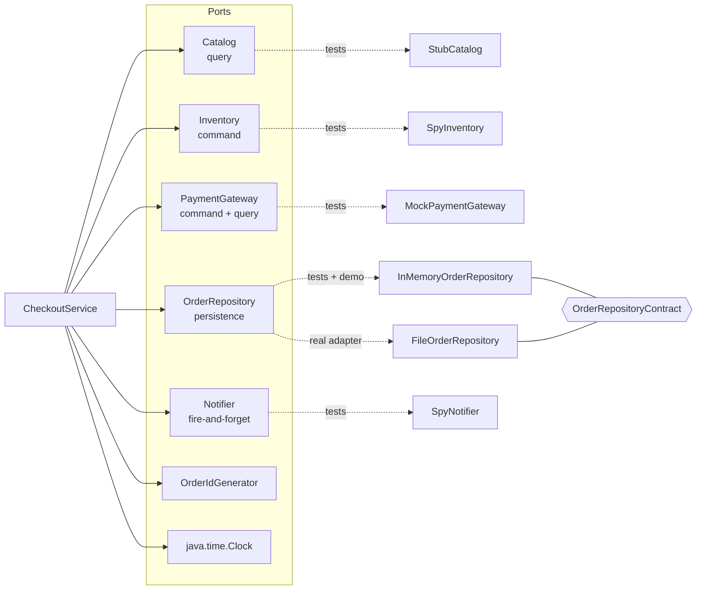

# 024 · Mocks, Stubs & Fakes

**Stack:** Java 21 (records, sealed interfaces, pattern-matching `switch`), JUnit 5, Mockito · **Level:** Intermediate · **Area:** Testing

One small **checkout service** — price → reserve stock → charge → persist → notify, with
compensating actions when a step fails — tested with **every kind of test double** from Gerard
Meszaros's *xUnit Test Patterns* taxonomy. Each double type gets its own test class, all aimed at
the same system under test, so you can compare them side by side. The same scenarios are then
re-written with **Mockito**, and the fakes are kept honest with **contract tests** that also run
against a "real" file-backed adapter.

| Double | What it is | Verifies | Here | Test class |
|---|---|---|---|---|
| **Dummy** | Fills a parameter; must never be used | nothing (fails if touched) | `doubles/Dummy` (dynamic proxy) | `CheckoutWithDummiesTest` |
| **Stub** | Returns canned answers to queries | the SUT's *output* (state) | `StubCatalog`, `StubPaymentGateway`, `FailingOrderRepository` | `CheckoutWithStubsTest` |
| **Spy** | A stub that records calls for later inspection | interactions, asserted *after* | `SpyInventory`, `SpyNotifier` | `CheckoutWithSpiesTest` |
| **Mock** | Pre-programmed with expected calls; fails on deviation | interactions, declared *before* | `MockPaymentGateway` | `CheckoutWithMocksTest` |
| **Fake** | A working implementation with a shortcut | real end state | `InMemoryOrderRepository`, `InMemoryInventory`, `SimulatedPaymentGateway` (in `main`) | `CheckoutWithFakesTest` |
| *Library* | Mockito plays all of the above | either | `mock`, `when`, `verify`, `spy`, `ArgumentCaptor`, `InOrder` | `CheckoutWithMockitoTest` |

## Architecture



```
placeOrder(request)
  empty cart?            → Rejected(EMPTY_CART)
  price every line       → Rejected(UNKNOWN_ITEM)         (nothing reserved yet)
  reserve every line     → Rejected(OUT_OF_STOCK)         release what was reserved
  charge(total, key=id)  → Rejected(PAYMENT_DECLINED | PAYMENT_UNAVAILABLE)   release all
  save(order)            → throw CheckoutFailedException  refund + release all
  notify                 → failure logged, order still Placed
```

## Design decisions & trade-offs

- **Choose the double by the kind of collaborator, not by habit.**
  *Queries* (`Catalog.priceOf`) get stubs — asserting that a query was called couples the test to
  implementation for no benefit. *Commands with side effects the result can't show*
  (`Inventory.release`, `PaymentGateway.refund`) get spies or mocks. *Stateful collaborators*
  (repositories) get fakes, which let tests assert on outcomes and survive refactoring.
- **Spy vs mock is about when you state the expectation.** The spy keeps the classic
  arrange–act–assert shape and gives readable, list-shaped failures (`["reserve BOOK-1 x2",
  "release BOOK-1 x2"]`). The hand-rolled mock fails *at the offending call*, so the stack trace
  points into production code — good for strict protocols such as "charge exactly once with this
  idempotency key, then refund". The cost of mocks is brittleness: they fail on harmless
  reorderings or extra calls, so they are used only for the payment conversation.
- **Strict dummies as defaults.** `CheckoutServiceBuilder` wires every collaborator as a `Dummy`
  that throws if touched. Tests name only the doubles that matter, and an early-exit test
  automatically proves "no stock reserved, no money charged". The trade-off: adding a new
  dependency call to an early path breaks tests — which is usually what you want.
- **Fakes live in `main`, and they are tested.** `InMemoryOrderRepository` and
  `SimulatedPaymentGateway` power the demo and could power local development or other modules'
  tests. Because a fake has real logic (idempotency, limits, thread safety), it gets its own unit
  tests; because it imitates a real adapter, it must pass the same **contract tests**
  (`OrderRepositoryContract`) as `FileOrderRepository`. Without that, a fake slowly drifts and
  tests pass against behaviour production doesn't have.
- **Hand-rolled first, Mockito second.** Hand-written doubles make each role explicit and need
  no library; Mockito is far less code and adds captors, `InOrder` and partial-mock spies. The
  Mockito class shows the danger too: one `mock()` object silently changes role between stub and
  mock depending on whether you `when` it or `verify` it.
- **Inject time and ids.** `Clock` (the JDK's built-in stub `Clock.fixed`, plus a tiny
  `MutableClock` fake) and `OrderIdGenerator` make every assertion exact, including
  "newest first" ordering.
- **Expected failures are values, unexpected ones are exceptions.** `CheckoutResult` is a
  sealed `Placed | Rejected`; only "money taken but order not stored" throws, and only after
  compensating. Notification is best-effort: a lost email never fails a paid order (the warning
  you see in the test log is that path being exercised).

## Project layout

```
src/main/java/dev/omar/checkout/
  domain/    Money, Sku, CustomerId, OrderId, OrderLine, Order, CheckoutRequest, CheckoutResult
  port/      Catalog, Inventory, PaymentGateway (+ ChargeRequest, PaymentResult), OrderRepository, Notifier, OrderIdGenerator
  service/   CheckoutService, CheckoutFailedException
  adapter/   in-memory fakes, FileOrderRepository, SimulatedPaymentGateway, ConsoleNotifier, SequentialOrderIdGenerator
  CheckoutDemo.java   composition root
src/test/java/dev/omar/checkout/
  doubles/   Dummy, StubCatalog, StubPaymentGateway, FailingOrderRepository, SpyInventory, SpyNotifier, MockPaymentGateway
  service/   CheckoutWith{Dummies,Stubs,Spies,Mocks,Fakes,Mockito}Test, CheckoutServiceBuilder
  contract/  OrderRepositoryContract + one subclass per implementation
  adapter/   tests for the fakes themselves
  domain/    value-object tests (no doubles needed)
```

## Build, run, test

```bash
mvn test                       # JUnit 5 + Mockito 5 via Maven Central
mvn package && java -jar target/mocks-stubs-and-fakes-1.0.0.jar

./run-tests.sh                 # no Maven: javac + JUnit console launcher + local jars
```

`run-tests.sh` uses jars from `/usr/share/java` (Debian/Ubuntu: `apt install junit5
libmockito-java libbyte-buddy-java libobjenesis-java`). The tests use only Mockito APIs that
exist in both the distro's Mockito 2.x and Mockito 5, so both paths run the same suite. In the
build environment for this repo Maven Central was not reachable, so the suite was verified with
`run-tests.sh`: **53 tests, all passing**.

## Example output

```
$ java -jar target/mocks-stubs-and-fakes-1.0.0.jar
checkout 2x BOOK-042, 1x MUG-001
  [email to ada] order ORD-1 confirmed, total $62.48
  placed ORD-1 for $62.48
checkout 1x MUG-001
  rejected: OUT_OF_STOCK (MUG-001)
checkout 3x POSTER-7
  rejected: PAYMENT_DECLINED (amount $135.00 exceeds limit $100.00)
checkout 1x GADGET-9
  rejected: UNKNOWN_ITEM (GADGET-9)
checkout (empty cart)
  rejected: EMPTY_CART (cart has no items)
orders for ada: 1 | gateway balance $62.48 | MUG-001 left in stock: 0
```

A failing mock reads like this:

```
AssertionError: charge called with ChargeRequest[customer=ada, amount=$20.00, idempotencyKey=ORD-1]
  but expected ChargeRequest[customer=ada, amount=$0.01, idempotencyKey=ORD-1]
```

## Possible extensions

- A JDBC `OrderRepository` run through the same contract with an embedded H2 database
  (or Testcontainers Postgres) to show the fast-fake / slow-real split.
- Contract tests for `PaymentGateway`, run against `SimulatedPaymentGateway` and a WireMock
  stub of a provider's HTTP API.
- A deliberately over-mocked test next to its fake-based equivalent, then a refactor that
  breaks only the over-mocked one.
- Mutation testing (PIT) to compare how many mutants each double style kills.
