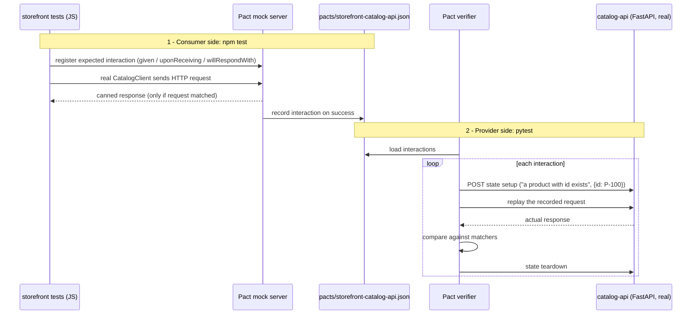

# 026 · Contract Testing

**Consumer-driven contracts between a JavaScript client and a Python API, verified with [Pact](https://docs.pact.io/).**

Two independently deployable services that talk over HTTP:

| Side | Name | Stack | Role |
|---|---|---|---|
| Consumer | `storefront` | Node 22, ESM, built-in `fetch`, `node:test`, Pact JS 17 | Prices carts and places orders through a `CatalogClient` |
| Provider | `catalog-api` | Python 3.11+, FastAPI, pydantic, pytest, Pact Python 3+ | Serves products and accepts orders |

The storefront's tests *write* a contract describing exactly the requests it makes and the parts of each response it reads. The catalog API's tests *replay* that contract against the real FastAPI app. If the provider changes something the consumer depends on, the provider build fails before anything is deployed, and no shared staging environment is needed to find out.

## Why contract tests?

End-to-end tests prove that two services work together, but they are slow and flaky, they need every service deployed at once, and a failure doesn't tell you who broke what. Mocks are fast, but a hand-written mock of the provider is just your *assumption* about the provider, and nothing checks it.

A contract test keeps the speed of the mock and adds that check:



## What's in the box

```
026-contract-testing/
├── consumer/                       # storefront (JavaScript)
│   ├── src/catalogClient.js        # HTTP adapter: wire format -> domain objects + typed errors
│   ├── src/cart.js                 # use cases (priceCart, checkout) over the client interface
│   ├── src/money.js                # integer-cents value object
│   ├── test/catalogClient.pact.test.js   # ← writes the contract
│   └── test/{cart,money}.test.js   # plain unit tests with a hand-written fake
├── provider/                       # catalog-api (Python)
│   ├── src/catalog_api/
│   │   ├── models.py  service.py  repository.py   # domain, rules, storage port
│   │   ├── schemas.py              # wire DTOs (camelCase): the provider's half of the contract
│   │   └── app.py                  # FastAPI routes, auth, error envelope
│   └── tests/
│       ├── test_pact_verification.py   # ← verifies the contract
│       ├── test_contract_breakage.py   # shows a breaking change caught + a safe one allowed
│       ├── provider_states.py      # handlers for every given(...) clause
│       └── test_service.py  test_api.py
├── pacts/storefront-catalog-api.json   # generated contract, committed
├── ci/contract-tests.yml           # example 3-stage pipeline
├── docker-compose.yml              # optional Pact Broker + Postgres
└── Makefile
```

## Concepts and design decisions

**Consumer-driven, not provider-driven.** The contract contains only what the storefront actually uses. `catalog-api` also returns `category`, `tags` and `warehouseLocation`, but the client never reads them, so they aren't in the pact. That tells the provider team which fields they can change freely. `test_contract_breakage.py` shows both cases using an ASGI middleware that rewrites responses:

| Simulated provider change | Result |
|---|---|
| rename `priceCents` → `price` (a float) | ❌ verification fails: `$.items[0] -> Actual map is missing the following keys: priceCents` |
| drop `warehouseLocation` | ✅ still verifies, because no consumer depends on it |

**Shape matchers vs literal values.** Most fields use type or regex matchers (`integer(4599)`, `regex('^[A-Z]{3}$','USD')`, `eachLike(product, 1)`), so the provider can return any data of the right shape. Values the client *branches on* are literal: `status: 'PENDING'` and the error `code` (`NOT_FOUND`, `INSUFFICIENT_STOCK`) that `toError()` maps to `ProductNotFoundError` / `OutOfStockError`. If a contract over-specifies, it breaks for no reason. If it under-specifies, it misses real breakages.

**Provider states with parameters.** `given('a product has limited stock', { id: 'P-100', stock: 1 })` maps to a handler in `provider_states.py` that seeds the in-memory repository directly. The repository is a `Protocol` with an in-memory adapter, and time and id generation are injected (`Clock`, `IdGenerator`). Those choices are what make verification deterministic and fast (about 2 s, with no database). A generic `""` teardown handler clears the store between interactions so they can't leak state into each other.

**Auth is out of scope for the contract.** The consumer records an *example* bearer token, matched only by `^Bearer \S+$`. The verifier swaps in a real token with `add_custom_header`. Credentials belong to the provider's environment and shouldn't be baked into a shared artefact. Because of that, the 401 paths are covered by ordinary provider tests (`test_api.py`), not by Pact. Contract tests check *compatibility*. They don't replace functional tests on either side.

**Thin adapters, tested separately.** On the consumer side, only `catalogClient.js` knows the wire format. `cart.js` depends on the client's domain interface (`Money`, typed errors), so it's unit-tested with a fake and no HTTP. The provider is laid out the same way: `schemas.py` is the only place that turns `price_cents` into `priceCents`, so a domain rename can't leak into the API without Pact noticing.

**Committed pact file vs Pact Broker.** In this monorepo the contract travels as a committed JSON file. Generation is deterministic, and CI runs `git diff --exit-code pacts/` to catch a stale contract. That needs no infrastructure, but it only works when both sides live in the same repo. With separate repos, use a broker. `verification.py` switches to `broker_source(...)` when `PACT_BROKER_BASE_URL` is set. It verifies against the consumer's `mainBranch` *and* every `deployedOrReleased` version, enables pending pacts so a consumer's new expectation can't break the provider's build, and publishes results so that `can-i-deploy` can gate releases.

## Build, run, test

Requirements: Node ≥ 20, Python ≥ 3.11. Pact's native core installs automatically with both libraries. Docker is needed only for the optional broker.

```bash
make install        # npm install + python venv with provider[test]
make contract       # 1) consumer tests write pacts/  2) provider verifies them
make lint           # ruff check + format check (provider)
make demo           # start catalog-api on :8000 and run the storefront against it
```

Or each side by hand:

```bash
cd consumer && npm install && npm test
cd provider && python -m venv .venv && .venv/bin/pip install -e '.[test]' && .venv/bin/pytest -q
```

Full broker loop (Docker):

```bash
make broker-up      # Pact Broker on http://localhost:9292
make publish        # publish consumer contract tagged with git sha + branch
make verify-broker  # provider verifies from the broker and publishes results
make can-i-deploy   # ask the broker whether this version is safe to deploy
```

> Test status at time of writing: consumer **15/15 passing**, provider **19/19 passing** (9 service, 6 API, 4 contract verification/breakage). The broker targets and `ci/contract-tests.yml` were not run here because no Docker daemon or GitHub runner was available.

## Example output

`make demo`:

```
Books:
  P-100    $45.99  Designing Data-Intensive Applications
  P-101    $39.99  The Pragmatic Programmer

Cart total: $125.97 (can checkout: true)
Order ORD-9B8E928A placed for $125.97 at 2026-11-18T18:52:24.000Z

Lookup of P-999 -> ProductNotFoundError: Product P-999 does not exist
```

Provider verification (excerpt):

```
Verifying a pact between storefront and catalog-api

  a request for product P-100 (0s loading, 6ms verification)
     Given a product with id exists
    returns a response which
      has status code 200 (OK)
      includes headers
        "Content-Type" with value "application/json" (OK)
      has a matching body (OK)
```

The same run with `priceCents` renamed:

```
1) Verifying a pact between storefront and catalog-api Given a product with id exists - a request for product P-100
    1.1) has a matching body
           $ -> Actual map is missing the following keys: priceCents

There were 2 pact failures
```

## Trade-offs and limits

- Pact checks that the provider *can* produce the response the consumer expects, for the states the consumer named. It does not check business correctness. That's still the job of `test_service.py`.
- Provider states couple the contract to provider test fixtures. Names like `"a product with id exists"` become a shared API between the two teams, so keep them few and stable.
- Committing the pact file is simple but puts the generated artefact under version control. The `git diff` check in CI keeps it honest.

## Possible extensions

- **Message pacts:** add an `OrderPlaced` event over a queue and verify it with `Verifier.message_handler`.
- **Bi-directional contracts:** compare the pact against FastAPI's generated OpenAPI schema instead of replaying requests.
- A second consumer (say, a Python back-office script), to show the provider verifying several contracts at once and `filter_consumers`.
- `can-i-deploy` + `record-deployment` steps in a real deploy pipeline with environments.
- Swap `InMemoryCatalogRepository` for Postgres while keeping the in-memory adapter for verification.
