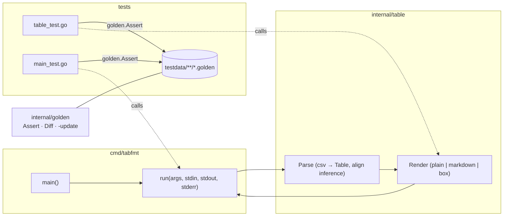

# Snapshot & Golden-File Tests

`tabfmt` is a small Go CLI that turns CSV (or any delimited text) into an
aligned table in **plain**, **Markdown** or **box-drawing** layout. The tool is
the vehicle; the subject is **golden-file testing**: the expected output of
each test lives in a checked-in `*.golden` file, and

```sh
go test ./... -update
```

regenerates them all, so an intended output change is a single command plus
a `git diff` to review.

No third-party dependencies: the golden helper (`internal/golden`) is about
150 lines of standard library code, including its own LCS line diff.

```text
$ tabfmt -format box -delim '\t' cmd/tabfmt/testdata/services.tsv
┌────────────┬───────────┬────────────┐
│ region     │ instances │ owner      │
├────────────┼───────────┼────────────┤
│ us-east-1  │        12 │ platform   │
│ eu-west-2  │         4 │ payments   │
│ ap-south-1 │           │ unassigned │
└────────────┴───────────┴────────────┘

$ tabfmt -format markdown internal/table/testdata/input/invoices.csv
| id      | customer              |   amount | paid |
| ------- | --------------------- | -------: | ---- |
| INV-001 | Acme Corp             | 1,250.00 | yes  |
| INV-002 | Globex                |     89.5 | no   |
| INV-003 | Initech \| Subsidiary |      -42 | yes  |
| INV-004 | Umbrella              |          | no   |
```

Numeric columns are detected and right-aligned (blanks, `1,250.00` and `-42`
count as numeric; `NaN` and `Inf` do not). Pipes are escaped in Markdown, and
`-max-width N` truncates long cells with `…`.

## What a failing golden test looks like

When output changes, the test prints a line diff against the golden file and
tells you how to accept the change:

```text
--- FAIL: TestCLIGolden/box_from_file (0.00s)
    main_test.go:42: golden: output does not match testdata/box_from_file.golden (run `go test -update` if the change is intended)
          $ tabfmt -format box -delim \t testdata/services.tsv
        - exit: 1
        + exit: 0
          --- stdout ---
        + ┌────────────┬───────────┬────────────┐
        + │ region     │ instances │ owner      │
        ...
          --- stderr ---
        - tabfmt: parse input: record on line 4: wrong number of fields
```

That diff is real, from building this project. The first `-update` run wrote a
golden file that *recorded a bug*: with `-delim '\t'`, `csv.Reader`'s
`TrimLeadingSpace` treated the tab as whitespace and swallowed an empty field.
Reading the new snapshot caught it. After the fix, the test above showed the
intended change, and a focused regression test (`TestParseKeepsEmptyTabFields`)
now pins the rule. This is the main lesson of golden testing: **`-update`
records whatever the code does, so a snapshot is only as good as the review of
its diff.**

## Concepts and design decisions

| Concept | Where | Trade-off |
| --- | --- | --- |
| **Golden files with an `-update` flag** | `internal/golden/golden.go` | Expected output is data, not string literals in Go code, so a 7-line box table is readable and diffable. The cost is that `-update` will happily approve a regression; reviewers must read golden diffs in PRs like any other code. |
| **Flag registered by the helper package** | `var update = flag.Bool("update", ...)` in `golden` | Any test package that imports `golden` accepts `-update`, with no per-package boilerplate. The flag is global to the test binary, which is the usual Go idiom (`go/format`, `gofmt` and many stdlib packages do the same). |
| **Readable failure messages** | `Diff`, `visible` | A minimal LCS line diff (`-` want, `+` got) plus trailing whitespace shown as `·`, the classic invisible snapshot failure. LCS is O(n·m), which is fine for test-sized outputs but not for megabyte files. |
| **Testing the test helper** | `golden_test.go` | `Assert` takes a small `TB` interface instead of `*testing.T`, so a recording fake can check that mismatches are non-fatal and include a diff, missing files are fatal and explain `-update`, and update-then-compare round-trips. |
| **Data-driven test discovery** | `TestRenderGolden` | Every `testdata/input/*.csv` is rendered in every format. A new case is a new CSV plus `-update`; no Go code changes. |
| **Snapshotting the whole CLI contract** | `cmd/tabfmt/main_test.go` | Each case records the command line, exit code, stdout *and* stderr in one transcript. Error messages and `-h` text are user-facing, so they are snapshotted too. |
| **Testable `main`** | `run(args, stdin, stdout, stderr) int` | `main` is one line. Tests run the program in-process (fast, no build step, coverage counts) instead of exec'ing a binary. |
| **Unit tests alongside snapshots** | `TestInferAligns`, `TestTruncate`, … | A golden failure shows *that* output changed; small rule-level tests show *why*. Both layers are kept on purpose. |
| **Deterministic, review-friendly output** | `render.go` | No trailing spaces in plain mode, a trailing newline always, a stable format order, no timestamps or map iteration in output. Non-determinism is the main way snapshot suites become flaky. |
| **Line-ending safety** | `.gitattributes` (`*.golden -text`) + CRLF normalisation in `Assert` | Git won't rewrite golden files, and a Windows checkout with `core.autocrlf` still passes. |
| **Pure core, thin shell** | `internal/table` (parse + render) vs `cmd/tabfmt` | Rendering is a pure `Table → string` function, which is what makes it easy to snapshot. I/O, flags and exit codes stay in the CLI layer. |

Other trade-offs worth knowing:

- **Width is counted in runes.** `Zürich` and `…` line up correctly; wide CJK
  characters and emoji (two terminal cells) would not. Handling them properly
  needs a width table such as `golang.org/x/text/width`, which I left out to
  keep the project dependency-free.
- **Snapshot granularity.** One golden file per input × format keeps failures
  local; a single giant snapshot would be simpler but one change would light
  up everything.
- **Exit codes**: `0` success, `1` bad input or I/O failure, `2` usage error
  (bad flag, format, delimiter or argument count).

## Architecture



```text
027-snapshot-golden-file-tests/
├── cmd/tabfmt/
│   ├── main.go            # flags, I/O, exit codes
│   ├── main_test.go       # CLI transcript snapshots
│   └── testdata/          # services.tsv + 13 CLI *.golden transcripts
├── internal/
│   ├── golden/            # snapshot helper + its own tests
│   └── table/
│       ├── table.go       # parsing, numeric alignment inference
│       ├── render.go      # the three layouts, truncation
│       ├── table_test.go
│       └── testdata/
│           ├── input/*.csv
│           └── <input>/<format>.golden
├── Makefile
└── go.mod
```

## Build, run, test

Requires Go 1.22+.

```sh
make build                     # → bin/tabfmt
./bin/tabfmt -format box internal/table/testdata/input/unicode.csv
cat data.csv | ./bin/tabfmt -max-width 20

make test                      # go test ./...
make update                    # go test ./... -update, then review `git diff`
go test ./... -cover
```

Typical workflow for an intended output change:

```sh
go test ./...                  # fails, shows the diff
go test ./... -update          # accept it
git diff -- '*.golden'         # REVIEW what you just accepted
```

Current results: 53 passing tests and subtests; coverage is 100% for `table`,
92% for the CLI and 83% for `golden` (the uncovered lines are filesystem error
branches).

## Possible extensions

- An `-update` that only rewrites files that changed and **deletes orphaned**
  golden files no test touched.
- A `-golden.diff=unified` mode with context lines and hunk headers for large
  snapshots.
- Scrubbers for non-deterministic output (timestamps, temp paths, UUIDs)
  applied before comparison.
- Display-width aware alignment for CJK and emoji.
- More formats (`html`, `json`, `tsv`) with a CSV/JSON input auto-detector,
  each added as one renderer plus `-update`.
- A fuzz test (`go test -fuzz`) that checks every rendered row has the same
  width, complementing the example-based snapshots.
