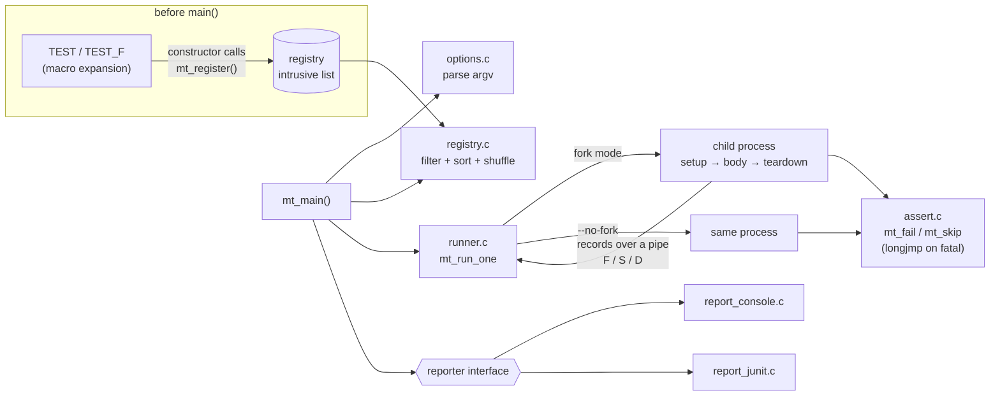

# Mini Test Framework

**mtest** is an xUnit-style test framework for C11, written from scratch in
about 1,500 lines (comments included) with no dependencies beyond libc and POSIX. It has the
features you reach for in GoogleTest or Check, in a form small enough to read
in one sitting:

- **Self-registering tests.** `TEST(suite, name) { ... }` and nothing else:
  you don't keep a list of tests by hand.
- **Fixtures** with setup and teardown (`FIXTURE` / `TEST_F`), and a fresh,
  zeroed instance for every test.
- **Two kinds of assertion.** `EXPECT_*` records a failure and carries on.
  `ASSERT_*` records a failure and stops the test. Every macro evaluates its
  arguments exactly once, and failures print both the expression and the
  values.
- **Crash isolation.** By default each test runs in a forked child. A
  segfault, an `abort()`, a stray `exit()` or a hang (`--timeout`) is
  reported as that test's result instead of killing the whole run.
- **Selection and ordering.** `--filter` takes globs with exclusions.
  `--shuffle` and `--seed` run tests in a reproducible random order, which
  catches tests that depend on each other. `--fail-fast` stops at the first
  failure.
- **Reports.** A gtest-style console summary, plus a **JUnit XML** file
  (`--junit=FILE`) that CI systems display natively.

```text
$ ./build/sample_outcomes --timeout=1
[==========] Running 6 tests
[  FAILED  ] math.broken_multiplication (0.18 ms)
  tests/sample/sample_outcomes.c:19: expected 6 * 7 == 41
    left:  42
    right: 41
  tests/sample/sample_outcomes.c:20: expected "<answer>" == "&answer"
    left:  "<answer>"
    right: "&answer"
[  SKIPPED ] math.skipped_on_purpose (0.15 ms): not implemented yet
[  CRASHED ] platform.segfaults (0.14 ms): killed by signal 11 (Segmentation fault)
[  TIMEOUT ] platform.hangs (1000.50 ms): exceeded 1s timeout
[==========] 6 tests ran (1001.68 ms total)
[  PASSED  ] 2
[  SKIPPED ] 1
[  FAILED  ] 3, listed below:
    math.broken_multiplication (failed)
    platform.segfaults (crashed)
    platform.hangs (timed out)
```

(`sample_outcomes` contains one test for each possible outcome, so it fails
on purpose. The end-to-end script uses it.)

## Writing tests

```c
#include "mtest.h"
#include "ringbuf.h"

TEST(ringbuf, rejects_zero_capacity)
{
    EXPECT_NULL(ringbuf_new(0));
}

FIXTURE(rb3) {                 /* a struct; each TEST_F gets a fresh one */
    ringbuf *rb;
};
FIXTURE_SETUP(rb3)    { self->rb = ringbuf_new(3); ASSERT_NOT_NULL(self->rb); }
FIXTURE_TEARDOWN(rb3) { ringbuf_free(self->rb); }

TEST_F(rb3, pops_in_fifo_order)
{
    for (int i = 1; i <= 3; i++)
        ASSERT_TRUE(ringbuf_push(self->rb, i * 10));
    int v;
    ASSERT_TRUE(ringbuf_pop(self->rb, &v));
    EXPECT_EQ_INT(v, 10);
}
```

Link the test file against `libmtest.a` and `mtest_main.o`, which provides
`main()`. If you need your own `main()`, call `mt_main(argc, argv)` from it.

| Family | Macros (`ASSERT_` = fatal, `EXPECT_` = continue) |
|---|---|
| Boolean | `_TRUE(c)`, `_FALSE(c)` |
| Signed integers | `_EQ_INT`, `_NE_INT`, `_LT_INT`, `_LE_INT`, `_GT_INT`, `_GE_INT` |
| Unsigned / sizes | `_EQ_UINT`, `_NE_UINT` |
| Strings (NULL-safe) | `_STREQ`, `_STRNE` |
| Floating point | `_NEAR(a, b, eps)` |
| Pointers | `_NULL(p)`, `_NOT_NULL(p)` |
| Memory | `_MEMEQ(a, b, n)` (reports the first differing offset) |
| Control | `FAIL(fmt, ...)`, `ADD_FAILURE(fmt, ...)`, `SKIP(reason)` |

## Command line

```text
--filter=PATTERNS  comma-separated globs over suite.name; '-' prefix excludes
--list             list selected tests and exit
--junit=FILE       also write a JUnit XML report
--timeout=SECS     kill a test after SECS seconds (fork mode)
--no-fork          run in-process (debugger-friendly; a crash ends the run)
--fail-fast        stop after the first failing test
--shuffle          random order; --seed=N reproduces one
--color/--no-color force colour (auto: only on a TTY, honours NO_COLOR)
-v, --verbose      show RUN/OK lines for every test
```

Exit status: `0` if every test passed or was skipped, `1` if any test failed,
crashed or timed out, `2` for a usage error. A `--filter` that matches no
tests also exits `2`, because a typo in a filter should not make CI pass
silently.

## Architecture



| Module | Responsibility |
|---|---|
| `include/mtest.h` | The whole public API: registration macros, fixtures and assertions. |
| `src/registry.c` | Stores registered tests, filters them, sorts them and shuffles them (splitmix64 + Fisher–Yates). |
| `src/filter.c` | An iterative glob matcher and the include/exclude filter language. |
| `src/options.c` | Parses argv. It is pure: no globals and no `exit()`, so it can be unit-tested. |
| `src/assert.c` | Holds the stack of assertion contexts, records failures and skips, and encodes the child-to-parent record format. |
| `src/runner.c` | Runs the xUnit life cycle and handles fork, pipe, `waitpid`, timeouts and turning a wait status into a result. |
| `src/report_*.c` | Two reporters behind one small interface (`begin`, `test_start`, `test_done`, `end`). |
| `src/main.c` | Orchestrates a run: select, run, tally and report, then return the exit code. |

## Design decisions and trade-offs

**Registration through constructor functions.** Each `TEST` expands to a
static `mt_test` record and an `__attribute__((constructor))` function that
links the record into an intrusive list before `main()` runs. Registration
never allocates, so it can't fail at a point where nothing can report the
error. The cost is portability: this needs GCC or Clang (MSVC would need a
`.CRT$XCU` section trick). The header refuses to compile on other compilers
rather than failing at runtime. Constructor order across translation units
is unspecified, so the registry sorts tests by `(file, line)` and every
platform runs them in the same order.

**Fatal assertions use `setjmp`/`longjmp`.** This is the only way for an
`ASSERT` deep inside a helper function to end the test without every caller
checking a return code. Setup plus body get one landing point and teardown
gets its own, so a failing body still runs teardown. Teardown runs only if
setup *completed*, so it never frees things setup didn't get to create. The
C rule for `longjmp` (locals changed after `setjmp` are indeterminate) is
handled by putting the phases in their own function and marking the one
mutable flag `volatile`. GCC's `-Wclobbered` caught the first version that
got this wrong. The known limitation is that a `longjmp` skips cleanup in
any frames it unwinds. Fixtures are the place to put cleanup that has to
happen.

**Fork per test, on by default.** Running each test in a child turns
"the run segfaulted" into "this one test crashed", and it gives every test a
fresh address space, so one test's global state can't leak into another.
Failures are streamed to the parent as they happen, as length-prefixed
records, so the assertions recorded before a crash are still reported. The
child sends a final `D` (done) record. Without it, even an exit status of 0
counts as a crash, which catches a test that calls `exit(0)` partway through
and would otherwise look like a pass. Timeouts are just `alarm()` in the
child plus the default action of `SIGALRM`. The costs: a `fork()` per test
(about 0.15 ms here), state that one test sets up can't be seen by the
next, and it's awkward under a debugger. `--no-fork` covers the debugging
case, but crashes and timeouts aren't contained in that mode.

**A skip never hides a failure.** If a test records a failure and then calls
`SKIP()`, its result is still `FAILED`.

**Crashes are errors, assertion failures are failures.** The JUnit report
uses `<error>` for crashes and timeouts and `<failure>` for failed
assertions, which is the distinction JUnit itself makes and CI dashboards
show.

**Reporters behind an interface.** The runner only calls
`begin`/`test_start`/`test_done`/`end` through function pointers. The
console reporter streams results as tests finish. The JUnit reporter only
implements `end()`, because the file needs per-suite totals before the first
`<testcase>`. Adding TAP or JSON output means adding one file.

**Typed assertion macros, not `_Generic`.** `ASSERT_EQ(a, b)` using C11
`_Generic` looks nicer, but `int` vs `long` vs `size_t` vs a string
literal makes the dispatch surprising and the error messages confusing.
Explicit `_INT`/`_UINT`/`_STR` macros make the comparison visible at the call
site. Each macro copies its arguments into typed locals once, so a call like
`ASSERT_EQ_INT(next(&it), 3)` is safe.

**The framework tests itself.** The self-tests are written with mtest. To
test outcomes such as "an ASSERT stops the body", "teardown runs after a
fatal failure", "a segfault becomes CRASHED" and "the timeout fires", they
build unregistered `mt_test` records and run them *nested inside* a running
test. Assertion contexts form a stack, so a failure inside the nested test
lands in the nested result and not in the outer test.

## Build, run, test

You need a C11 compiler (GCC or Clang), `make`, and a POSIX system (Linux or
macOS). `xmllint` is optional: if it's installed, the self-test also
validates the JUnit report with it.

```sh
make              # build/libmtest.a, build/self_tests, build/example_tests, build/sample_outcomes
make test         # all three suites (below)
make sanitize     # the same under AddressSanitizer + UBSan
make valgrind     # in-process self-tests under valgrind
make CC=clang test
```

`make test` runs:

1. `build/self_tests`: 38 unit tests of filtering, option parsing, XML
   escaping, assertion messages, the fixture life cycle, fork isolation and
   shuffling.
2. `build/example_tests`: 6 tests of the example ring buffer, showing how
   a project would use mtest.
3. `tests/selftest.sh`: 24 end-to-end checks of a real test binary. It
   covers exit codes, filter and exclusion handling, `--list`,
   `--fail-fast`, the reproducible seed, `--no-fork`, and JUnit XML that is
   well-formed, correctly escaped and correctly totalled.

All suites pass with GCC 13 and Clang, build cleanly with
`-Wall -Wextra -Wpedantic -Werror`, run clean under ASan/UBSan, and report
no leaks under valgrind.

## Layout

```text
include/mtest.h            public API
src/                       framework (see the module table above)
examples/ringbuf.{h,c}     code under test for the example suite
examples/test_ringbuf.c    example suite: plain tests + a fixture
tests/test_*.c             self-tests, written with mtest
tests/sample/              deliberately failing suite used by selftest.sh
tests/selftest.sh          end-to-end CLI checks
```

## Possible extensions

- Parameterised tests (`TEST_P` over a table of inputs).
- Running tests in parallel with `--jobs=N`. Fork mode already makes tests
  independent, so this would mostly mean running several children at once
  and gathering their results with `poll()`.
- Capturing each test's stdout and stderr into the report (JUnit
  `<system-out>`).
- TAP or JSON reporters, and a reporter that prints only per-test timings.
- Death tests (`EXPECT_DEATH(stmt, signal)`), built on the existing fork
  machinery.
- Windows support, using `CreateProcess` instead of fork and a `.CRT$XCU`
  section for registration.
