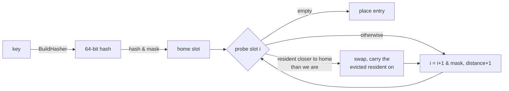

# Generic Hash Map (Robin Hood hashing)

`robin-hood-map` is a generic hash map for Rust built from scratch. It uses
**open addressing** with linear probing, **Robin Hood** insertion,
**backward-shift deletion** (so no tombstones), power-of-two **resizing** at
a 7/8 load factor, and has no `unsafe` code (`#![forbid(unsafe_code)]`).
Its API follows the parts of `std::collections::HashMap` that people use
most:

```rust
use robin_hood_map::RobinHoodMap;

let mut counts = RobinHoodMap::new();
for word in "the cat saw the other cat".split_whitespace() {
    *counts.entry(word).or_insert(0) += 1;
}
assert_eq!(counts["cat"], 2);
assert_eq!(counts.remove("the"), Some(2));
```

The crate supports:

- `insert`, `get`, `get_mut`, `get_key_value`, `contains_key`, `remove`,
  `remove_entry`, all of which accept any borrowed form of the key
  (`&str` for `String` keys).
- The full **entry API**: `Entry::{Occupied, Vacant}`, `or_insert`,
  `or_insert_with`, `or_default`, `and_modify`, `into_mut`, `remove_entry`.
- `iter`, `iter_mut`, `keys`, `values`, `values_mut` and `into_iter`, all
  `ExactSizeIterator` and `FusedIterator`.
- `with_capacity`, `reserve`, `shrink_to_fit`, `retain` and `clear`.
- A pluggable `BuildHasher` (SipHash `RandomState` by default).
- `Clone`, `Debug`, `Default`, `PartialEq`/`Eq` (order-independent),
  `Index`, `Extend`, `FromIterator` and `From<[(K, V); N]>`.
- `probe_stats()`, which reports a histogram of how far entries sit from
  their home slots.

## How it works



Every slot is `Option<Bucket { hash, key, value }>`. The table length is
always a power of two, so `hash & mask` gives the home slot and
`(i + 1) & mask` wraps around the end of the table.

```text
slot:      0      1      2      3      4      5      6      7
         [a:0]  [b:1]  [c:2]  [d:0]  [e:1]  [ -- ] [f:0]  [g:1]
          \_______________/    \__________/         \__________/
          a,b,c: home slot 0   d,e: home slot 3     f,g: home slot 6
                 (each cell shows key:probe distance)
```

**Insertion.** The new entry walks forward from its home slot. When it
meets a resident whose probe distance is *smaller* than its own (the
resident is "richer"), the two swap places, and the evicted resident carries
on walking. This takes from the rich and gives to the poor: no entry ends up
much farther from home than its neighbours.

**Lookup with early exit.** Robin Hood ordering means that along a probe
path, probe distances never rise by more than one per step. So if a lookup
reaches a resident that is closer to home than the lookup has travelled, the
key cannot be further along. Misses therefore stop early instead of
scanning to the next empty slot.

**Backward-shift deletion.** After a slot is emptied, each following entry
that is not at its home slot moves back one place, until the scan reaches an
empty slot or an entry that is at home. With tombstones, a table that sees
lots of churn fills with dead markers and eventually needs a full rehash.
Backward shifting avoids that: after any sequence of operations the table
looks the same as if those keys had simply been inserted.

**Cached hashes.** Each bucket stores the full 64-bit hash. That costs 8
bytes per entry, and in return:

- probe distances can be computed without rehashing;
- most non-matching keys are rejected by a cheap integer compare before
  `Eq` is called;
- resizing never calls the hasher again.

## Engineering concepts demonstrated

| Concept | Where |
| --- | --- |
| Invariant-driven design. The Robin Hood ordering is written down, checked by a test helper after every operation, and relied on by lookups that stop early | `src/map.rs` (module docs, `assert_invariants`) |
| Generic programming with trait bounds (`K: Eq + Hash`, `S: BuildHasher`, `K: Borrow<Q>`, `Q: ?Sized`), with bounds placed only on the `impl` blocks that need them | `src/map.rs` |
| Ownership and borrowing without `unsafe`. The entry API holds `&mut map` plus a slot index, and `VacantEntry::insert` returns `&'a mut V` | `src/entry.rs` |
| Separation of concerns: core algorithm, entry API, iterators and diagnostics each live in their own module | `src/{map,entry,iter,stats}.rs` |
| Differential testing against `std::HashMap` as an oracle, using a deterministic PRNG so every failure can be reproduced | `tests/api.rs`, `map::tests::stress` |
| Adversarial testing. A hasher that sends every key to one of 4 values creates the worst possible clustering | `map::tests::invariants_hold_with_a_pathological_hasher` |
| Resource correctness. `Rc` strong counts show that `clear` and `remove` drop values exactly once | `tests/api.rs` |
| Observability. `ProbeStats` makes an internal quality metric visible | `src/stats.rs`, `examples/probe_report.rs` |
| Benchmarking that compares fairly: both maps use the same hasher and the same key sets, measured with Criterion | `benches/vs_std.rs` |

## Design decisions and trade-offs

- **`Option<Bucket>` slots rather than a separate metadata array.** This
  layout is simple and safe, and keeping the key next to its hash helps
  cache locality on hits. The cost is space: for `<u64, u64>` each slot is
  32 bytes, including the `Option` tag and padding. `std`'s SwissTable keeps
  a separate 1-byte control array that it scans 16 slots at a time with
  SIMD. That design is much faster, but it needs `unsafe` and
  `MaybeUninit`.
- **7/8 maximum load factor.** This is high for linear probing. It works
  because Robin Hood hashing keeps the *variance* of probe lengths low. It
  does not lower the *mean*, which matches plain linear probing. A lower
  limit (for example 1/2) would make probes shorter but double the memory.
- **Low bits of the hash pick the slot.** With the default SipHash this is
  fine. With a weak hasher, keys that agree in their low bits pile up in the
  same few slots, and the example below shows the damage. Taking the high
  bits, or multiplying the hash by a large odd constant (Fibonacci hashing),
  would make the map more robust.
- **`entry()` reserves room for one entry first** (as `std` does). Because
  of that, a `VacantEntry` can insert without resizing, and the slot index
  it holds stays valid. The price is that looking up an existing key while
  the table is exactly full can trigger a resize that wasn't needed.
- **`retain` rebuilds the table.** It moves entries into a fresh table of
  the same size instead of deleting in place, because backward shifting
  during iteration would move entries the scan had not reached yet behind
  the cursor. The rebuild is O(buckets), allocates once, and never rehashes.

## Build, run, test

You need Rust 1.73 or newer.

```sh
cargo test                                      # unit, integration and doc tests
cargo clippy --all-targets -- -D warnings
cargo run --release --example probe_report      # probe-length histograms
cargo bench                                     # Criterion: RobinHoodMap vs std::HashMap
```

The test suite has 30 tests:

- **Unit tests (`src/`)**, which can see the internals. They check bucket
  sizing, the eviction rule, backward shifting, wrap-around, growth, shrink,
  and randomized stress runs with full invariant checks, using both SipHash
  and the pathological hasher.
- **Integration tests (`tests/api.rs`)**, which use only the public API.
  They cover every method, the entry-API variants, lazy `or_insert_with`,
  iterator counts, drop behaviour, equality semantics, probe-length bounds
  at 100k entries, and a 50,000-operation differential run against `std`.
- **The doc test** on `RobinHoodMap`.

## Example output

`cargo run --release --example probe_report` (shortened):

```text
== SipHash (default), 100000 sequential keys ==
entries=100000 buckets=131072 load=0.763 mean_distance=1.586 max_distance=24
  d=0      36053 ########################################
  d=1      25405 ############################
  d=2      15724 #################
  d=3       9279 ##########
  d=4       5588 ######
  ...
== SipHash, filled to exactly the 7/8 load limit ==
entries=114688 buckets=131072 load=0.875 mean_distance=3.501 max_distance=29
== Identity hasher, keys that are multiples of 64 (2,000 keys) ==
entries=2000 buckets=4096 mean_distance=15.1 max_distance=31
```

Even when the table is at the 7/8 limit, a successful lookup never probes
more than 30 slots. With a bad hash function, the mean distance is about 10
times worse, even though that table is less than half full.

## Benchmarks

Criterion, `u64 → u64`, both maps using `RandomState`. These were measured
on a shared cloud VM (`--measurement-time 2`), so treat them as ratios, not
absolute numbers.

| Operation | n | RobinHoodMap | std::HashMap |
| --- | ---: | ---: | ---: |
| insert (from empty, with growth) | 1,000 | 78.6 µs | 47.4 µs |
| insert (from empty, with growth) | 100,000 | 8.52 ms | 4.35 ms |
| lookup, hit | 1,000 | 12.8 µs | 13.3 µs |
| lookup, hit | 100,000 | 4.68 ms | 2.11 ms |
| lookup, miss | 1,000 | 11.8 µs | 11.8 µs |
| lookup, miss | 100,000 | 4.38 ms | 1.93 ms |
| insert then remove all | 1,000 | 58.0 µs | 30.9 µs |
| insert then remove all | 100,000 | 9.67 ms | 5.21 ms |

**How to read this:**

- **Small tables (1,000 entries) that fit in cache:** lookups are on par
  with `std`. SipHash dominates the cost, and short Robin Hood probes are as
  good as SwissTable's group scan.
- **Large tables (100,000 entries):** `std` is about 2× faster. Each of our
  slots is 32 bytes, against `std`'s 16-byte entries plus a 1-byte control
  array. So we touch more cache lines per probe, and SwissTable checks 16
  candidates with a single SIMD instruction.
- **Inserts:** we also lose on insert because each growth step reallocates
  a table of `Option`s and moves every bucket.

The obvious next steps are listed below.

## Possible extensions

- **Split metadata from entries.** Keep a `Vec<u8>` of probe distances
  (0 = empty) next to a `Vec<MaybeUninit<(K, V)>>`. Probes would then scan a
  dense byte array, which is the main idea behind SwissTable's speed.
- **Fibonacci hashing:** `(hash * 0x9E3779B97F4A7C15) >> (64 - log2(n))`,
  so weak hashers stop clustering.
- **Store a 32-bit hash fragment** instead of 64 bits, to shrink buckets.
- **Add a `RobinHoodSet<T>`** wrapper over `RobinHoodMap<T, ()>`, plus
  `drain`, `extract_if` and `try_reserve`.
- **Bound the maximum probe distance** and resize early when it is crossed,
  to defend against hash-flooding.
- **Fuzz and model-check:** run `cargo fuzz` with an operation-sequence
  target, and use `loom`/`miri` once the map contains `unsafe` code.
