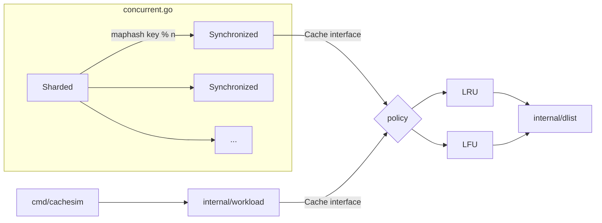

# LRU & LFU Caches

Bounded, generic in-memory caches for Go with **O(1)** `Get`, `Put` and
`Delete`:

- **`LRU[K, V]`** evicts the least recently used entry.
- **`LFU[K, V]`** evicts the least frequently used entry, breaking ties by
  recency, using the constant-time bucket design from Shah, Mitra & Matani
  (2010).
- **`Synchronized`** and **`Sharded`** make either policy safe for concurrent
  use, with one lock or many.
- **`cachesim`** is a small CLI that replays synthetic workloads against both
  policies so you can see where each one wins and where it fails.

Standard library only (Go 1.24+, for `maphash.Comparable`).

```go
c, err := cache.NewLRU[string, int](2,
	cache.WithOnEvict(func(k string, v int) { fmt.Println("evicted", k) }))
if err != nil { ... }
c.Put("a", 1)
c.Put("b", 2)
c.Get("a")    // a is now most recently used
c.Put("c", 3) // prints "evicted b"
fmt.Println(c.Keys()) // [c a]

// Concurrency-safe, 16 shards, 10k entries total, read-through loading.
users, _ := cache.NewShardedLFU[int, User](16, 10_000)
u, err := users.GetOrLoad(42, db.LoadUser)
```

## Concepts demonstrated

| Concept | Where |
| --- | --- |
| Hash map + intrusive doubly linked list for O(1) ordering | `lru.go`, `internal/dlist` |
| O(1) LFU with a list of frequency buckets | `lfu.go` |
| Generics with `comparable` keys and inline (unboxed) values | everywhere |
| Small interfaces enabling decorators | `Cache` in `cache.go`, wrappers in `concurrent.go` |
| Functional options, sentinel errors with `%w` wrapping | `cache.go` |
| Lock striping (sharding) and its consistency trade-offs | `concurrent.go` |
| Model-based testing against a naive reference | `model_test.go` |
| Native Go fuzzing | `FuzzCachesMatchModel` |
| Race-detector tests, benchmarks, runnable `Example`s | `*_test.go` |
| Testable CLI (`run(args, stdout, stderr) int`) | `cmd/cachesim` |

## Architecture



### LRU

A `map[K]*Node` finds an entry; a doubly linked list orders entries from most
recently used (front) to least (back). An access is "unlink, relink at
front"; eviction is "pop the back". Both are a few pointer writes.

```
map ──► a ⇄ c ⇄ b      front = MRU, back = next victim
```

### LFU

Entries live in **frequency buckets**. Buckets form a list in ascending
frequency, and each bucket keeps its entries in recency order:

```
buckets:  [freq 1] ⇄ [freq 3] ⇄ [freq 7]
             │          │          │
           e ⇄ d      b ⇄ c        a        (front = most recent)
```

- **Access**: move the entry from bucket *f* to bucket *f+1*, which is either
  the next bucket or a new one inserted right after the current one. No
  search.
- **Evict**: back entry of the first bucket (lowest frequency, then least
  recent).
- **Delete**: unlink the entry; if its bucket is now empty, unlink the bucket.

The popular "map of frequency → list plus a `minFreq` field" version is
O(1) for `Get`/`Put` but **not** for `Delete`: deleting the last entry at
`minFreq` forces a scan to find the new minimum. Keeping the buckets
themselves in a linked list removes that field entirely, so every operation
stays O(1).

`internal/dlist` exists because `container/list` stores `any` (boxing every
value) and cannot move a node between lists without reallocating it. LFU
promotion depends on relinking the same node into another bucket.

## Design decisions & trade-offs

- **Base caches are not thread-safe.** Single-goroutine owners (a request
  handler's local memo, a parser's symbol cache) should not pay for a mutex.
  Concurrency is added by composition (`Synchronized`, `Sharded`), not built
  into each policy.
- **`Mutex`, not `RWMutex`.** In a cache every `Get` updates recency or
  frequency, so there are no read-only operations that could share a lock.
- **Sharding is approximately LRU/LFU.** Each shard runs the exact policy on
  its own slice of the keys, so a hot shard may evict an entry that is better
  than a cold shard's worst one. In exchange, goroutines touching different
  shards do not contend. Capacity is split exactly (10 over 3 shards gives
  4/3/3), and `Len`/`Stats` on a sharded cache are summed shard by shard, so
  they are not point-in-time snapshots while writers are running.
- **`GetOrLoad` holds the lock while loading.** This means two goroutines
  never load the same key at the same time, but a slow loader blocks its whole
  shard. A per-key singleflight would remove that cost but add complexity
  (see extensions).
- **`Put` on an existing key counts as an access** (it refreshes recency, and
  bumps frequency in LFU), and it never evicts.
- **`Peek` changes nothing**: no promotion, no stats. Use it for debugging and
  for tests that must not disturb the order.
- **Eviction callback runs inline**, inside the lock for the wrappers. That
  keeps the cache simple and the callback ordered, at the cost of requiring
  callbacks to be quick and not re-enter the cache. Explicit deletes and
  overwrites do not trigger it.
- **Invalid construction returns an error** (`ErrInvalidCapacity`,
  `ErrInvalidShards`) rather than panicking, since capacity often comes from
  configuration. Misusing the internal list (relinking a node that is still
  linked, for example) panics, because that is a programming error.

## Choosing a policy

`cachesim` makes the trade-off measurable. Every policy sees the identical
key stream (same seed). Results with 10,000 keys, a 500-entry cache and
200,000 requests:

```text
$ make sim
workload=zipf keys=10000 ops=200000 capacity=500 seed=1
  policy    hits  misses  evictions  hit-ratio
     LRU  141399   58601      58101     70.70%
     LFU  152759   47241      46741     76.38%

workload=scan-mix keys=10000 ops=200000 capacity=500 seed=1
  policy    hits  misses  evictions  hit-ratio
     LRU   87769  112231     111731     43.88%
     LFU  105287   94713      94213     52.64%

workload=shift keys=10000 ops=200000 capacity=500 seed=1
  policy    hits  misses  evictions  hit-ratio
     LRU  140410   59590      59090     70.20%
     LFU  123780   76220      75720     61.89%

workload=loop keys=10000 ops=200000 capacity=500 seed=1
  policy  hits  misses  evictions  hit-ratio
     LRU     0  200000     199500      0.00%
     LFU     0  200000     199500      0.00%
```

| Workload | What it models | Result |
| --- | --- | --- |
| `zipf` | Stable popularity | LFU wins: counts identify the hot set more reliably than recency does |
| `scan-mix` | Hot traffic plus periodic batch scans of one-off keys | LFU wins: scanned keys never get past frequency 1, while LRU lets them flush the hot set |
| `shift` | The hot set moves every 20k requests | LRU wins: LFU keeps yesterday's favourites because their old counts are high |
| `loop` | Cyclic scan larger than the cache | Both get 0%: each key is evicted just before it is needed again |

`TestPolicyTradeOffs` pins each of these outcomes, so a regression in either
policy fails the build. The `shift` and `loop` rows are why production caches
often use adaptive or aging policies (ARC, 2Q, W-TinyLFU) instead of either
pure policy.

## Build, run, test

```sh
make test     # go test ./...
make race     # go test -race ./...   (concurrency tests)
make cover    # ~99-100% statement coverage per package
make fuzz     # 30s of fuzzing both caches against their models
make bench    # benchmarks, including Synchronized vs Sharded under -cpu=1,4
make sim      # the table above
make build    # bin/cachesim

go run ./cmd/cachesim -workload shift -capacity 2000 -keys 50000 -seed 3
go run ./cmd/cachesim -h
```

### How the tests are organised

- **Unit tests** (`lru_test.go`, `lfu_test.go`) cover each rule: eviction
  order, tie-breaking, updates, `Peek`, `Delete` from a middle bucket, stats
  and callbacks.
- **Model-based tests** (`model_test.go`) run thousands of random operations
  against both the real cache and a deliberately naive O(n) model in which
  every entry stores its last-access time and access count, and eviction just
  scans for the minimum. They must agree on every return value, every
  eviction and `Len` after every step. The same check runs as a **fuzz
  target**; without `-fuzz`, its seed corpus runs as part of `go test`.
- **Concurrency tests** hammer both wrappers from 16 goroutines and check
  invariants (`Len ≤ Cap`, `hits + misses = gets`, no cross-key values), with
  `-race` doing most of the work.
- **Examples** in `example_test.go` are compiled, run and checked against
  their `// Output:` comments, so the documentation cannot drift.

### Benchmarks

Read-through over a Zipf(1.1) key stream on a 2-vCPU sandbox:

```text
BenchmarkGetOrPut/LRU/cap=4096     52 ns/op   80.0 hit%   9 B/op   0 allocs/op
BenchmarkGetOrPut/LFU/cap=4096    135 ns/op   80.3 hit%  63 B/op   0 allocs/op
```

LFU costs about 2.5× LRU per operation because promotion touches two lists
and sometimes allocates a bucket. "0 allocs/op" is a rounded average: a node
is allocated only on a miss. The `BenchmarkParallel` comparison of one lock
against 16 shards only shows its benefit with real parallelism; on a 2-core
machine the numbers are dominated by scheduling noise, so run it on more
cores with `-cpu=1,4,8,16`.

## Possible extensions

- Per-key **singleflight** in `GetOrLoad`, so a slow load blocks only callers
  for the same key.
- **TTL expiry** with a time source injected through an option, for
  deterministic tests.
- **Aging LFU** (halve all counts periodically, or use a decaying sketch) to
  fix the `shift` workload, building towards **W-TinyLFU**.
- **ARC** or **2Q** as more `Cache` implementations, added to `cachesim`.
- **Pooling bucket nodes** in LFU to remove the allocation on promotion.
- Weighted entries (capacity in bytes rather than entries).
