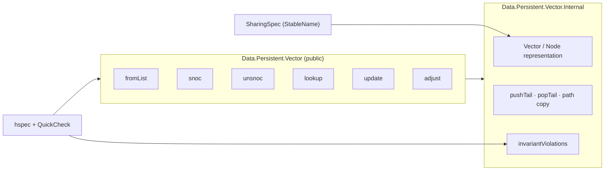

# Persistent Immutable List & Vector

Two persistent (immutable, versioned) sequence types for Haskell, built on
**structural sharing**:

- **`Data.Persistent.List`**: a strict-spined cons list. `cons` shares the
  whole input, `drop` allocates nothing, and `update`/`take`/`append`/`filter`
  copy only the prefix they must change.
- **`Data.Persistent.Vector`**: a 32-way **bit-partitioned vector trie** with
  a tail buffer, the design behind Clojure's `PersistentVector` and Scala's
  `Vector`. Indexing and updates are O(log₃₂ n) (at most 4 hops for a
  million elements), `snoc`/`unsnoc` are amortised O(1), and each update
  copies a single root-to-leaf path.

Both are verified with **QuickCheck properties** against Prelude lists, a
**model-based state machine test**, a structural **invariant checker**, and
tests that prove sharing with `StableName`s.

```haskell
import qualified Data.Persistent.Vector as V

let v1 = V.fromList "persistent"
    v2 = V.update 0 'P' v1      -- copies one path, shares the rest
    v3 = v2 V.|> '!'            -- touches only the tail
v1 V.!? 0                       -- Just 'p': old versions never change
v3 V.!? 10                      -- Just '!'
```

Dependencies: `base` and `array` for the library; `hspec` and `QuickCheck`
for tests; `containers` for the benchmark comparison. Tested with GHC 9.4.7
and cabal 3.8.

## Concepts demonstrated

| Concept | Where |
| --- | --- |
| Persistence and structural sharing | both modules; proved in `test/SharingSpec.hs` |
| Path copying in a trie | `adjust`, `snoc`/`pushTail`, `unsnoc`/`popTail` in `Vector/Internal.hs` |
| Bit-partitioned indexing (index bits *are* the path) | `slot`, `lookup` |
| Amortisation via a tail buffer | `snoc`, `unsnoc` |
| O(n) bottom-up bulk construction | `fromList` |
| Canonical representation and an executable invariant | `invariantViolations` |
| Property-based testing against a reference model | `test/ListSpec.hs`, `test/VectorSpec.hs` |
| Model-based (state machine) testing with history checks | "model-based state machine" in `VectorSpec` |
| Boundary-value testing at shape transitions | `boundarySizes` in `test/Gen.hs` |
| Typeclass laws (Functor, Foldable, Traversable, Semigroup, Monoid) | "laws" sections |
| Public API vs. `.Internal` module split | `Vector.hs` re-exports a safe subset |

## Architecture

```text
Vector { size = 1100, shift = 10, root, tail }

tailOffset = ((1100 - 1) >> 5) << 5 = 1088

                     root  (Branch, shift 10)
                    /                        \
     Branch (shift 5)                         Branch (shift 5)
    /    |    ...    \                        /          \
  Leaf  Leaf  ...   Leaf                   Leaf         Leaf
  0-31  32-63     992-1023              1024-1055    1056-1087

tail: [1088 .. 1099]   (always 1..32 elements in a non-empty vector)
```

Every leaf in the tree is full; only the tail may be partial. Looking up
index `i` in the tree reads 5 bits per level, most significant first (here
in a vector big enough to contain it):

```text
i = 1500 = 0b 00001 01110 11100
              │     │     └ slot in leaf   (i      & 31) = 28
              │     └────── slot at shift 5 ((i>>5) & 31) = 14
              └──────────── slot at shift 10((i>>10)& 31) = 1
```



### Path copying, concretely

`update 1500 x v` on a 5,000-element vector (depth 2) allocates three new
arrays: the root, the branch at slot 1, and the leaf at slot 14. The other
four root children, the other 31 leaves under slot 1, and the tail are the
*same heap objects* in both versions. `SharingSpec` asserts exactly this.

## Design decisions and trade-offs

- **Branching factor 32.** Wide nodes make trees shallow (reads are fast and
  cache friendly) at the cost of copying up to 32 pointers per level on
  write. 32 is the established sweet spot; `bits` is a single constant, so
  experimenting is a one-line change.
- **Tail buffer.** Appends go to a separate array and only enter the tree
  once per 32 elements, making `snoc` amortised O(1). The cost is a second
  case in every operation (`i >= tailOffset`).
- **Canonical shape.** For any size there is exactly one valid tree: full
  leaves, a tail of 1–32, no single-child root above minimum depth. This
  makes the invariant checkable, lets `fromList` and repeated `snoc` be
  tested for agreement, and means `unsnoc` must actively *collapse* the root.
- **Immutable `Data.Array`.** Simple and safe; every write is a fresh copy.
  A production version would use `SmallArray#` (via `primitive`) and
  transient (locally mutable) building, which is the main reason
  `Data.Sequence` builds faster below.
- **Strict spine, lazy elements.** Both structures force their shape
  (no thunk chains, predictable memory, `length` is safe) while elements
  stay lazy, matching `Data.Sequence`.
- **Total API.** `lookup`/`!?`/`head` return `Maybe`; out-of-range `update`
  and `adjust` return the input unchanged (as in `Data.Sequence`) and, as
  the sharing tests check, *the same object*, not a copy.
- **List `filter` shares its longest passing suffix** instead of rebuilding
  the whole list, at the cost of a non-tail-recursive pass.
- **No `cons`/concat in O(log n) for the vector.** That needs an RRB-tree
  (relaxed radix balanced); see extensions.

## Build, run, test

```bash
make test     # cabal test: 72 examples, ~20 s (the big model test dominates)
make demo     # guided tour of versions and shapes
make bench    # vector vs Data.Sequence vs list
make match M=sharing   # run one part of the suite
```

The test suite needs `hspec` and `QuickCheck`. With Hackage access, `cabal`
fetches them; offline, distro packages work (Debian/Ubuntu:
`apt install ghc cabal-install libghc-hspec-dev libghc-quickcheck2-dev`).

### Example output

`make demo` (excerpt):

```text
== Persistent vector: shape as it grows ==
     size  depth     tree  tail
        0      1        0     0
       33      1       32     1
     1056      1     1024    32
     1057      2     1056     1
    32800      2    32768    32
    32801      3    32800     1
  1000000      3   999968    32

== Persistent vector: a thousand versions are cheap ==
built 1001 versions of a 1,000,000-element vector
original element 7919  = Just 7919
latest   element 7919  = Just (-1)
```

`make bench` (n = 200,000, median of 5, 2-vCPU sandbox):

```text
Vector  fromList (bulk)               22.2 ms
Vector  repeated snoc                 60.2 ms
Seq     fromList                       8.0 ms
Vector  lookup x n                    83.5 ms
Seq     lookup x n                   110.6 ms
Vector  update x n                   111.0 ms
Seq     update x n                   169.3 ms
List    update x 200                1996.2 ms
```

The vector beats the finger tree on random reads and writes; `Data.Sequence`
wins construction thanks to its tuned, unboxed internals; the list's O(i)
indexing makes even 200 updates slower than 200,000 vector updates.
Bulk `fromList` is ~3× faster than repeated `snoc`, which copies the tail
array on every append.

### What the tests cover

- **Agreement with Prelude lists** for every operation, on sizes biased
  towards the shape boundaries (31/32/33, 1056/1057, 32800/32801, ...).
- **Laws**: reverse involution, Semigroup associativity, Monoid identity,
  Functor identity/composition, `unsnoc . snoc == Just`,
  `update i (lookup i) == id`.
- **Boundary sizes**: for each, bulk and incremental builds must agree and
  be well formed, and draining with `unsnoc` must stay well formed at every
  size on the way down to empty.
- **State machine**: 200 random sequences of `snoc`/`unsnoc`/`update`/
  `adjust` from starting sizes that straddle boundaries, checking invariants
  after every step, then checking that *every historical version* still
  matches its model.
- **Sharing**: `StableName` equality shows which subtrees are the same heap
  objects after each operation.

The invariant checker was mutation-tested: disabling root collapse in
`unsnoc` makes 7 boundary tests fail.

## Possible extensions

- **RRB-tree** relaxation for O(log n) concatenation, slicing and `cons`.
- **Transients**: a mutable builder in `ST` for bulk updates, then freeze.
- `SmallArray#`-backed nodes and `INLINE` pragmas, benchmarked with
  `tasty-bench`.
- A **persistent hash array mapped trie** (HAMT) reusing the same node and
  path-copying code.
- `Foldable`-based `foldMap` that skips the list round-trip for `Eq`/`Ord`.
