# 032 · Skip List

**Stack:** Java 21 (records, pattern matching, `RandomGenerator`), JUnit 5 · **Level:** Intermediate · **Area:** Data structures

A sorted map backed by a probabilistic **skip list** (William Pugh, 1990), extended into an
**indexable** skip list. Every forward pointer records how many entries it jumps, the same
"span" trick Redis uses for sorted sets. You get the usual ordered-map operations, plus
**rank / select** and **range counts in O(log n)**, a live **range view** with a fail-fast
iterator, and a benchmark against `java.util.TreeMap` (a red-black tree).

```java
var scores = new SkipListMap<Integer, String>();
scores.put(70, "carol"); scores.put(95, "alice"); scores.put(82, "bob");

scores.ceilingKey(80);                           // 82
scores.rank(82);                                 // 1   (entries strictly below 82)
scores.select(0);                                // 70=carol
scores.range(Range.closed(75, 100)).size();      // 2   (two rank lookups, no walk)
scores.range(Range.atLeast(80)).keys();          // [82, 95]
```

## How a skip list works

Level 0 is a sorted linked list. Each node also gets a random **height**: with probability
`p` it is promoted to the next level, and again, and so on. Each level is then a sparser
"express lane" over the one below it. A search starts at the top-left sentinel, moves right
while the next key is smaller, and drops a level when it would overshoot.

```
level 3  H ─────────────────(4)────────────────► 40 ─────────────────(3)───────────────► nil
level 2  H ───────(2)──────► 20 ───────(2)─────► 40 ───────(2)─────► 60 ───────(1)─────► nil
level 1  H ──(1)─► 10 ──(1)► 20 ───────(2)─────► 40 ──(1)► 50 ──(1)► 60 ───────(1)─────► nil
level 0  H ──(1)─► 10 ──(1)► 20 ──(1)► 30 ──(1)► 40 ──(1)► 50 ──(1)► 60 ──(1)► 70 ──(0)► nil

         (n) = span: how many level-0 steps the pointer covers (a nil pointer spans the rest)
```

**Rank via spans:** adding up the spans along a search path gives a position. `rank(50)` walks
to the last key below 50: `H→40` at level 3 adds 4, every later pointer would reach 50 or
beyond, so the answer is **4**. `select(4)` (the 5th entry) takes a pointer only while the
running total stays ≤ 5: `H→40` gives 4, then `40→60` at level 2 would give 6, so it drops a
level, and `40→50` at level 1 gives 5, so it returns **50**.

```mermaid
flowchart LR
    subgraph API
        M[SkipListMap&lt;K,V&gt;<br/>extends AbstractMap]
        RV[RangeView<br/>size / iterator / stream / keys]
        R[Range&lt;K&gt; record<br/>open · closed · unbounded]
    end
    subgraph Policy
        LG[[LevelGenerator]]
        G[GeometricLevelGenerator<br/>p, RandomGenerator]
    end
    M -->|range&#40;Range&#41;| RV
    RV --> R
    M -->|nextLevel&#40;max&#41;| LG
    G -.implements.-> LG
    M --> S[SkipListStats record]
    B[bench.Benchmark] --> M
    B --> T[java.util.TreeMap]
```



## Complexity

| Operation | SkipListMap (expected) | TreeMap (worst case) |
|---|---|---|
| `get` / `put` / `remove` / `floor` / `ceiling` … | O(log n) | O(log n) |
| `firstKey` / `pollFirstEntry` | O(1) / O(log n) | O(log n) |
| `rank(key)`, `select(i)` | **O(log n)** | O(n), no API |
| `range(r).size()` | **O(log n)** | O(log n + k), `subMap().size()` walks the range |
| iterate *k* entries of a range | O(log n + k) | O(log n + k) |
| memory | `1/(1-p)` pointers + spans per entry | 3 pointers + colour bit per entry |

The skip list's bounds are *expected* over the random coin flips. They do not depend on the
input order, so no adversarial key sequence can degrade it as long as the randomness is
hidden. The O(log n) order statistics are paid for on writes: every insert and delete
updates one span on each active level.

## Engineering concepts and design decisions

- **Randomness behind an interface (Strategy + dependency injection).** `LevelGenerator` is
  a one-method functional interface. Production uses `GeometricLevelGenerator`
  (configurable `p`, any `java.util.random.RandomGenerator`). Tests pass a seeded generator
  for reproducibility, or a **scripted lambda** (`max -> heights.nextInt()`) to build an
  exact, hand-checkable shape. The map also validates what the generator returns, so a bad
  strategy fails loudly instead of corrupting the structure.
- **One search, many operations.** `lastBefore(key, inclusive)` is the only navigation walk.
  `floor`, `ceiling`, `lower`, `higher`, `containsKey` and range starts all wrap it, and
  `countBefore` is the same walk with span accumulation. Less duplicated pointer logic means
  fewer places for off-by-one bugs.
- **Fitting the platform's contracts.** Extending `AbstractMap` gives `equals`, `hashCode`,
  `toString`, `keySet` and `values` that interoperate with any `Map`; the tests assert
  `skipList.equals(treeMap)` both ways. Navigation methods return immutable snapshot
  entries, while iterator entries write through on `setValue`, which matches `TreeMap`.
  Null keys are rejected and null values are allowed.
- **Fail-fast iterators.** A `modCount` is bumped on every *structural* change (replacing a
  value is not structural). Iterators check it and throw `ConcurrentModificationException`.
  `Iterator.remove()` works by unlinking through the map and re-syncing the expected count.
- **Live, lazy range views.** `range(Range)` validates bounds against the map's own
  comparator (a `Range` record has none), then returns a view that reads the current map
  every time it is used. Nothing is copied until you ask for `keys()`.
- **Invariant checking as a test oracle.** The package-private `checkInvariants()` checks
  level-0 order, `size`, the current level count, that every tower is linked within its
  height, and that **every span equals the true positional distance**. Mutation sanity
  check: dropping the `span--` in `remove` makes 12 tests fail.
- **Differential (model-based) testing.** `DifferentialTest` runs 20,000 random
  put/remove/get/navigation/range/rank/select/iterator-remove operations per seed against
  `TreeMap` as the oracle, and compares every result, across 7 seeds and both `p` values.

### Trade-offs

- **Skip list vs balanced tree.** The skip list is far simpler to make correct: no rotations
  or colour cases, and inserts and deletes are local. It also extends cleanly to order
  statistics and to lock-free concurrency (`ConcurrentSkipListMap`). The cost is pointer
  chasing through `Node → Node[]` arrays, which hurts cache locality. The benchmark below
  shows `TreeMap` ahead on point operations and plain iteration.
- **`p = 1/2` vs `1/4`.** Both give the same expected search cost (`(1/p)·log_{1/p} n =
  2·log2 n`). `1/4` uses 1.33 pointers per entry instead of 2, but the measured searches are
  slower here and less predictable. The default is `1/2`.
- **Spans cost writes.** Every insert and delete touches a span on each active level, even
  levels the node does not reach. That is the price of O(log n) `rank` and range counts.
- **Not thread-safe.** That keeps the code clear; the Javadoc points to
  `ConcurrentSkipListMap` for concurrent use.
- **Fixed `MAX_LEVEL = 32`.** It is enough for 2³² entries at `p = 1/2`. The head allocates
  32 slots once; data nodes allocate only their own height.

## Project layout

```
src/main/java/dev/omar/skiplist/
  SkipListMap.java              core structure: search, insert/delete with spans, views, invariants
  Range.java                    record of optional open/closed bounds + factories
  LevelGenerator.java           strategy interface for node heights
  GeometricLevelGenerator.java  Pugh's coin-flip generator (configurable p, seedable)
  SkipListStats.java            structural snapshot (levels, pointers, nodes per level)
  bench/Benchmark.java          SkipListMap (p=1/2, p=1/4) vs TreeMap micro-benchmark
src/test/java/dev/omar/skiplist/
  SkipListMapTest.java          map contract, navigation, rank/select, iterators, scripted shapes
  RangeQueryTest.java           14 parameterised ranges, live views, fail-fast range iterator
  DifferentialTest.java         20k random ops per seed vs TreeMap + invariant checks
  GeometricLevelGeneratorTest   distribution P(h ≥ k) = p^(k-1), mean 1/(1-p), validation
```

## Build, run, test

```bash
mvn test                                   # JUnit 5 via Maven Central
mvn package && java -jar target/skip-list-1.0.0.jar 200000 42   # benchmark

./run-tests.sh                             # no Maven: javac + JUnit console launcher + local jars
./run-bench.sh [size] [seed]               # no Maven: compile and run the benchmark
```

`run-tests.sh` uses jars from `/usr/share/java` (Debian/Ubuntu: `apt install junit5`). Maven
Central could not be reached in this repo's build environment, so the suite was run with
`run-tests.sh` on OpenJDK 21: **79 tests, all passing**, with `-Xlint:all -Werror` on both
main and test sources.

## Example output

`./run-bench.sh` (200k random inserts into a 800k key space, 20k queries, ranges 1,000 keys
wide; best of 5 rounds after 3 warm-ups; your numbers will vary):

```
ns/op             SkipListMap p=1/2   SkipListMap p=1/4             TreeMap
put                           847.5               939.2               342.3
get                           683.6              1306.5               407.1
range count                  1185.7              2133.1             10741.8
range iterate                8682.5             14727.5              3135.7

p=0.50: 177090 entries, 23 levels, 2.00 pointers/entry, first levels [177090, 88702, 44353, 22158, 11105, 5581]
p=0.25: 177090 entries, 9 levels, 1.33 pointers/entry, first levels [177090, 44188, 11019, 2680, 680, 181]
```

What this shows:

- **Range count is about 9× faster** than `TreeMap.subMap(...).size()`, because the spans turn
  it into two O(log n) rank lookups instead of a walk over about 250 entries.
- **TreeMap wins point operations and iteration** by about 2–3×. Its nodes hold fields
  directly, while each skip-list hop reads a separate `next[]` array, so it pays an extra
  cache miss per step.
- The **level histogram halves (or quarters) at each level**, which confirms the geometric
  distribution, and pointers per entry match `1/(1-p)` exactly.

This is a hand-rolled harness and not JMH, so treat the numbers as relative.

## Possible extensions

- Implement the full `NavigableMap` interface (`subMap`, `headMap`, `descendingMap` views)
  and run it against Guava's `NavigableMapTestSuiteBuilder` testlib.
- Add backward pointers on level 0 (as Redis does) for O(1) reverse-iteration steps.
- Flatten nodes into parallel primitive arrays, or specialise for `int` keys, to fix cache
  locality and boxing, then re-measure against `TreeMap`.
- Build a lock-free variant with `VarHandle` CAS on level 0 and lazy index levels, compared
  against `ConcurrentSkipListMap`.
- Move the benchmark to JMH and add a sorted-insert workload, where `TreeMap` rebalances
  constantly and the skip list does not care.
