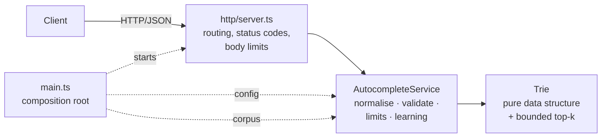

# 033 · Trie Autocomplete Service

A prefix tree (trie) with frequency-ranked completions, wrapped in a tiny,
dependency-free HTTP API. Type `ty` and get `typescript`, `type`, `types`;
pick `typed` a few times and it climbs the list.

**Stack:** TypeScript 5 (strict), Node ≥ 18 `node:http`, Vitest · **Level:** Starter · **Area:** Data structures

## What it does

- `Trie` stores words with an integer frequency and supports `insert`,
  `increment`, `has`, `hasPrefix`, `delete` (with branch pruning) and
  `complete(prefix, limit)`, which returns the top-k words under a prefix.
- `AutocompleteService` adds policy: input normalisation, limits, merging of
  duplicate words, and learning from user selections.
- A small HTTP server exposes it as JSON. Its only runtime dependency is Node itself.

## Architecture



```
root
 └─ t
    ├─ r ─ e ─ e(880)
    │        └─ s(260)
    └─ y ─ p ─ e(900)
                ├─ d(300)
                ├─ o ─ f(410)
                └─ s(620) ─ c ─ r ─ i ─ p ─ t(950)
```

Each node holds a `Map<char, node>` and an optional frequency. A node with a
frequency ends a word. A node without one is only a prefix.

## Engineering concepts and design decisions

| Decision | Why | Trade-off |
|---|---|---|
| **Layered design**: Trie → Service → HTTP adapter | The trie is a reusable, pure structure with no knowledge of HTTP, casing or limits. The HTTP layer only translates requests and errors. Each layer is tested on its own. | A few more files than one big module. |
| **`Map` children instead of a 26-slot array** | Works for any Unicode alphabet, and sparse nodes don't allocate unused slots. | Slightly slower per lookup than array indexing. |
| **Code-point iteration** (`for…of` on strings) | Emoji and other astral characters are one edge, not two broken UTF-16 halves. | None worth noting at this scale. |
| **Bounded top-k with binary insertion** | `complete` visits the m words under the prefix once but keeps only the best k, costing O(p + m log k). Results come out already sorted. | Very short prefixes (`"t"`) still scan the whole subtree. See *Extensions*. |
| **Deterministic ranking**: frequency desc, then alphabetical | The same input always gives the same output, which matters for tests, caching and user trust. | — |
| **Iterative DFS, iterative pruning** | There is no recursion, so very long keys can't overflow the call stack. | Slightly less elegant than recursion. |
| **Prune on delete** | Insert/delete churn does not leak dead nodes. | Delete records its path, using O(length) extra memory. |
| **Normalisation at the edge** (NFKC + locale-independent lowercasing + whitespace collapse) | `" TypeScript"`, `"typescript"` and full-width `"ＴＹＰＥ"` all map to one key. Normalisation is a policy, so it lives in the service and not in the trie. | Case-preserving display would need a separate "display form" table. |
| **Defensive HTTP**: 1 KiB body cap, content-type check, `limit` ceiling, max query length | A public endpoint should not let a client force huge scans or unbounded buffering. | — |
| **Typed error mapping** (`ValidationError` → 400, `HttpError` → its status, anything else → 500) | Clients get useful 4xx messages. Unexpected errors are logged but never leak stack traces. | — |
| **Config from an injected `env` object** | `loadConfig(env)` is pure and easy to test. Only `main.ts` reads `process.env`. | — |
| **No framework** | Four endpoints don't justify Express. The project stays dependency-free and the routing stays readable. | Hand-rolled routing doesn't scale to dozens of routes. |

## API

| Method & path | Description | Responses |
|---|---|---|
| `GET /health` | Liveness and index size | `200 {"status":"ok","words":33}` |
| `GET /suggest?q=<prefix>&limit=<n>` | Ranked completions. `limit` defaults to `DEFAULT_LIMIT` and is capped at `MAX_LIMIT`. | `200 {"query","suggestions":[{"word","frequency"}]}`, `400` |
| `POST /select` with `{"word":"typed"}` | Records a pick (+1 frequency). Unknown words are learned. | `200 {"word","frequency"}`, `400`, `413`, `415` |
| `DELETE /words/:word` | Removes a word | `204`, `404`, `400` |

Wrong methods return `405` with an `Allow` header. Unknown paths return `404`.

## Build, run, test

```bash
npm install
npm test            # 50 Vitest tests (unit + real-HTTP integration)
npm run coverage    # ~99% line coverage
npm run typecheck
npm run build && npm start
```

Configuration is read from environment variables:

| Variable | Default |
|---|---|
| `HOST` | `127.0.0.1` |
| `PORT` | `3000` |
| `CORPUS_PATH` | `data/words.tsv` (`word<TAB>frequency`, `#` comments) |
| `DEFAULT_LIMIT` / `MAX_LIMIT` | `5` / `50` |
| `MAX_QUERY_LENGTH` | `100` |

### Example session

```console
$ PORT=3911 npm start
autocomplete: 33 words, listening on http://127.0.0.1:3911

$ curl -s 'localhost:3911/suggest?q=ty&limit=3'
{"query":"ty","suggestions":[{"word":"typescript","frequency":950},{"word":"type","frequency":900},{"word":"types","frequency":620}]}

$ curl -s -X POST -H 'Content-Type: application/json' -d '{"word":"typed"}' localhost:3911/select
{"word":"typed","frequency":301}
```

## Testing approach

- **Unit tests** cover each trie operation, including edge cases: a prefix that is
  also a word, deletes that must prune vs. keep nodes, emoji keys, and invalid input.
- **Reference-model test**: 2,000 random words from a seeded generator are
  checked against a brute-force filter-and-sort for several prefixes. This
  catches ranking and top-k bugs that hand-picked cases miss.
- **Integration tests** start the real server on an ephemeral port and call it
  with `fetch`. Mocks are only used to force the 500 path.
- Writing the tests caught a real bug: trimming each corpus line *before*
  splitting on tabs silently turned `"\t5"` into the word `"5"`.

## Possible extensions

- **Cached top-k per node**: store each node's best k words and update them on
  insert. Queries become O(p + k) regardless of subtree size, at the cost of
  memory and slower writes.
- **Radix/compressed trie**: merge single-child chains to cut node count.
- **Fuzzy matching**: run a bounded Levenshtein search over the trie for typo tolerance.
- **Persistence**: snapshot `entries()` to disk periodically so learned frequencies survive restarts.
- **Time decay**: down-weight old selections so trending terms rise.
- **Per-user personalisation**: add a small per-user trie whose results are blended with the global one.
