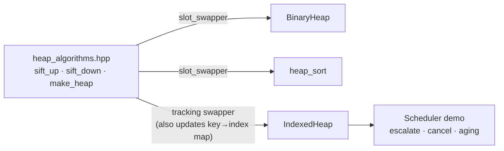

# 034 · Binary Heap & Priority Queue

**Stack:** C++20 (concepts, ranges, `constexpr` algorithms), CMake, GoogleTest · **Level:** Starter · **Area:** Data structures

A small header-only library, `heapq`, with three heap-based tools that share
one set of sift algorithms:

| Component | What it is | Key operations |
|---|---|---|
| `BinaryHeap<T, Compare>` | Value-semantic priority queue | `push`/`emplace` O(log n), `pop` → `T` O(log n), O(n) range construction |
| `IndexedHeap<Key, Priority, Compare>` | Addressable priority queue | `decrease_key`, `update`, `erase(key)` O(log n), `contains`/`priority_of` O(1) |
| `heap_sort(first, last, comp)` | In-place sort | O(n log n) worst case, O(1) extra memory, usable in `constexpr` |

A **task scheduler demo** builds on `IndexedHeap` to show why decrease-key
matters. It escalates and cancels queued tasks in O(log n), and *aging*
promotes long-waiting tasks so low-priority work can't starve.

```cpp
#include "heapq/heapq.hpp"

heapq::BinaryHeap<int> heap{5, 1, 8, 3};   // min-heap, heapified in O(n)
heap.pop();                                 // 1
heapq::MaxHeap<int> biggest{4, 10, 2};      // 10 on top

heapq::IndexedHeap<std::string, int> dist;  // e.g. Dijkstra's frontier
dist.push("A", 0);
dist.push("B", 100);
dist.decrease_key("B", 7);                  // found a shorter path
dist.pop();                                 // {"A", 0}

std::vector<int> v{3, 1, 2};
heapq::heap_sort(v);                        // {1, 2, 3}
heapq::heap_sort(v, std::ranges::greater{}); // {3, 2, 1}
```

## Concepts and design decisions

**Implicit tree in an array.** The heap is a complete binary tree stored
breadth-first in a `std::vector`, with `parent(i) = (i-1)/2` and
`left(i) = 2i+1`. There are no node allocations or pointers, and the layout
is cache-friendly near the root.

```
index:  0   1   2   3   4   5   6          1
value: [1,  3,  2,  7,  4,  9,  5]       /   \
                                        3     2
                                       / \   / \
                                      7   4 9   5
```

**One algorithm, pluggable bookkeeping.** `sift_up`, `sift_down` and
`make_heap` in `heap_algorithms.hpp` never move elements directly. They call
a `swap(i, j)` callback:



`BinaryHeap` and `heap_sort` pass a plain swap. `IndexedHeap` passes one that
also updates its `unordered_map<Key, index>`. The loops exist once, and the
position table cannot drift out of sync because every move goes through it.

**Floyd's heapify.** Building from a range sifts down each internal node from
the bottom up. That costs O(n) total instead of O(n log n) for n pushes,
because most nodes sit near the leaves and barely move.

**A comparator meaning "leaves first".** `Compare(a, b)` means *a pops
before b*. So `std::less` gives a min-heap, which matches what schedulers
and graph algorithms want. `std::priority_queue` defaults to a max-heap, and
its `Compare` reads as "a is lower priority". `MaxHeap<T>` is the alias for
the other direction. Template parameters are constrained with
`std::strict_weak_order`, so a bad comparator fails at the call site with a
readable error.

**Decrease-key needs an index.** A plain heap can't find an element without
an O(n) scan. `IndexedHeap` trades extra memory (one hash entry per key) for
O(1) lookup, which makes `decrease_key`, `update` and `erase` O(log n).
`decrease_key` only sifts up and rejects a priority that points the wrong
way (`PriorityDirectionError`). `update` handles either direction. Removing
from the middle swaps in the last leaf, which may then need to move *either*
way. That is an easy case to get wrong, and the property tests cover it.

**Errors you can catch, not UB.** `pop()`/`top()` on an empty heap throw
`EmptyHeapError`, which derives from `std::out_of_range`. `try_pop()`
returns `std::optional` for the non-throwing path, and `pop()` returns the
element by value, so move-only types like `std::unique_ptr` work.
`IndexedHeap::push` gives the strong exception guarantee: if the map insert
throws, the array is rolled back.

**Heaps are not stable.** Equal-priority elements come out in arbitrary
order. The scheduler gets FIFO fairness by ranking tasks on
`(priority, sequence)`, compared with a defaulted `operator<=>`.

**Aging against starvation.** With a steady stream of urgent work, a
priority-9 task never runs. With `aging_threshold = N`, a task is promoted
one level every N dispatches (via `decrease_key`). Promoted tasks keep their
original sequence number, so they beat newer work at the same level.

### Trade-offs

- **Binary vs d-ary / pairing / Fibonacci heaps.** Fibonacci heaps have O(1)
  amortised decrease-key, but large constants and poor locality make them
  slower in practice for most sizes. A 4-ary heap would make the tree
  shallower and improve cache use. I chose binary for clarity.
- **Hash map index vs handles.** Mapping keys to positions keeps the API
  key-based (natural for graph vertices and task ids), but costs a hash per
  swap. Returning opaque handles into a stable slot array would avoid
  hashing, but the caller would have to keep the handles.
- **Aging cost.** `apply_aging` scans every pending task after each
  dispatch, which is O(n log n) in the worst case. A production scheduler
  would use per-level FIFO buckets (O(1) per operation for a small fixed
  number of levels) or compute effective priority lazily from timestamps.
- **Heapsort vs `std::sort`.** Heapsort guarantees O(n log n) with O(1)
  memory, but it jumps around memory and is unstable. Introsort is faster on
  average and uses heapsort only as its worst-case fallback.

## Project layout

```
include/heapq/
  heap_algorithms.hpp   sift_up/sift_down/make_heap/is_heap (shared core)
  binary_heap.hpp       BinaryHeap, MaxHeap
  indexed_heap.hpp      IndexedHeap with decrease_key/update/erase
  heap_sort.hpp         heap_sort (iterator + range overloads)
  errors.hpp            exception types
  heapq.hpp             umbrella header
demo/
  scheduler.hpp/.cpp    Scheduler: priorities, FIFO ties, escalate, cancel, aging
  main.cpp              CLI that runs a scripted workload
tests/                  GoogleTest suites, including randomised property tests
```

## Build, run, test

Requires CMake ≥ 3.20 and a C++20 compiler (tested with GCC 13). GoogleTest
comes from the system if installed, otherwise CMake fetches pinned v1.15.2
with git.

```bash
make test          # configure, build, run all 38 tests via CTest
make sanitize      # same suite, Debug build under ASan + UBSan
make run           # run the scheduler demo
make run ARGS="--no-aging"
make run ARGS="--aging 2 --ticks 12"

# or plain CMake
cmake -S . -B build && cmake --build build && ctest --test-dir build
```

The tests include **model-based property tests**. 20,000 random operations
on `BinaryHeap` are checked against `std::priority_queue`, and 20,000 random
push / decrease_key / erase / pop operations on `IndexedHeap` are checked
against a `std::map` model, with `check_invariants()` verifying the heap
property and the position table along the way. `heap_sort` is checked
against `std::sort`, and a `static_assert` proves it runs at compile time.

## Example output

```
$ ./build/heap_scheduler
aging: every 3 ticks, API stream for 8 ticks

tick  task              base  prio  waited
----  ----------------  ----  ----  ------
   1  send-newsletter      2     2      0
   2  api-request-0        3     3      1
   3  api-request-1        3     3      1
   4  api-request-2        3     3      1
   5  api-request-3        3     3      1
   6  api-request-4        3     3      1
   7  backup-db            5     3      6
   8  resize-images        5     3      7
   9  api-request-5        3     2      3
  10  api-request-6        3     2      3
  11  api-request-7        3     2      3
  12  nightly-report       9     6     11
```

`send-newsletter` was submitted at 7 and escalated to 2, so it runs first.
`rotate-logs` was cancelled and never appears. With aging, `backup-db` and
`resize-images` climb from 5 to 3 and, being older, overtake new API
requests. Run with `--no-aging` and they wait until the stream ends.

## Possible extensions

- `merge(BinaryHeap&&)` and a d-ary heap with the arity as a template parameter.
- Handle-based `IndexedHeap` variant, benchmarked against the hash-map version.
- Dijkstra / Prim examples on top of `IndexedHeap`.
- A Google Benchmark comparing `heap_sort`, `std::sort` and `std::make_heap` + `std::sort_heap`.
- Multi-worker scheduler with a mutex/condition-variable-protected queue, and deadline (EDF) scheduling.
