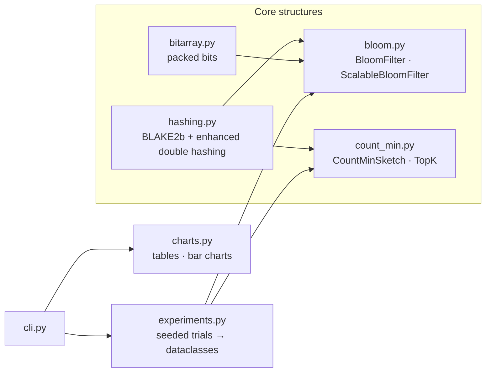

# 035 · Bloom Filter & Count-Min Sketch

**Stack:** Python 3.10+ (standard library only), pytest · **Level:** Intermediate · **Area:** Data structures

Two classic probabilistic data structures. You choose the error rate, and an
experiment harness checks the measured error against the theory and prints it
as terminal charts.

| Structure | Answers | Error | Guarantee |
|---|---|---|---|
| `BloomFilter` | "Is *x* in the set?" | False positives only | FPR ≈ target `p` at design capacity |
| `ScalableBloomFilter` | Same, unbounded size | False positives only | Compound FPR ≤ `p` however much it grows |
| `CountMinSketch` | "How often did *x* occur?" | Over-counts only | `est ≤ true + εN` with probability `1 − δ` |
| `TopK` | "What are the heaviest hitters?" | Uses CMS estimates | Memory `O(sketch + k)` |

```python
from sketches import BloomFilter, CountMinSketch, ScalableBloomFilter, TopK

seen = BloomFilter.from_capacity(1_000_000, error_rate=0.01)  # 1.2 MB, 7 hashes
seen.add("alice@example.com")
"alice@example.com" in seen      # True  (always: no false negatives)
"bob@example.com" in seen        # False (or True ~1% of the time)

urls = ScalableBloomFilter(initial_capacity=1_000, error_rate=0.001)
urls.update(f"/page/{i}" for i in range(50_000))   # grows to 6 stages, FPR stays < 0.1%

counts = CountMinSketch.from_error(epsilon=0.001, delta=0.01, conservative=True)
for word in "the cat and the hat and the bat".split():
    counts.add(word)
counts["the"]                    # 3 (never less than the true count)
counts.error_bound()             # ε·N: worst-case over-count with 99% confidence

top = TopK(10, CountMinSketch.from_error(0.001, 0.01))
top.update(stream_of_ip_addresses)
top.items()                      # [(ip, estimated_count), ...] highest first
```

## Concepts and design decisions

**Sizing from the error you can tolerate.** Callers think in terms of
"10 million items at 0.1%", not bit counts. `optimal_parameters` turns that
into `m = −n·ln p / (ln 2)²` bits and `k = (m/n)·ln 2` hashes.
`CountMinSketch.from_error` does the same with `w = ⌈e/ε⌉` and
`d = ⌈ln 1/δ⌉`. You can still call the raw constructors when you want a
specific memory budget.

**One digest, k hashes.** Running *k* independent hashes per operation is
wasteful. `hashing.py` takes one keyed BLAKE2b digest, splits it into `h1` and
`h2`, and uses *enhanced double hashing*:
`gᵢ = h1 + i·h2 + (i³ − i)/6 mod m`. Kirsch & Mitzenmacher proved that this
keeps the asymptotic false-positive rate. The trade-off is that BLAKE2b is
slower than a non-cryptographic hash such as xxHash or Murmur3. It is still
the right choice for a stdlib-only library. Python's built-in `hash()` was
ruled out because it is randomised per process for `str`, which would make
serialised filters useless after a restart.

**Typed, canonical encoding.** Items are encoded with a type tag, so `"1"`,
`b"1"` and `1` stay distinct. `bool` is rejected because `True == 1` would
make it silently alias `1`.

**Memory is the feature.** `BitArray` packs 8 bits per byte over a
`bytearray`. Count-Min counters live in `array('Q')` rows (8 bytes each, not
~28 for a Python `int`). Unsigned storage also turns an impossible negative or
overflowing count into an immediate error instead of silent corruption.

**One-sided error, by construction.** A Bloom filter only ever sets bits, so it
can't produce false negatives. A Count-Min cell is a sum over every item
hashed to it, so the minimum across rows can't under-count. Property-style
tests check both invariants on deliberately tiny, collision-heavy sketches.

**Conservative update.** On each add, this variant raises a counter only as
far as the new minimum needs. It never does worse than the standard update.
On the Zipf stream below it roughly halves the mean error. The cost: the
sketch becomes insert-only, so negative counts are rejected outright rather
than silently breaking the guarantee.

**Scalable Bloom filter.** A fixed filter falls apart once it is overfilled
(see the `overload` chart: 16% FPR at 2× capacity for a 1% filter). The
scalable variant (Almeida et al.) chains stages that grow geometrically, each
with error `p₀·rᶦ`. Since `Σ p₀·rᶦ = p₀/(1−r)`, setting `p₀ = p(1−r)` bounds
the total by `p`. The trade-off is that lookups probe every stage, so they
cost O(log n) filters.

**Mergeability.** Filters and sketches built with the same parameters and
seed combine. Bloom `|` gives exactly the filter you'd get from inserting both
sets. Bloom `&` is a conservative superset of the true intersection.
`CountMinSketch.merge` sums cells. This is what makes these structures useful
in distributed systems: each shard sketches locally, and the results are
merged centrally.

**Introspection grounded in the data.** `estimated_fpr()` uses the actual fill
ratio (`fill^k`) instead of a formula that assumes you know `n`, so it stays
correct after unions. `estimated_cardinality()` recovers the distinct count
from the bits set (Swamidass & Baldi).

**Experiments as pure functions.** `experiments.py` returns frozen
dataclasses from seeded, deterministic runs. The CLI, the tests and any
notebook share the same code, and the charts are plain strings with no
plotting dependency.

### Architecture



```
src/sketches/
  hashing.py      canonical encoding, keyed hash pair, index generation
  bitarray.py     fixed-size packed bit array with |, &, serialisation
  bloom.py        sizing math, BloomFilter, ScalableBloomFilter
  count_min.py    CountMinSketch (standard + conservative), TopK
  experiments.py  accuracy experiments and a Zipf stream generator
  charts.py       aligned tables, linear/log horizontal bar charts
  cli.py          `sketches` command
tests/            111 tests: invariants, statistical bounds, serialisation, CLI
```

## Build, run, test

```bash
cd projects/035-bloom-filter-count-min-sketch
python -m venv .venv && source .venv/bin/activate
pip install -e '.[test]'

pytest                     # 111 tests, ~2 s
sketches bloom             # target vs measured FPR
sketches overload          # what happens past capacity
sketches cms               # Count-Min: standard vs conservative
sketches topk --k 10       # heavy hitters
sketches cms --csv > cms.csv   # raw numbers for your own plots
```

There are no runtime dependencies. Without installing, you can run
`PYTHONPATH=src python -m sketches bloom`. All commands take `--seed` and are
deterministic.

## Example output

```
$ sketches bloom
 target  bits (m)  hashes (k)  bits/item   theory  measured
-------  --------  ----------  ---------  -------  --------
10.000%     47926           3       4.79  10.071%   10.012%
 5.000%     62353           4       6.24   5.027%    4.840%
 1.000%     95851           7       9.59   1.004%    1.060%
 0.100%    143776          10      14.38   0.100%    0.092%
 0.010%    191702          13      19.17   0.010%    0.008%

False-positive rate at capacity (10,000 items, 50,000 probes) (log scale)
10.000%  target   │████████████████████████████████████████ 10.000%
         measured │▓▓▓▓▓▓▓▓▓▓▓▓▓▓▓▓▓▓▓▓▓▓▓▓▓▓▓▓▓▓▓▓▓▓▓▓▓▓▓▓ 10.012%
 1.000%  target   │████████████████████████████████ 1.000%
         measured │▓▓▓▓▓▓▓▓▓▓▓▓▓▓▓▓▓▓▓▓▓▓▓▓▓▓▓▓▓▓▓▓ 1.060%
 0.010%  target   │████████████████ 0.010%
         measured │▓▓▓▓▓▓▓▓▓▓▓▓▓▓▓ 0.008%
```

Every 10× cut in error rate costs about 4.8 bits per item.

```
$ sketches overload
 load  items   theory  from fill  measured
-----  -----  -------  ---------  --------
0.50x   2500   0.025%     0.025%    0.050%
1.00x   5000   1.004%     1.010%    1.040%
2.00x  10000  15.745%    15.858%   16.510%
3.00x  15000  43.603%    43.317%   43.815%
```

```
$ sketches cms
epsilon   w x d        update  mean err  max err  eps*N  within bound    exact
-------  ------  ------------  --------  -------  -----  ------------  -------
   0.01   272x5      standard     98.13     1899    999       99.991%   0.000%
   0.01   272x5  conservative     55.16     1778    999       99.991%   0.693%
  0.001  2719x5      standard      3.23       82    100      100.000%   9.923%
  0.001  2719x5  conservative      1.35       78    100      100.000%  30.415%

Mean over-count per distinct item (N=100,000, Zipf s=1.1)
 eps=0.01  standard     │████████████████████████████████████████ 98.13
           conservative │▓▓▓▓▓▓▓▓▓▓▓▓▓▓▓▓▓▓▓▓▓▓ 55.16
eps=0.001  standard     │█ 3.23
           conservative │▓ 1.35
```

The "within bound" column is the guarantee made visible. At least `1 − δ` (99%)
of items must be within `ε·N`, and measured coverage is above 99.99%. The
maximum error can exceed the bound. That is the δ tail, and it is why the
guarantee is probabilistic.

(Some rows are trimmed above; run the commands for the full tables.)

## Possible extensions

- **Counting Bloom filter** (4-bit counters) or a **cuckoo filter** to support deletion.
- **Count-Mean-Min** or Count sketch (±1 hashing) for unbiased estimates on less-skewed data.
- **Blocked Bloom filter**: put all *k* bits in one cache line for 2–3× faster lookups.
- **HyperLogLog** next to the Bloom cardinality estimate, to compare accuracy per byte.
- A numpy/xxHash fast path behind the same interfaces, with benchmarks.
- Time-decayed sketches (sliding windows) for "top-k in the last hour" queries.
